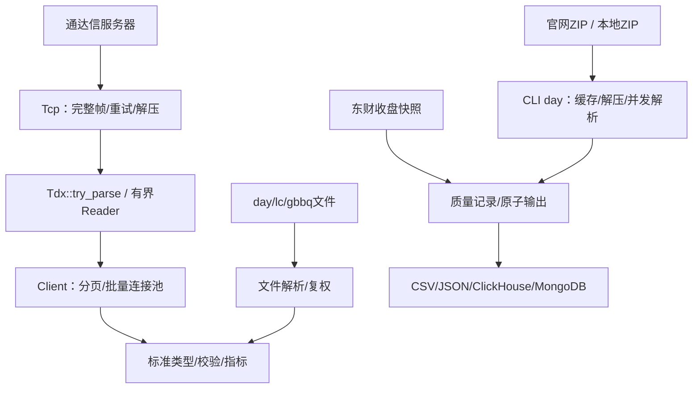

# rustdx 架构评估与迭代结果

最新复查日期：2026-10-11，复查基线6065885、修复提交2fbbda6；本轮对应核心库1.12.2、CLI1.8.2，待发布。早期迭代始于2026-10-10的a6deec1。范围为行情协议、文件解析、计算模块、CLI和构建交付。

## 技术架构

| 包 | 职责 | 实现 |
| --- | --- | --- |
| jelven-rustdx-complete | 行情及计算核心 | 阻塞TCP、协议解码、文件解析、复权、标准数据类型、指标、日历、连接池、缓存 |
| jelven-rustdx-cli | 获取、导出和导入 | ureq/rustls HTTP、ZIP缓存、线程解析、有界结果通道、CSV/JSON、数据库导入 |
| tests-integration | 外部接口样本与检查 | 不发布；外部测试通过变量跳过 |

保留Rust edition 2024及同步模块化workspace，最低Rust1.89。标准库线程足以承担当前批量采集，不引入异步运行时或额外服务。

## 原基线风险与结果

| 原问题 | 迭代后 |
| --- | --- |
| 连接池借用用Vec下标，清理移动槽位 | 借出对象自持连接，idle队列只管理空闲连接；关闭不可恢复 |
| 重试不覆盖正文，次数少一次 | 首试之外计重试；完整帧及解压在重试单元内，坏连接淘汰 |
| 解析截断panic、失败与空数据混淆 | 内置协议try_parse传播错误并清空失败状态；旧parse兼容 |
| 单只/批量配置和分页不一致 | 复用带TcpConfig的池；checked偏移、去重、日期/无进展检查 |
| 代码、日期、精度和单位不一致 | 标准Symbol/Bar、f64、UTC+8源日期；CSV单位兼容 |
| 增量无事件丢因子，停牌事件遗漏 | 继承前状态，跨停牌事件顺序应用，文件前因子输入只读 |
| 连续性按360天年/30天月估算 | 真实日期与2024–2026休市表，单交易日缺口、重复/逆序检查 |
| 部分文件失败仍报成功 | 报告文件错误，非法记录拒绝发布，原子替换输出 |
| ClickHouse字段错误和无版本重复 | date字段、统一HTTP、version表与FINAL语义、明确旧表迁移 |
| 无界结果通道和缓存 | 有界通道、线程/单文件限制、缓存容量和过期清理 |
| 续传旧ZIP拼新版本，解压目录冲突 | .part/If-Range/Content-Range、来源隔离、文件锁、先临时解压 |
| RSI/KDJ预热与非有限值错误 | 线性滚动、边界处理、None缺口、明确平滑口径 |
| Tcp结构尺寸断言依赖平台布局 | Tcp使用受控尺寸范围，协议数据结构保留精确快照 |
| release用错误包名和分支ref | 唯一核心包名、crates.io发布脚本；移除tag二进制Release |
| CLI JSON/帮助/Excel入口不可用 | JSON原子导出、帮助即退出、输入验证及前导零保留 |

阶段实现及验证见[ITERATION.md](ITERATION.md)，兼容性变化见[MIGRATION.md](MIGRATION.md)。

## 1.12.1源码复查（基线00df6f4）

复查覆盖行情Client/连接池、文件解析与质量报告、东财分页、ClickHouse/MongoDB导入、缓存/下载、指标、CLI、发布元数据及全部维护文档。已发布 `jelven-rustdx-complete 1.12.1` 与 `jelven-rustdx-cli 1.8.1`（CLI 因 crates.io 上 `rustdx-cli` 归属他人而改用自有命名空间）。

| 确认的问题 | 本轮处理 |
| --- | --- |
| 同一Client并发批次耗尽池，改变并行数关闭在用池 | 批次排队、批次内并行；本地协议回归覆盖同规模及变规模重叠 |
| ClickHouse读取正文错误被吞掉、200正文异常未检查 | 完整读取、异常header/正文检查、wait_end_of_query及连接超时 |
| 已有表仅检查引擎，可能不能正确去重 | 校验逻辑键、日期分区、Float64、字段及纳秒版本默认值 |
| 全空day集合覆盖旧结果，报告早于实际导入完成 | 无有效行即失败；报告在原子输出/导入结束后定案，错误写入顶层 |
| 东财页码0下溢、上限大于total仍继续翻页 | 提前验证输入、按实际total停止，逐页拒绝重复及total变化 |
| 字母品种误判A股、NaN行情判为未触板、复权区间未验证 | 修正类型判定和输入校验 |
| 静态概念表错配且无核实日期 | 移除全部样例、弃用旧查询，示例改为通达信板块文件 |
| 旧推广/外部发布指南与当前行为冲突 | 删除20份归档、旧设计稿、4个样例生成脚本及重复示例，重写变更记录 |
| 测试脚本过滤错误、失败被掩盖、报告未落盘 | 使用有效cargo命令、pipefail、真实日志，显式在线模式 |
| CLI源码包排除许可证、维护者元数据过时 | 包含MIT许可证并更新维护者；版权及必要协议来源保留 |

股票/指数实际使用同一请求命令0x052d，响应解析不同；已修正旧注释中的命令区分。未添加运行时第三方数据依赖。

## 1.12.2源码复查（基线6065885）

本轮复查继续覆盖协议与重试、复权/指标、导入文件生命周期、缓存并发、示例脚本和文档。保留同步架构与现有依赖，不增加新的数据源。

| 确认的问题 | 修复及依据 |
| --- | --- |
| 停牌期间两次派息仍沿用同一昨收；首日旧事件重复应用 | 连续派息10→9→8对应0.8乘数；首日及更早事件排除，非法事件/乘数报错 |
| 浮点半分误差、主板前缀过宽 | 整数分计算；1.15元按10%涨停为1.27；排除01/02/03及未列出的60x前缀 |
| 证券列表空页被当成功，重复/总量越界无校验 | 以总数量为完整性约束，拒绝异常分页；本地协议服务器回归 |
| 心跳短报文panic或保留旧数量，名称乱码触发debug断言 | 安全解析清空旧值，GBK名称与其他解析器一致处理 |
| 重连握手失败跳过剩余预算 | 重连纳入尝试单元；本地服务覆盖首请求断线、次握手断线、第三次恢复 |
| 本地时区影响当日分时回退 | 固定UTC+8 |
| 路径字符串检查遗漏输入覆盖和输出别名，并发导入共用固定CSV | 路径解析及跨进程输出锁，覆盖day/east、报告、输入和保留文件 |
| 下载缓存锁在解析前释放 | 来源对象持锁至解析结束，防止其他进程替换正在读取的目录 |
| 下载/HEAD可无期限等待，本地备选ZIP先覆盖缓存 | 有界请求时限；本地ZIP先验证目录再复制 |
| ClickHouse前因子绕过CSV校验，factor.csv非原子写入 | 共用逐行解析、拒绝空集/重复/非法值，原子提交保留因子 |
| EMA缺口永久污染，MACD返回Some(NaN)，SMA溢出不恢复 | 缺口重置、位置保留、参数和结果检查；补偿求和及异常窗口重算 |
| KDJ收盘超出高低区间仍输出，文档写成SMA | 校验窗口OHLC关系，明确EMA系数与初始化口径 |
| 行业/省份静态映射包含推测值 | 移除，旧API弃用返回未知，保留原始编码，示例同步 |
| 诊断脚本依赖不存在命令/文档并误报成功 | 精简为本项目协议握手+心跳，失败传播退出码 |

删除6个仅调用pytdx的Python脚本、1个过期请求脚本、1份未采用快照；移除注释死代码、错误导入名及无依据的第三方一致性声明。许可证、协议来源和服务器地址来源保留，属于项目必要材料。

## 设计边界及后续工作

现有低层请求对象仍混合请求、响应和结果；为兼容调用保留可变字段及旧parse。新代码应优先Client/KlineBuilder及try_parse，后续主版本可拆成不可变请求和独立decode。

空响应依然不能确定证券状态。缺口标注未知，未引入权威上市/停牌历史库；交易日历2024–2026之外必须由调用方补充准确数据。指标为本项目明确口径，不保证与任意第三方默认算法相同。涨跌停规则不包含完整历史制度变化及新股特殊阶段。

连接层每次请求有超时，但顺序多服务器故障转移不等于统一总deadline；按服务器冷却/评分及采集总体时限可在真实负载观测后推进。当前输入排序用于稳定选取文件，CSV跨文件行顺序仍可能随worker完成顺序变化，逻辑键和文件内顺序稳定。

标准Bar会转换通达信股票成交量单位；非股票品种需明确口径。累计收益factor与价格调整乘数分别使用，不互换。东财只提供当前快照，跨日缺失必须先补历史，不能直接接续累计收益。

版本表通过合并/FINAL实现逻辑去重，不具备跨文件事务；源数据回灌采用最后导入优先。本地已核验真实行情、官网全量包和ClickHouse 25.8，目标生产环境仍须复核schema、源时间戳、导入行数和查询是否使用FINAL。东财公共接口存在出口限流，MongoDB未验收。

建议按以下顺序继续优化，均需独立数据或运行证据：

| 优先级 | 工作 | 验收依据 |
| --- | --- | --- |
| 高 | 2027交易日历更新、历史涨跌幅/新股特殊阶段 | 交易所规则与已核实日期用例 |
| 高 | 进程连接总预算、服务器分散及总deadline | 空帧率、失败率、P95和最大任务时长，先从总计4–8连接观测 |
| 中 | 导入任务记录及失败后的部分落库核对 | 源行数/键/边界、任务版本、故障注入；目前不提供跨文件事务 |
| 中 | MongoDB在线验收及目标系统验证 | 小表upsert重复写入、错误退出和恢复 |
| 后续主版本 | 不可变请求及独立解码，淘汰旧parse/静态分类兼容入口 | 下游迁移及协议样本回归 |

## 验证范围

早期迭代执行离线workspace测试、截断边界、TCP断线重连和连接池本地服务器、HTTP续传、ZIP解压失败保护、坏文件原子输出、JSON导出、示例编译、Clippy、格式和Rust1.89检查；在1.12.0时期完成真实通达信全功能smoke、官网526.2MiB全量包解析、2981万行ClickHouse导入和重复去重，1.12.1时期另验收真实小表。

本轮新增修复以本地协议/HTTP服务、文件回归和数值用例验证；未重跑外部行情、全量导入或MongoDB验收，实际检查结果见[验收报告](PRODUCTION_ACCEPTANCE.md)。本轮版本为核心库1.12.2、CLI1.8.2，发布状态见[变更记录](../CHANGELOG.md)。

早期性能基准仅测本机合成10万行SMA+RSI（10轮约23–42ms），不代表本轮补偿求和实现或目标机器性能；尚未测P95网络延迟和生产负载。东财单页曾成功，后续请求被502或提前断连，作为外部可用性风险保留。CI覆盖Linux/macOS/Windows，本机实际验证平台为macOS/aarch64；仓库不配置tag触发的CLI二进制Release。
