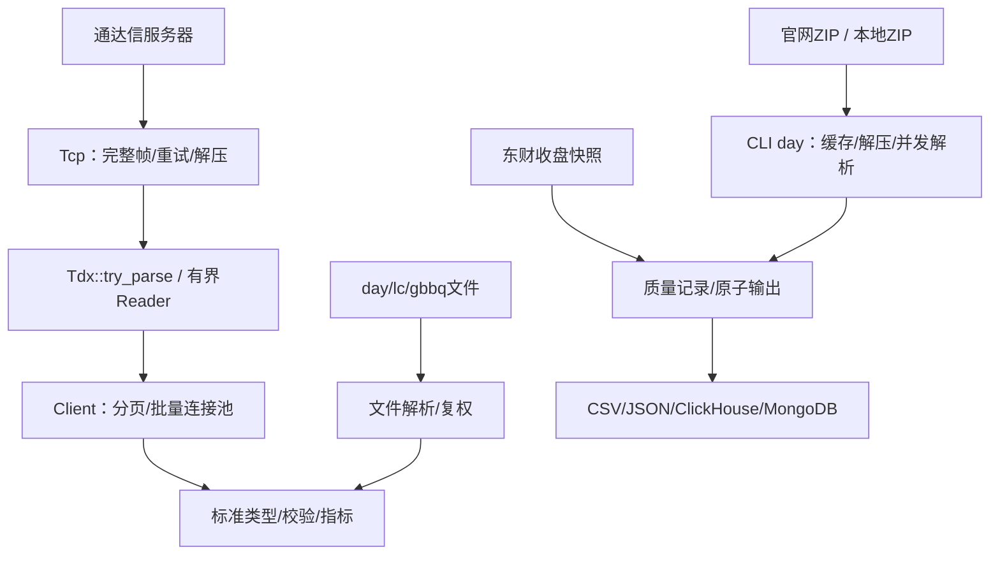

# rustdx 架构评估与迭代结果

评估与迭代日期：2026-10-10。初始基线为 main/a6deec1。范围限定为本项目的行情协议、文件解析、计算模块、CLI和构建交付。

## 技术架构

| 包 | 职责 | 实现 |
| --- | --- | --- |
| rustdx-complete | 行情及计算核心 | 阻塞TCP、协议解码、文件解析、复权、标准数据类型、指标、日历、连接池、缓存 |
| rustdx-cli | 获取、导出和导入 | ureq/rustls HTTP、ZIP缓存、线程解析、有界结果通道、CSV/JSON、数据库导入 |
| tests-integration | 外部接口样本与检查 | 不发布；外部测试通过变量跳过 |

保留Rust edition 2024及同步模块化workspace，最低Rust1.89。标准库线程足以承担当前批量采集，不引入异步运行时或额外服务。

## 原基线风险与结果

| 原问题 | 迭代后 |
| --- | --- |
| 连接池借用用Vec下标，清理移动槽位 | 借出对象自持连接，idle队列只管理空闲连接；关闭不可恢复 |
| 重试不覆盖正文，次数少一次 | 首试之外计重试；完整帧及解压在重试单元内，坏连接淘汰 |
| 解析截断panic、失败与空数据混淆 | 内置协议try_parse传播错误并清空失败状态；旧parse兼容 |
| 单只/批量配置和分页不一致 | 复用带TcpConfig的池；checked偏移、去重、日期/无进展检查 |
| 代码、日期、精度和单位不一致 | 标准Symbol/Bar、f64、UTC+8源日期；CSV单位兼容 |
| 增量无事件丢因子，停牌事件遗漏 | 继承前状态，跨停牌事件顺序应用，文件前因子输入只读 |
| 连续性按360天年/30天月估算 | 真实日期与2024–2026休市表，单交易日缺口、重复/逆序检查 |
| 部分文件失败仍报成功 | 报告文件错误，非法记录拒绝发布，原子替换输出 |
| ClickHouse字段错误和无版本重复 | date字段、统一HTTP、version表与FINAL语义、明确旧表迁移 |
| 无界结果通道和缓存 | 有界通道、线程/单文件限制、缓存容量和过期清理 |
| 续传旧ZIP拼新版本，解压目录冲突 | .part/If-Range/Content-Range、来源隔离、文件锁、先临时解压 |
| RSI/KDJ预热与非有限值错误 | 线性滚动、边界处理、None缺口、明确平滑口径 |
| release用错误包名和分支ref | tag草稿发布、正确rustdx-cli包名、三平台与SHA256 |
| CLI JSON/帮助/Excel入口不可用 | JSON原子导出、帮助即退出、输入验证及前导零保留 |

阶段实现及验证见[ITERATION.md](ITERATION.md)，兼容性变化见[MIGRATION.md](MIGRATION.md)。

## 设计边界及后续工作

现有低层请求对象仍混合请求、响应和结果；为兼容调用保留可变字段及旧parse。新代码应优先Client/KlineBuilder及try_parse，后续主版本可拆成不可变请求和独立decode。

空响应依然不能确定证券状态。缺口标注未知，未引入权威上市/停牌历史库；交易日历2024–2026之外必须由调用方补充准确数据。指标为本项目明确口径，不保证与任意第三方默认算法相同。涨跌停规则不包含完整历史制度变化及新股特殊阶段。

连接层每次请求有超时，但顺序多服务器故障转移不等于统一总deadline；按服务器冷却/评分及采集总体时限可在真实负载观测后推进。当前输入排序用于稳定选取文件，CSV跨文件行顺序仍可能随worker完成顺序变化，逻辑键和文件内顺序稳定。

标准Bar会转换通达信股票成交量单位；非股票品种需明确口径。累计收益factor与价格调整乘数分别使用，不互换。东财只提供当前快照，跨日缺失必须先补历史，不能直接接续累计收益。

版本表通过合并/FINAL实现逻辑去重，不具备跨文件事务；源数据回灌采用最后导入优先。数据库及外部行情本轮未做在线验收，生产切换应在隔离环境核验真实schema、源时间戳及导入行数后进行。

## 验证范围

本轮执行离线workspace测试、存量文件/抓包快照、完整截断边界、TCP断线重连和连接池本地服务器、HTTP续传、ZIP解压失败保护、坏文件原子输出、JSON导出、编译示例、Clippy、格式和Rust1.89检查。

基准仅测本机合成10万行SMA+RSI（10轮约23–42ms），未测全市场峰值RSS、P95网络延迟及真实服务限流。CI三平台配置已更新，本机实际验证平台为macOS/aarch64。未推送、未创建tag、未发布包或release。
