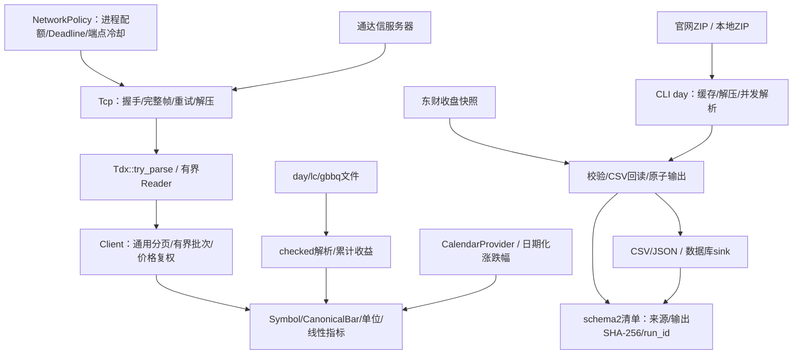

# rustdx 架构评估与迭代结果

最新复查日期：2026-10-22，优化基线904b33e，源码实现截至1f9f739。核心库1.12.2、CLI1.8.2仍是10月11日已发布版本；本轮源码优化尚未发布新crate版本。早期迭代始于2026-10-10的a6deec1。范围为行情协议、文件解析、计算模块、CLI和构建交付。需求、开发、测试、运营、运维和版本文档见[文档索引](README.md)。

## 技术架构

| 包 | 职责 | 实现 |
| --- | --- | --- |
| jelven-rustdx-complete | 行情及计算核心 | 阻塞TCP、进程配额/时限、协议解码、checked文件解析、复权、标准数据类型、线性指标、严格日历、日期规则、连接池、缓存 |
| jelven-rustdx-cli | 获取、导出和导入 | ureq/rustls HTTP、ZIP缓存、有界线程/结果通道、运行清单/摘要、CSV/JSON、数据库sink及schema检查 |
| tests-integration | 外部接口样本与检查 | 不发布；外部测试通过变量跳过 |

保留Rust edition 2024及同步模块化workspace，最低Rust1.89。标准库线程足以承担当前批量采集，不引入异步运行时或额外服务。

## 原基线风险与结果

| 原问题 | 迭代后 |
| --- | --- |
| 连接池借用用Vec下标，清理移动槽位 | 借出对象自持连接，idle队列只管理空闲连接；关闭不可恢复 |
| 重试不覆盖正文，次数少一次 | 首试之外计重试；完整帧及解压在重试单元内，坏连接淘汰 |
| 解析截断panic、失败与空数据混淆 | 内置协议try_parse传播错误并清空失败状态；旧parse兼容 |
| 单只/批量配置和分页不一致 | 复用带TcpConfig的池；checked偏移、去重、日期/无进展检查 |
| 代码、日期、精度和单位不一致 | 标准Symbol/Bar、f64、UTC+8源日期；CSV单位兼容 |
| 增量无事件丢因子，停牌事件遗漏 | 继承前状态，跨停牌事件顺序应用，文件前因子输入只读 |
| 连续性按360天年/30天月估算 | 真实日期与2024–2026休市表，单交易日缺口、重复/逆序检查 |
| 部分文件失败仍报成功 | 报告文件错误，非法记录拒绝发布，原子替换输出 |
| ClickHouse字段错误和无版本重复 | date字段、统一HTTP、version表与FINAL语义、明确旧表迁移 |
| 无界结果通道和缓存 | 有界通道、线程/单文件限制、缓存容量和过期清理 |
| 续传旧ZIP拼新版本，解压目录冲突 | .part/If-Range/Content-Range、来源隔离、文件锁、先临时解压 |
| RSI/KDJ预热与非有限值错误 | 线性滚动、边界处理、None缺口、明确平滑口径 |
| Tcp结构尺寸断言依赖平台布局 | Tcp使用受控尺寸范围，协议数据结构保留精确快照 |
| release用错误包名和分支ref | 唯一核心包名、crates.io发布脚本；移除tag二进制Release |
| CLI JSON/帮助/Excel入口不可用 | JSON原子导出、帮助即退出、输入验证及前导零保留 |

阶段实现及验证见[ITERATION.md](ITERATION.md)，兼容性变化见[MIGRATION.md](MIGRATION.md)。

## 1.12.1源码复查（基线00df6f4）

复查覆盖行情Client/连接池、文件解析与质量报告、东财分页、ClickHouse/MongoDB导入、缓存/下载、指标、CLI、发布元数据及全部维护文档。已发布 `jelven-rustdx-complete 1.12.1` 与 `jelven-rustdx-cli 1.8.1`（CLI 因 crates.io 上 `rustdx-cli` 归属他人而改用自有命名空间）。

| 确认的问题 | 本轮处理 |
| --- | --- |
| 同一Client并发批次耗尽池，改变并行数关闭在用池 | 批次排队、批次内并行；本地协议回归覆盖同规模及变规模重叠 |
| ClickHouse读取正文错误被吞掉、200正文异常未检查 | 完整读取、异常header/正文检查、wait_end_of_query及连接超时 |
| 已有表仅检查引擎，可能不能正确去重 | 校验逻辑键、日期分区、Float64、字段及纳秒版本默认值 |
| 全空day集合覆盖旧结果，报告早于实际导入完成 | 无有效行即失败；报告在原子输出/导入结束后定案，错误写入顶层 |
| 东财页码0下溢、上限大于total仍继续翻页 | 提前验证输入、按实际total停止，逐页拒绝重复及total变化 |
| 字母品种误判A股、NaN行情判为未触板、复权区间未验证 | 修正类型判定和输入校验 |
| 静态概念表错配且无核实日期 | 移除全部样例、弃用旧查询，示例改为通达信板块文件 |
| 旧推广/外部发布指南与当前行为冲突 | 删除20份归档、旧设计稿、4个样例生成脚本及重复示例，重写变更记录 |
| 测试脚本过滤错误、失败被掩盖、报告未落盘 | 使用有效cargo命令、pipefail、真实日志，显式在线模式 |
| CLI源码包排除许可证、维护者元数据过时 | 包含MIT许可证并更新维护者；版权及必要协议来源保留 |

股票/指数实际使用同一请求命令0x052d，响应解析不同；已修正旧注释中的命令区分。未添加运行时第三方数据依赖。

## 1.12.2源码复查（基线6065885）

本轮复查继续覆盖协议与重试、复权/指标、导入文件生命周期、缓存并发、示例脚本和文档。保留同步架构与现有依赖，不增加新的数据源。

| 确认的问题 | 修复及依据 |
| --- | --- |
| 停牌期间两次派息仍沿用同一昨收；首日旧事件重复应用 | 连续派息10→9→8对应0.8乘数；首日及更早事件排除，非法事件/乘数报错 |
| 浮点半分误差、主板前缀过宽 | 整数分计算；1.15元按10%涨停为1.27；排除01/02/03及未列出的60x前缀 |
| 证券列表空页被当成功，重复/总量越界无校验 | 以总数量为完整性约束，拒绝异常分页；本地协议服务器回归 |
| 心跳短报文panic或保留旧数量，名称乱码触发debug断言 | 安全解析清空旧值，GBK名称与其他解析器一致处理 |
| 重连握手失败跳过剩余预算 | 重连纳入尝试单元；本地服务覆盖首请求断线、次握手断线、第三次恢复 |
| 本地时区影响当日分时回退 | 固定UTC+8 |
| 路径字符串检查遗漏输入覆盖和输出别名，并发导入共用固定CSV | 路径解析及跨进程输出锁，覆盖day/east、报告、输入和保留文件 |
| 下载缓存锁在解析前释放 | 来源对象持锁至解析结束，防止其他进程替换正在读取的目录 |
| 下载/HEAD可无期限等待，本地备选ZIP先覆盖缓存 | 有界请求时限；本地ZIP先验证目录再复制 |
| ClickHouse前因子绕过CSV校验，factor.csv非原子写入 | 共用逐行解析、拒绝空集/重复/非法值，原子提交保留因子 |
| EMA缺口永久污染，MACD返回Some(NaN)，SMA溢出不恢复 | 缺口重置、位置保留、参数和结果检查；补偿求和及异常窗口重算 |
| KDJ收盘超出高低区间仍输出，文档写成SMA | 校验窗口OHLC关系，明确EMA系数与初始化口径 |
| 行业/省份静态映射包含推测值 | 移除，旧API弃用返回未知，保留原始编码，示例同步 |
| 诊断脚本依赖不存在命令/文档并误报成功 | 精简为本项目协议握手+心跳，失败传播退出码 |

删除6个仅调用pytdx的Python脚本、1个过期请求脚本、1份未采用快照；移除注释死代码、错误导入名及无依据的第三方一致性声明。许可证、协议来源和服务器地址来源保留，属于项目必要材料。

## 2026-10-22源码优化方案与结果

按正确性、资源治理、导入追溯和性能依次落地，保留同步架构及既有类型/CSV兼容。详细实现位置见[开发说明](DEVELOPMENT.md)，逐项交付见[优化记录](OPTIMIZATION.md)。

| 设计选择 | 已实现行为与理由 | 验证依据 |
| --- | --- | --- |
| 日历Provider与日期规则分离 | 日历声明版本/来源/范围，严格导航越界报错；规则基于当日证券事实选择，避免现名推断历史 | 外部日历、覆盖边界及规则生效日期回归；原始规则见LIMIT_RULES |
| 全局受管TCP治理 | 默认8条共享许可，分层总体时限，轮换/冷却，批次完结释放连接，避免闲池长期占满配额 | 独立进程主连接/池/重连/批次及缓慢正文回归 |
| 兼容标准数据适配 | CanonicalBar带来源/周期/价格口径，独立收益指数与价格乘数；分钟文件显式市场 | 市场、单位、周期及非法值用例 |
| 同一快照取摘要 | 有界读取的实际解析字节计算SHA-256，CSV发布前流式回读，不对数千万键构建全局HashSet | 源摘要、输出回读、同证券区间重叠回归 |
| 先持久化再做外部动作 | 每次归档和最新清单分别原子替换；发布/写库/清理前后记录状态，失败保留CSV | 归档、迟到HTTP异常及子进程失败/超时回归 |
| 职责拆分 | Client批次/分页/复权、CLI sink/schema独立；day/lc/gbbq提供checked入口，gbbq去unsafe | 既有协议、真实gbbq样本、偏移/截断属性与ASan fuzz |
| 线性窗口指标 | 布林带双栈中心化矩、KDJ单调队列，常规输入O(n)，状态O(period) | 独立公式、价格缩放不变量及窗口20/200/2000性能观测 |

CLI每个day文件32MiB、gbbq/前因子64MiB、外部日历1MiB；名单HTTPS响应16MiB。ClickHouse完整响应含迟到异常检查，HTTP操作及mongoimport各有300秒上限。分层网络时限不等于day整条命令总deadline，下载仍最多2小时，同步计算闭包不能被抢占。

## 当前设计边界及后续工作

现有低层请求对象仍混合请求、响应和结果；为兼容调用保留可变字段及旧parse。新代码应优先Client/KlineBuilder及try_parse，后续主版本可拆成不可变请求和独立decode。

空响应依然不能确定证券状态。缺口标注未知，未引入权威上市/停牌历史库；内置日历2024–2026之外必须提供完整且准确的外部数据。指标为本项目明确口径，不保证与任意第三方默认算法相同。日期规则已覆盖主要板块制度变化及注册制IPO等阶段，但截至2026-10-22；旧核准制IPO首日和未覆盖特别制度返回错误，逐只证券状态仍由调用方提供。

受管TCP已覆盖许可、全部服务器连接/握手、完整帧、分页及批次总体时限，并提供端点轮换/冷却和统计；裸socket兼容接口不在预算内。整条CLI采集任务、跨进程总连接数及生产P95仍由宿主/部署环境治理。当前输入排序用于稳定选取文件，CSV跨文件行顺序仍可能随worker完成顺序变化，逻辑键和文件内顺序稳定。

标准Bar会转换通达信股票成交量单位；非股票品种需明确口径。CanonicalBar适配覆盖TCP/day/lc，东财仍走CLI数据类型，尚未全部统一。累计收益factor与价格调整乘数分别使用，不互换。东财只提供当前快照，跨日缺失必须先补历史，不能直接接续累计收益。

运行清单记录run_id、客户端run_version、摘要和不确定部分写入；它不是跨文件/跨数据库事务。ClickHouse仍由服务端生成行version，通过合并/FINAL去重；客户端run_version不是该行版本。logical_keys是输出证据，不是数据库独立核对。历史曾核验真实行情、官网全量包和ClickHouse25.8，本轮没有重跑外部验收；MongoDB仍未验收，东财有出口限流。

建议按以下顺序继续优化，均需独立数据或运行证据：

| 优先级 | 工作 | 验收依据 |
| --- | --- | --- |
| 高 | 2027完整休市数据、规则核实日期续期及证券状态历史 | 交易所公告、完整数据来源和生效边界；不能只扩展覆盖日期 |
| 高 | 当前源码目标机行情/ClickHouse验收、MongoDB在线验收 | 小表写入/重复/错误恢复，目标数据与清单独立核对 |
| 中 | 全命令/跨进程治理与真实网络负载观测 | 空帧率、失败率、P95、总任务时长及总连接数；不把单进程预算当作跨机限制 |
| 中 | 数据库逐键核对和部署端备份/并发协调 | query_id、实际目标逻辑键及数值；保留未知写入CSV后确认再恢复 |
| 中 | 东财等来源CanonicalBar适配与低层请求继续拆分 | 来源/单位/价格口径样本及下游兼容 |
| 后续主版本 | 不可变请求及独立解码，淘汰旧parse/静态分类兼容入口 | 下游迁移及协议样本回归 |

## 验证范围

早期迭代执行离线workspace测试、截断边界、TCP断线重连和连接池本地服务器、HTTP续传、ZIP解压失败保护、坏文件原子输出、JSON导出、示例编译、Clippy、格式和Rust1.89检查；在1.12.0时期完成真实通达信全功能smoke、官网526.2MiB全量包解析、2981万行ClickHouse导入和重复去重，1.12.1时期另验收真实小表。

2026-10-22新增修复以本地协议/HTTP服务、文件回归、属性和数值用例验证；Rust1.89 workspace/all-features、Clippy拒绝警告及格式通过。156个核心库单测、4个CLI库单测、22个CLI命令单测、4项属性/样本和52个文档测试等离线回归通过；ASan/覆盖率fuzz544,705次无崩溃。详细方法见[VALIDATION.md](VALIDATION.md)。未重跑外部行情、全量导入或MongoDB验收，分轮证据见[验收报告](PRODUCTION_ACCEPTANCE.md)。本轮源码优化尚未发包，交付和回退见[RELEASES.md](RELEASES.md)。

本轮10万行、10轮布林带+KDJ在窗口20/200/2000约41/44/43ms，是窗口扩展观测，不宣称旧版倍数加速；尚未测P95网络延迟和生产负载。东财单页曾成功，后续请求被502或提前断连，作为外部可用性风险保留。CI配置覆盖Linux/macOS/Windows、MSRV、fuzz和性能观测，本机实际验证平台为macOS/aarch64；仓库不配置tag触发的CLI二进制Release。
