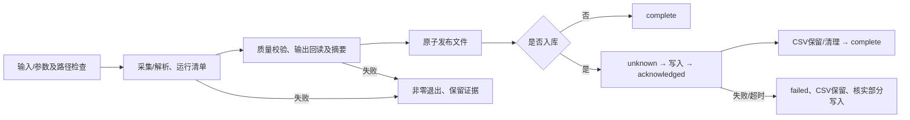

# rustdx 需求说明

更新日期：2026-10-22。根据现有源码及本轮审查结果整理，变更映射见[文档索引](README.md)。核心库1.12.2、CLI1.8.2是现有发布版本；本轮新增功能已进入仓库源码，尚未发布新crate版本。

## 使用者与完成条件

库使用者需要按明确的市场、周期、单位和日期取得行情并计算指标；数据运营人员需要将本地日线或收盘快照发布到文件/数据库，并在失败后判断哪些动作已完成。运维人员需要追溯来源、识别不确定写入及回退源码部署。

文件任务以有效数据输出、完整运行清单和命令成功退出为完成证据。数据库任务还须取得数据库成功回执并完成CSV保留/清理；成功回执不代表逐行独立核验。生产数据可用性须再核对日期、证券覆盖及目标库数据。

参数、路径锁或下载来源解析在采集前失败时，可能尚无运行清单。异常终止可能保留running或中间状态；各状态定义见[导入说明](IMPORTS.md)。

## 功能要求

### FR-01 日历与行情日期（P0，已实现）

调用方查询交易日、前后交易日、区间或最近N日时，严格接口必须检查整个搜索范围。超出已声明覆盖区间时返回明确错误。CLI允许使用带版本、来源和覆盖区间的完整外部休市表，并在清单中记录所用日历。

内置休市数据为2024–2026。旧兼容接口仍保留范围外工作日估算，不能将该结果用于证明严格连续性。缺少交易日记录标记为待核实；默认告警，`day --strict` 拒绝缺口及覆盖不足。示例和完整性要求见[迁移说明](MIGRATION.md)。

### FR-02 日期化涨跌停（P0，已实现，覆盖有限）

历史计算须输入行情日期、当日ST状态、板块及经公告确认的上市阶段。主板ST自2026-07-06起为10%；历史及IPO阶段按[日期规则](LIMIT_RULES.md)处理。价格使用未复权的分单位报价。

无幅度限制返回明确的空结果，非法价格、不支持制度或范围外查询返回错误。旧核准制IPO首日不能套用普通昨收比例。当前规则不提供逐只证券的上市/ST/退市历史，调用方需提供事实。

### FR-03 行情语义（P1，已实现）

证券标识应保留市场和前导零，标准行情应携带来源、周期和价格口径。标准成交量为股，现有day/东财CSV保留手。TCP非A股源单位由调用方显式指定，分钟文件适配须提供带市场的证券代码。

累计收益指数与价格复权乘数不得互换；计算累计收益时原始OHLC不改写。类型、转换入口和既有格式见[开发说明](DEVELOPMENT.md)及[迁移说明](MIGRATION.md)。

### FR-04 有界行情采集（P1，已实现）

受管TCP主连接、连接池、重连及批量任务共享进程连接预算。调用方可在首次初始化前配置；晚配置或重复配置返回错误。批量任务有界排队，批次内并行，结束释放批量连接。

连接、完整帧、分页和批次超过总体时限时返回错误；自动选服轮换起点并冷却失败端点。统计供调用方观测资源与失败，不包含业务解析错误。默认值及裸socket兼容边界见[网络预算](NETWORK.md)。

### FR-05 文件采集与发布（P0，已实现）

`day`接受目录、官网包、URL或本地ZIP；可以按名单、市场或代码筛选。线程数和单文件读取有上限。名单为空、输入非法、来源冲突或全空集合失败；不以新失败结果覆盖旧成功输出。

先检查文件质量，A股重复/逆序日期返回错误；非A股按既有兼容规则告警，允许发布时再排序并对同日保留源中最后一条。`--strict`拒绝告警。同证券多输入的日期区间重叠拒绝发布，与文件内处理分别执行。CSV在发布前回读检查行数、键所属区间及日期边界，再原子替换输出。输入/输出路径别名及并发输出锁应在采集前检查。

### FR-06 可追溯导入及恢复（P1，已实现）

`day/east`进入采集后默认保留最新运行清单与每次运行归档；清单包含运行标识、来源摘要、输出摘要/行数/日期边界和数据库阶段。源摘要必须描述实际解析的字节，东财摘要明确为规范化接口数据。

发起可能部分写入前记录unknown；完整成功回执后记录acknowledged。数据库失败保留CSV并返回非零状态；不得把failed视为事务回滚，也不得自动重试不确定写入。成功后的保留/清理动作单独记录，详见[导入说明](IMPORTS.md)。

### FR-07 不可信数据解析（P0，已实现）

新代码使用返回错误的二进制解析入口。截断、非法日期、极端偏移或非法数值不能冒充有效记录。gbbq重复读取不得二次解密，解密实现不使用unsafe。旧兼容入口的限制见[开发说明](DEVELOPMENT.md)。

### FR-08 外部名单与收盘快照（P1，已实现）

交易所名单使用HTTPS、有界响应和超时；验证分页数量、重复及无进展，不返回成功的部分名单。鉴权/接口变化显式失败。

`east`只输出当前行情日已收盘且字段完整的证券；无收盘数据的证券记为状态未知。JSON输出为数组。增量前因子须属于上一交易日，漏跑先补历史；不能忽略质量校验。公共接口限流导致失败时保留上次成功结果，生产安排见[运营说明](OPERATIONS.md)。

### FR-09 指标（P2，已实现）

布林带及KDJ在常规有效输入下总计算量为O(n)，扩展窗口不引入逐行全窗口扫描。保留各指标的预热、非法参数、非有限值和缺口恢复规则；浮点舍入末位差异允许在独立公式误差范围内。

KDJ平滑、RSI横盘值及累计收益口径以本库说明为准，不推定与其他软件默认值一致。数值回归及性能证据见[验证方法](VALIDATION.md)。

### FR-10 工程验证（P2，已实现）

保持Rust2024、最低Rust1.89和同步有界架构。CI覆盖跨平台构建/测试、all-features、MSRV、Clippy、格式、checked解析fuzz和指标性能观测。离线检查通过不能充当外部服务验收；记录必须注明版本、日期、环境和跳过项。

### FR-11 文档与源码交付（本轮交付）

需求、方案、开发、测试、运营、运维和版本交付文档应覆盖上述行为及验证边界，并通过链接检查。文档分支合入main后推送远端。

保留更新前源码优化版和上一发布版两个可直接检出的历史标签；main代表最新交付。引用规则及回退方式见[版本交付](RELEASES.md)，数据备份和源码标签分别管理。
