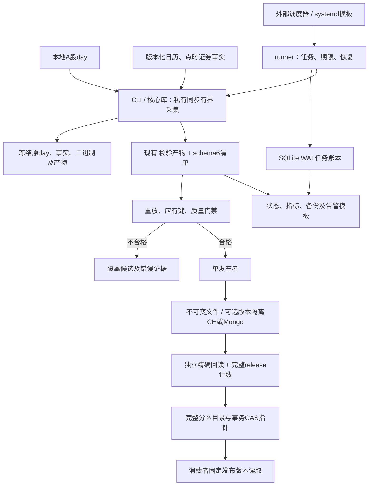

# rustdx 生产系统融合技术方案

方案日期：2026-10-23。设计基线：本仓库 `5d3f961e78a711014f19b2625a603a909f69bcc7`，Cargo版本为核心1.12.2/CLI1.8.2。原始能力参考 `rustdx-complete 1.11.0` / `rustdx-cli 1.7.2`；版本及风险证据见[发布版评估](UPSTREAM_CRATE_ASSESSMENT.md)。

**状态声明：设计及实施范围同步至2026-10-23。** 已实现独立`rustdx-runner`、SQLite WAL账本、私有day任务、事实/应有键校验、封存release、事务CAS目录、版本隔离ClickHouse/MongoDB、固定目录导出、指标及在线备份/隔离恢复；TCP完整帧留证与重放接口也已实现。实施范围是单机本地A股原价日线，详见[实施记录](../development/PRODUCTION_IMPLEMENTATION.md)。目标Linux、真实全市场事实、全量/长期SLO及G5跨机治理尚未验收或实现；没有执行生产部署、推送或crate发布。下文超出该范围的能力继续作为设计。

## 1. 目标、适用范围与设计选择

目标是在现有行情库与CLI基础上，建立可复现、资源有界、数据可追溯、失败可恢复的生产数据链路。首期面向历史日线补数和每日收盘数据；通达信快照、财务和逐笔按已验收协议逐项接入。当前东财入口只取得收盘快照，历史缺失须从相应历史来源补齐。

采用现有强化分支作为唯一生产实现，保留Rust2024/MSRV1.89、同步I/O和有界线程。原包发布提交已在本仓库历史中，继续将原包加入生产依赖不能增加独立数据可信度。协议差异审计可以隔离双依赖，业务运行只保留一套类型、规则和错误语义。

首期选择Linux单机受管采集、一个数据发布者、不可变文件留存、ClickHouse作为分析目标；MongoDB按实际文档查询需求选用。任务可以由现有企业调度器或systemd timer触发，新增薄runner管理任务状态和发布判定。达到单机验收门禁后，才依据实测并发与恢复需求扩展跨主机。

| 设计选择 | 理由 | 代价与约束 |
| --- | --- | --- |
| 核心库处理协议与计算，CLI处理一次有界采集 | 复用已验证代码，避免把调度、身份与数据库治理塞入协议层 | 必须限制旧危险接口的生产使用 |
| runner作为独立适配层 | 接受外部调度事件，管理期限、恢复和任务账本，保持CLI兼容 | 已实现本地day入口；其余来源适配和目标部署另验收 |
| 原始证据、校验产物、正式发布分开 | 能重放、定位差异、隔离失败候选 | 需要持久磁盘及归档管理 |
| 数据核验先于业务发布 | 成功回执不能证明字段正确，流程complete不能证明应有覆盖完整 | 增加完整回读与覆盖核对成本 |
| 单发布者起步 | 当前同机锁与平面表可以形成清晰运维边界 | 不提供发布者高可用，故障由账本恢复 |
| 新模型逐步影子验证 | 原CSV/数据库接口已有用户，避免无依据改变字段语义 | 迁移期间须维护明确契约与对照 |

本方案不包含交易下单、用户账户系统、Web产品或毫秒级行情流。若未来需要实时推送，应另行定义源授权、延迟预算、队列与消费者语义，不能由当前批处理证据推导。

## 2. 融合复用矩阵与剩余缺口

| 能力 | 本仓库现状 | 融合处理 | 需求关联 |
| --- | --- | --- | --- |
| 协议覆盖与连接池 | 已保留上游功能，完整帧重试、借出连接所有权、配置传递已强化 | 继续复用；剩余名单/分时/公司信息等协议迁移为不可变请求与checked解码 | FR-04、FR-07 |
| 任务与网络预算 | OperationContext、TCP/HTTP许可、同机OS锁、取消已实现 | runner继承同一deadline并协调多个任务；跨机出口另行限额 | FR-04 |
| 标准行情与计算 | Symbol/CanonicalBar、量单位、收益指数/价格乘数、线性指标已实现 | 将字段语义固化为数据契约，显式声明未验收品种与周期 | FR-03、FR-09 |
| 历史文件与导出 | 4096条分块、磁盘归并、确定性CSV、checked解析、原子输出已实现 | 按run_id写私有目录，保留生产证据；不重复实现解析链 | FR-05、FR-12 |
| 日期与证券事实 | 严格CalendarProvider、日期规则、SecurityHistory入口已实现 | 补完整日历和逐证券事实，构造点时名单；入口存在不等于事实齐全 | FR-01、FR-02 |
| 运行清单与观测 | schema6、每运行归档、阶段耗时和新鲜度已实现 | 账本读取清单，将CLI完成与数据发布分别记录 | FR-05、FR-14 |
| 原始响应与重放 | 东财逐页正文重放、TCP可选同步完整帧留证/重放已实现 | FrameObserver从握手前留证，FrameArchive限额/fsync/库存；TCP runner Job尚未接入 | FR-07、FR-13 |
| 数据库交付 | 兼容CLI平面表与新增runner版本隔离目标均已实现 | 新目标insert-only、全字段/完整release计数，全部目标verified才提交目录 | FR-06、FR-17 |
| 调度、备份、跨机 | 单机runner、状态/指标、WAL及产物/证据备份恢复已实现 | systemd等由部署触发；跨机协调/HA继续按G5设计 | FR-15至FR-18 |

现状依据[架构评估](PROJECT_ANALYSIS.md)、[需求主文档](../requirements/REQUIREMENTS.md)、[网络预算](NETWORK.md)、[导入证据](../operations/IMPORTS.md)。后续需求扩展应进入唯一需求主文档，不把本方案的拟议状态改写成已交付功能。

## 3. 首期架构与责任边界

下图为已实现单机day发布链路，采用Mermaid流程图，属于软件架构示意而非正式UML。TCP/东财核心能力仍可独立使用，但尚未接入runner Job。各数据库是可选独立目标，多目标配置要求全部verified，不隐含跨库事务。

组件职责：

| 组件 | 输入/输出 | 责任 |
| --- | --- | --- |
| 核心库 | checked请求/原字节 → 类型化行情或错误 | 协议、单位、日期、纯计算、受管网络 |
| CLI | 单次采集参数 → 产物、清单、退出码 | 执行一次有界任务、质量检查、文件/数据库验收 |
| runner | 明确Job配置 → job/attempt及恢复决策 | 去重、资源预约、子进程管理、持久任务账本 |
| publisher（runner内模块） | 合格候选 → 可消费发布版本 | 冻结候选、写入/核验、覆盖门禁、正式指针更新 |
| 数据维护流程 | 公告/独立参考 → 版本化事实 | 日历、上市/停复牌/ST事实、规则生效边界 |
| 运维适配 | 清单/账本/实际资源 → 状态、指标和备份 | 已有textfile与模板；告警实际接入、趋势及SLO另部署验证 |

图的阅读顺序是采集、留证与校验、隔离或候选发布、回读、指针更新。Mermaid源保留在本文件，纯文本环境使用图前后描述和职责表。代码关系已实现不等于目标Linux服务与业务事实已验收。

## 4. 数据契约与点时覆盖

### 4.1 行情身份与数值口径

通用设计逻辑键包含 `dataset_id + market + code + instrument_class + period + timestamp + price_basis`。当前实现以`a-share/day/raw/cny/shares/v1`契约固定周期/价格/单位，物理键为`dataset_id + release_id + contract_version + date + market + code + instrument_class`；日线日期对应UTC+8交易日。扩展其他品种、周期/复权须新增明确契约与验收，不能与当前契约混合。

| 字段组 | 必须保存的语义 | 校验 |
| --- | --- | --- |
| 证券与时间 | 市场、原代码、品种、周期、交易日/源时点、采集时点 | 前导零、市场能力、周期匹配、日期覆盖 |
| 价格与成交 | OHLC、amount、volume、原单位/缩放、价格口径 | 有限值、OHLC关系、金额/量非负；转换按品种核实 |
| 调整数据 | 原始昨收、除权参考价、ReturnIndex、PriceMultiplier、锚点 | 收益指数不得直接缩放OHLC，事件顺序和锚点明确 |
| 来源与版本 | source、request_id、原始正文/文件摘要、解析器与适配器版本 | 归档内容与解析内容一致，独立重放能够复现 |
| 事实版本 | calendar_version、rule_version、security_history_version、universe_version | 版本覆盖行情日与所有导航范围 |
| 发布身份 | job_id、attempt_id、run_id、release_id、contract_version | 可从消费记录追溯到清单与原证据 |

现有CanonicalBar数值以元/股等标准口径表达；旧day/东财CSV继续使用兼容列和手单位。新数据表/文件须显式版本化后采用标准单位，不能直接重命名旧vol列。源编码本身的精度与独立跨源比对容差单独声明；同一CSV与数据库之间仍执行Float64精确一致校验。

原价保留为重算基础。前后复权随锚点和后续事件变化，修订要产生新release；历史回测还须保存事实已知时间与生效时间，避免使用今天的证券名称或未来除权信息重构当时策略输入。现有结构尚不提供完整全市场双时间事实库，属于拟议扩展。

### 4.2 应有覆盖的构造

发布前根据版本化的点时证券名单、日历和证券状态，构造本次范围内的应有键。Trading日期要求对应行情；Suspended日期保存有证据的免行情原因；退市及尚未上市边界按已核实事实裁剪；事实缺口标为Unknown。没有返回记录本身不能生成Suspended或Delisted事实。

维护数据必须保存来源URL、公告日期、实际取得内容摘要、有效区间和核实截止。内置日历只有2024–2026，2027完整休市数据仍缺；日期规则核实截至2026-10-22，不能只扩大日期范围而没有新公告。单交易所规则复核也不替代全部板块核实。[cite:8](#cite-8)[cite:9](#cite-9)

| 覆盖情况 | 生产门禁 |
| --- | --- |
| 指定范围全部应有键取得且事实有效 | 可以继续正式发布 |
| 证券有已核实停牌/退市等免行情事实 | 单独记原因与覆盖，不用空行情填充 |
| 日历、证券事实或应有键未知 | 拒绝发布到要求完整的数据集，保持上一正式版本 |
| 业务明确允许部分数据 | 创建明确标注partial的独立数据集/订阅契约，不能混入完整集 |
| 当前快照缺少历史区间 | 先历史补数；不得以收盘快照任务complete替代历史完整性 |

文件格式检查、全部导出键回读和应有业务覆盖是三道不同的检查。当前CLI只证明已导出的范围；新增publisher负责把它与应有范围比较。

## 5. 任务账本、调度与取消

### 5.1 持久任务模型

单机已采用本地盘SQLite账本，事务保存任务状态与发布指针，启用WAL与持久同步；备份使用SQLite在线接口，不孤立复制主文件。`rusqlite=0.40.2`及bundled SQLite仅属于runner，已通过Rust1.89构建/回归，不加入核心依赖。账本schema2自动迁移阶段一schema1。下表为设计对象，当前输入快照/候选明细以冻结文件与manifest表达，不必全部映射为同名SQL表。

| 对象 | 关键字段与规则 |
| --- | --- |
| Job | job_id、dataset_id、源策略、范围、计划交易日、policy_revision、状态、截止时间 |
| Attempt | attempt_id、job_id、CLI run_id、代码/二进制摘要、开始/结束、退出码、清单位置 |
| InputSnapshot | 输入摘要、字节数、源/取得时点、事实与契约版本 |
| Candidate | release_id、attempt_id、覆盖、质量、产物摘要、数据库核验、隔离原因 |
| Publication | dataset_id、catalog_version、manifest_uri/hash、上一版本、提交时点 |
| Event | 对象ID、阶段、原因、证据位置、操作者/调度身份，追加保存 |

调度去重键由数据集、源策略、采集范围、计划交易日和策略版本确定，不包含凭据。一次Job可以有多个Attempt，每次Attempt拥有独立run_id和私有产物目录；修订源或契约创建明确新候选。输入摘要在取得源后补充，不能在采集前假定内容未变化。

runner在启动前原子登记任务，检查同目标互斥、空间、事实覆盖和剩余deadline。CLI默认10800秒仅为已有配置默认值，不是生产SLA；runner给各阶段保留预算，实际CLI时限不得长于任务剩余时间。Ctrl-C/SIGTERM和取消文件触发协作取消，宽限期后终止整个子进程树；强制终止后进入恢复核查，不能凭非零退出认定未写库。

### 5.2 状态与重试

Job主流程为 `queued → running → released`，Attempt在封存登记后进入`evaluated`；失败按现场进入failed/quarantined/reconciliation_required/cancelled。CLI `complete`只表示其范围内流程完成，`released`还要求业务覆盖、正式产物、所有配置目标verified与发布指针提交。全部应有键均由事实明确免行情时不启动CLI，manifest记录`collector_executed=false`。

| 失败位置 | 可自动动作 | 发布限制 |
| --- | --- | --- |
| 未发生输出/数据库动作的瞬时网络失败 | CLI受管请求可在剩余预算内有限重试；runner中断隔离后由显式再次执行建立Attempt | 不改变正式版本，不内置自动Job重采 |
| 解析/单位/事实/覆盖错误 | 隔离原证据与候选，等待修订输入或规则 | 不静默跳过坏数据 |
| 文件publication_pending | 核对私有文件/输出摘要，确定rename是否发生 | 文件状态不等于数据库状态 |
| 数据库unknown或某目标未开始 | 标记reconciliation_required，核查请求/响应与服务端在途写入 | recover不INSERT；可明确隔离后创建新release |
| 数据库acknowledged但未verified | 对固定产物继续核验；失败保留恢复文件 | 未核验不能推进指针 |
| verified但指针未提交 | 核对封存产物与上一个目录版本，尝试规定的事务提交 | 不必重新采集或重复写库 |
| 指针已提交但任务结束事件丢失 | 以账本中的Publication复核后补终态 | 不创建第二次相同发布 |

无人值守任务不得依赖交互式备用ZIP输入。补数、修订和失败重跑都使用显式参数、范围与来源证据。调度服务故障恢复时扫描未结束Attempt，而非将所有running一律重跑。

## 6. 原始留证、质量校验与版本发布

### 6.1 证据存储

当前存储采用根目录内`attempts/`、`releases/`、`catalogs/`、`database/`及`ledger.sqlite`。保存实际解析day字节、公告/日历/名单/证券事实、CLI二进制、CSV、schema6清单、规范分区、独立核验及完整目录。数据库请求/响应另留库存与账本关联，凭据值不入JSON、账本和argv；源使用与再分发权限由部署输入核实。

东财复用RawPage重放。TCP已有FrameObserver/FrameArchive，传输前保存请求，从首次握手起保存解压前完整16字节header及有界body，重连保留observer；记录时点/端点、SHA-256库存，重放核对请求并调用checked解析。帧体最大65535字节、归档总字节/记录数由调用方限制，直接同步fsync文件不堆积报文队列。该接口尚未接入本地day以外的runner Job。只保留摘要不保留原字节不构成备份。

生产任务保留规范产物与原证据。现有day数据库导入默认可删除CSV；runner须显式选择保留并核实最终路径，或在独立不可变归档完成后才清理工作副本。只记录SHA-256不能恢复丢失内容。

### 6.2 发布门禁

| 门禁 | 要求 | 未通过处理 |
| --- | --- | --- |
| 输入完整性 | 同快照摘要、完整记录、数量/尾部/压缩边界 | 隔离候选 |
| 语义 | 证券/周期/单位/时点/原价与调整口径符合契约 | 返回明确错误 |
| 日期和事实 | 日历与证券状态覆盖、重复/逆序/缺口核查 | Unknown不得补事实 |
| 数值 | 有限值、OHLC关系、量额范围、事件顺序、指标预热 | 保存最小错误证据 |
| 业务覆盖 | 应有证券/日期/分区，与取得数据和免行情原因一致 | 保留上一正式版本 |
| 产物 | 确定性行序、流式回读、摘要/行数/键范围 | 不进行发布 |
| 数据库 | 完整回执，全部键/字段精确回读，候选范围没有额外逻辑键 | 不标verified、不推进指针 |
| 正式提交 | 封存内容持久化后，事务更新目录指针与发布事件 | 候选成为可回收孤立产物 |

异常值如跨源价格差异首先触发诊断，不凭一般百分比阈值自动认定哪一源正确。门禁参数按数据集契约版本化，规则修订须有依据。

### 6.3 不可变发布目录

一个 `release_id` 表示某次候选的固定覆盖分区与内容，唯一绑定摘要、来源/事实/契约版本和核验结果。发行版本号不能只用开始时间决定新旧：重跑旧源可能比新数据更晚执行，取舍应依据源时点、覆盖和已批准的修订顺序。

为避免每日发布复制全部历史，`ReleaseManifest`列出候选日期分区，`Catalog`保存整个数据集完整日期映射；每个分区指向封存release与固定文件摘要，未变日期可引用上一目录。新目录验证交易日连续、修订顺序与声明范围，日期内按证券有序且无重复。`catalog_version`表示完整映射版本，区别于单次CLI run_version。

文件与清单先写私有路径、持久化内容及目录项，再登记候选；publisher对封存内容核验后，在账本一个事务中校验旧catalog_version并更新 `published_pointer(dataset_id)` 与发布事件。比较后交换（CAS）失败表示正式目录已变化，必须重新评估修订范围，不能覆盖较新目录。文件持久化与数据库写入不参与这个事务，提前完成的孤立候选可以保留核查。

消费者先固定catalog_version，再解析其分区映射，按release_id读取整个查询范围；查询中途不重新取“最新”。单独读取旧CSV路径或平面表不能提供这一语义。首期可以只发布文件目录；启用数据库版本隔离后，同样使用该目录与release_id。

## 7. 数据库模型、独立验收与恢复

### 7.1 当前兼容路径

现有表按CSV日期与含市场前缀代码使用 `(date,code)` 逻辑键，且没有完整标准行情维度。因此每张兼容表只接收一种固定周期、品种/单位与价格口径的数据集，不混用新契约键。当前同机写入锁覆盖前因子读取到验收，约束受管任务；它不能约束其他客户端、任意DNS别名或其他主机。

ClickHouse继续检查目标引擎、键、分区、Float64与版本字段，完整读完HTTP响应并使用query_id，随后独立 `SELECT ... FINAL` 回读。ReplacingMergeTree后台合并不提供即时唯一性，其版本排序也不证明源数据更准确。[cite:12](#cite-12) HTTP200可能包含迟到异常或结果正文错误，客户端断连不等于数据库未执行。[cite:13](#cite-13)

MongoDB继续要求非部分、非稀疏、simple排序规则的完整唯一索引，导入后以长驻mongosh逐批核对。day可以用MongoDB，east目前不能直入MongoDB；新增入口应单独设计与验收。

### 7.2 版本隔离模型

| 存储 | 已实现物理身份与约束 | 发布前核验 |
| --- | --- | --- |
| 文件 | `release_id`私有不可变目录；清单指向固定摘要 | 字节摘要、规范行数/键/字段、分区完整性 |
| ClickHouse | DBA预建普通MergeTree，键含dataset_id/release_id/contract_version及全部行键；禁止TTL/异步插入 | 无FINAL的全部键/字段精确回读及release总计数，重复/额外键拒绝 |
| MongoDB | DBA预建完整唯一索引/simple集合，仅insert，不upsert | 全键/全字段精确回读与release范围计数 |
| 控制账本 | dataset指针引用目录版本与manifest摘要 | 事务CAS、发布事件、引用的release均封存且verified |

只按导出的键回读不能发现同release的额外键，因此新增发布核验还需限定release的完整计数与范围检查。现有标准化CSV行序摘要可以继续复用，但schema3/4与schema5/6的摘要顺序不同，不能直接比较所有历史摘要。

相较原拟议的ReplacingMergeTree/候选重写，当前选择普通MergeTree及insert-only：不靠合并掩盖重复，确认丢失时保持unknown且不重新INSERT。每批512行，请求/响应各8MiB上限；传输前请求fsync与事务intent，完整成功响应后确认，全部字段及总范围精确核验。verified后目录失败的恢复保存新回读材料但保留原Receipt，使已写孤立目录保持同一身份。

单发布者持目标凭据，worker清空继承环境只交付候选文件；消费者使用只读身份。受管流程不再写已封存release，修订创建新release，但数据库INSERT权限仍能被持有者用于追加任意release，OS同UID也不是恶意程序隔离。部署必须落实身份/ACL/凭据与外部写入治理。固定目录数据库导出重新精确核验，外部篡改会失败并保留旧输出。

多个目标独立验收；默认一个主分析目标即可。确有双目标要求时，目录分别记录各目标的核验与可用版本，只有满足约定的必需目标集合才发布。此流程不构成跨库事务，也不承诺exactly-once执行。

### 7.3 不确定写入的恢复步骤

1. 固定发生失败的Attempt、CSV摘要、目标身份、query_id、运行与数据库状态，停止同目标新发布。
2. 核实输入/产物没有变化，取得服务端查询状态与目标范围数据；确认是否存在仍执行的写入。
3. 以保留产物独立核验全部导出键与数值，并检查候选release的总范围；决定继续验收、创建隔离新Attempt或人工修订。
4. verified且已封存时完成目录提交；不一致时隔离候选，不能将“已收到回执”当作可发布依据。
5. 记录恢复事件、保留旧正式目录；恢复后再次核查消费者实际读取的catalog_version。

现有平面表重复导入可能覆盖较新值，恢复前必须检查源时点、外部写入与版本顺序。版本隔离表通过新候选避免修改正式release，但仍须确认未完成查询及封存状态。

## 8. 资源预算、容量与性能

| 资源 | 当前事实 | 生产安排 |
| --- | --- | --- |
| 网络 | 默认受管TCP/HTTP共享8许可，同目录跨进程OS锁；裸socket和跨机不受约束 | runner限制活跃任务，统一许可目录/容量；Mongo内部连接另外观测 |
| 时限 | CLI默认10800秒，分层请求/分页/批次预算；同步系统调用不能抢占 | 任务绝对deadline、阶段剩余预算、取消宽限期及进程树回收 |
| 解析内存 | 每块4096条；day32MiB、gbbq/前因子各64MiB；结果通道容量1 | 按线程数、块/因子、文件元数据与全部子进程核算，限制目录文件数量 |
| 排序与暂存 | 非A股最多8路多轮磁盘归并；输入快照和私有CSV增加I/O | 为同时存在的源、CSV、归并中间文件、原证据与归档预留空间 |
| 数据库回读 | 默认4096键/批，可调1..16384；单批文本16MiB上限 | 批量依据目标库容量实测；保持全部字段精确验收 |
| Mongo进程 | mongosh默认V8老年代128MiB，其他内存不在限制内 | 测量完整进程树RSS，不将128MiB当总RSS预算 |
| 指标 | 常规线性窗口路径已实现，输出仍O(n) | 固定数据/窗口/版本跟踪成本，不声称未经同口径测量的加速倍数 |

容量模型采用实际测量值代入：峰值RSS包含基础进程、每worker固定块和状态、文件列表/报告O(文件数)、因子快照、数据库回读与子进程；暂存容量包含同时活跃快照、CSV、归并中间文件、压缩/解压重叠与失败保留。4096条分块不意味着整个任务内存与文件数量无关。

每次验收记录输入字节/行/文件数、线程、阶段耗时、真实RSS、磁盘峰值、回读批量和数据库版本。没有同环境原包/新分支基准时，不给倍数改善；现有小窗口基准与779,200行子集不能推断约2971万行全量的完成时间。

## 9. 可观测性、SLO与告警

当前schema6记录累计调用耗时、活跃墙钟并集、任务资源/自然日新鲜度及最近至多1024请求的最近秩P95。runner已有结构化状态与原子Prometheus textfile，含Job状态、未结束Attempt、事件、发布时间/刷新时点及磁盘；systemd metrics timer及告警模板已交付，实际接入待验收，没有内置Prometheus服务。下表是完整运维目标，质量/网络/数据库详细观测仍从清单/证据核查；跨任务P95须合并原始样本/直方图，不能平均已有P95。

| 维度 | 指标/事件 | 判定用途 |
| --- | --- | --- |
| 任务 | queued/running/failed/reconciliation_required、阶段、超期 | 区分排队、源失败、解析失败与可能写入 |
| 网络 | 当前/峰值许可、等待、空响应、请求失败、延迟分布 | 判断出口与端点，空响应不直接判停牌 |
| 质量 | 应有/取得/免行情/Unknown键数、缺口、重复、规则覆盖 | 业务发布门禁 |
| 新鲜度 | 最新已发布交易日、预期交易日、发布时间 | 不用自然日年龄替代交易日落后 |
| 数据库 | 写入状态、verified数、回读耗时/批量、字段差异 | ack成功后仍有异常的定位 |
| 存储与恢复 | 空间、临时字节、孤立候选、备份年龄、恢复演练状态 | 归档、容量及恢复能力 |

生产SLO须定义测量对象、窗口、分母和数据集：如指定交易日收盘后，在批准的截止时点前发布完整数据的比例；已发布应有键覆盖率；源延迟与本系统处理延迟；恢复到可消费版本所需时间。外部源停机期间仍记录业务未达标，再单独归因，不能通过删除失败任务美化成功率。

当前没有长期生产观测，不设未经业务确认和测量支持的99.9%可用率、P95阈值或RPO/RTO。上线前必须给出具体SLO/RPO/RTO配置并通过演练，未给定值属于决策依赖，不能视为门禁已满足。

## 10. 部署、备份与运维

首期用固定Linux镜像、固定Rust工具链/依赖构建，保存代码提交、Cargo.lock、发布包与二进制摘要。采集身份只可写工作目录；publisher管理正式目录及目标写入；消费者只读。凭据由部署环境注入，日志与账本保存不含凭据的目标身份。

现有验收模板固定ClickHouse25.8.33.6、MongoDB8.0.16，但尚未执行Linux验收。是否用于生产须由目标版本验证决定，不能因模板存在视为可上线；本机macOS实验ClickHouse版本只作历史证据。

| 备份对象 | 方法与恢复校验 |
| --- | --- |
| 原始输入与规范产物 | 不可变归档至独立故障域，校验摘要和实际可读取内容 |
| 任务账本与发布目录 | 一致性备份，恢复指针引用的完整manifest及所有release |
| ClickHouse/MongoDB | 对选定实际版本执行一致性备份/恢复，保存schema与索引 |
| 代码与配置/事实 | 保存构建材料、无凭据配置、日历/规则/证券事实版本；凭据按部署体系恢复 |

保留期按每日字节量、源修订窗口、追溯和恢复要求确定，不在本方案虚构天数。删除release前需检查所有保留目录与活跃消费者引用；失败unknown候选在核查结束前不自动清理。源、代码与数据库是不同回退对象，源码回退不自动恢复数据。

恢复演练在隔离目标从账本/目录/数据库备份或原证据重建指定发布版本，核对键、字段、摘要与消费者目录，实测RPO/RTO。已有断连/SIGKILL重跑通过不替代备份丢失或整机故障的演练。

## 11. 跨主机扩展与失效写入隔离

跨主机只在单机容量、排队或恢复需求达到已定义阈值后启用。届时任务账本可迁入现有具备事务能力的控制数据库，worker按分区领取租约并生成独立Attempt；全局出口预算通过集中派发或网络出口控制落实。SQLite本地文件锁不能扩展为跨机协调。

**租约到期不停止旧进程，也不阻止已发出的数据库请求。** 初步扩展仍保留一个publisher，worker无正式数据库写权限，只交付隔离产物。需要worker写staging时，其身份只能写自己的attempt/release范围，正式目录不能引用未封存候选。

| 能力阶段 | 必需隔离 | 可以承诺的范围 |
| --- | --- | --- |
| 单机兼容平面表 | 同机锁、一个受管writer、禁止外部并发写 | 当前模式下受管任务互斥 |
| 多机采集、单publisher | worker私有产物，publisher独占正式写入与指针 | worker失效不直接污染正式目标 |
| 多机publisher高可用（拟议） | epoch、写入网关、release隔离、封存、事务CAS指针，消费者统一读取目录 | 经专项验收后，过期Attempt不能推进正式目录 |

高可用设计要求：

1. 发布任期使用单调epoch，每个候选具有唯一release_id；旧任期不得复用新任期数据范围。
2. 所有目标写入经网关，数据库凭据只给网关；网关检查任期与release未封存状态。worker/publisher直接连接数据库会绕过隔离。
3. 网关封存时禁止新写入，等待/核查该release所有在途请求终态，然后执行完整核验；unknown请求未解决则不能封存。
4. 事务CAS发布指针同时检查任期、旧目录版本与核验/封存证据；旧publisher恢复后CAS必须失败。
5. 消费者只读发布目录内的固定release；过期Attempt即使完成隔离staging写入，也不可被自动消费。

上述跨机网关、任期与分布式控制事务尚未实现；已有SQLite CAS仅适用本地单publisher。若不能落实跨机任期校验、在途请求清空、封存和消费者目录约束，就维持单publisher。CAS不提供ClickHouse/MongoDB/文件之间的事务。

## 12. 兼容迁移与工程落位

| 迁移对象 | 路径 |
| --- | --- |
| 原包依赖 | 应用迁至单一`jelven-rustdx-complete`新发布版或固定源码构建；隔离审计保留原包比较 |
| 旧协议对象 | checked请求/独立解码先覆盖生产入口，再逐步弃用公开字段和旧parse；主版本删除前验证下游 |
| CSV与factor | 旧列/单位保持兼容；新契约文件另标contract_version；收益与价格调整分别映射 |
| 平面数据库表 | 新版本隔离表先影子生成/全键核验，回填明确历史范围，再迁消费者到目录；不直接改旧表键 |
| 现有消费者 | 明确支持目录版本后切换；未迁消费者继续使用单机兼容模式，不获得版本化快照承诺 |
| 包版本 | 提升核心/CLI版本及依赖，真实注册表环境验证打包；同版本号源码优化不能当作已发布 |

工程落位：

| 位置 | 内容与状态 |
| --- | --- |
| `src/`、`rustdx-cmd/src/` | 已新增TCP evidence与FrameArchive接口；其余checked协议继续扩展 |
| `rustdx-runner/` | 已新增crate：config/model/ledger/supervisor/pipeline/database/consumer/storage/ops及control_plane/wire_archive回归 |
| `config/runner/` | 严格Job JSON与publisher环境变量示例；CLI自身仍不自动读取统一配置 |
| `deploy/runner/` | Linux/systemd、指标timer/告警、新CH表/Mongo索引及运维说明，目标运行待验收 |
| `rustdx-runner/tests/` | 发布故障、恢复、候选隔离、真实服务跨批次与固定目录回归 |
| `docs/requirements/`、`docs/validation/evidence/` | FR-15至18及本次组件证据；不把临时大文件入Git |
| 部署运行存储 | raw、work、quarantine、release、manifest、ledger、backup；按环境创建并管理 |

runner已加入workspace且`publish=false`；SQLite仅新增控制层依赖，核心增加留证接口无新增依赖。没有引入异步运行时或Web API，消费者用PinnedDataset或导出命令固定目录版本。

## 13. 分阶段执行与验收门禁

阶段以可验证结果推进，不凭估算周数承诺完成。

| 阶段 | 交付 | 核心验收 | 前置条件 |
| --- | --- | --- | --- |
| G0：冻结事实与基线 | 源码/二进制/依赖身份、目标数据集契约、应有范围 | 确认当前发布包与源码差异、单位/日期/规则范围、所有生产入口 | 选定目标源、市场/周期、部署版本 |
| G1：补齐生产正确性 | 剩余生产协议checked化、日历/证券事实、构建发布材料 | 独立固定样本、截断/非法值/数量/身份；MSRV全特性、Clippy、实际包检查 | 取得真实协议与公告证据 |
| G2：目标环境验收 | 固定Linux全量负载、数据库故障和备份恢复证据 | 全输入范围独立核验、资源峰值、重复导入、确认丢失/SIGKILL/空间不足、恢复演练 | 隔离数据库与生产规模输入 |
| G3：单机发布层 | runner/账本、证据归档、目录与单publisher | Job/Attempt去重、deadline、complete与released分离、未知覆盖拒绝、指针中断恢复 | G1/G2通过；具体SLO/RPO/RTO |
| G4：试运行与迁移 | 指定数据集灰度、消费者版本读取、监控/运维记录 | 实际连续运行达到批准窗口与指标，覆盖完整，保留可回退正式版本 | 新旧表/文件对照通过 |
| G5：可选跨机 | 多机采集；有明确需要时再增加publisher高可用 | 租约失效、旧worker恢复、在途写入、重复消息、CAS冲突、网络分区，消费者无混合版本 | G4通过且实测确有扩展需求 |

G2/G3必须增加以下故障断点验收：

| 故障断点 | 预期不变量 |
| --- | --- |
| 原始留证前后、解析/归并时强制终止 | 旧正式目录不变，未完成私有文件可识别，重跑不混用来源 |
| 数据库提交前、成功正文中断、回读中断 | unknown/acknowledged与verified区分，恢复文件存在，不误发布 |
| verified后、封存前、指针事务前后终止 | 未封存不发布；已提交指针可恢复终态，消费者固定一致目录 |
| 同任务重复调度、旧补数晚于新修订完成 | 不按执行时间覆盖新源，修订冲突可识别 |
| 日历到期、证券状态缺口、缺一个应有交易日 | 拒绝完整数据集发布，不伪造停牌或日历事实 |
| 磁盘满、归档丢失、数据库备份恢复 | 不误标complete/released，恢复后摘要与消费范围可核验 |
| 跨机租约过期与旧进程恢复（仅G5） | 旧任期无法写正式release或推进目录；未封存内容不可消费 |

本仓库已有128文件/779,200行、两库两次精确回读及4项故障恢复，是G2准备证据，见[第三轮验收](../history/OPTIMIZATION_ROUND3.md)。本次另完成G3组件工程实现及16项回归，包括600只明确模拟证券/1,200行真实本机两库、目录中断恢复、unknown不重写、WAL归档恢复与TCP留证。记录见[组件实施](../development/PRODUCTION_IMPLEMENTATION.md)。G3生产门禁并未因此整体通过：G1完整事实、G2目标Linux/全量、G4长期试运行、业务SLO/RPO/RTO、数据库服务端恢复和权限隔离仍待证据；G5未实施。

上线决策依赖包括目标数据库版本/拓扑、采集频率与源权限、市场/证券范围、全量规模、消费者一致性需求、SLO/RPO/RTO与留存空间。组件可构建及回归已完成，实际部署前须将上述输入转为真实配置及门禁；不把未知值作为默认生产承诺。MongoDB当前每请求启动mongosh，吞吐量成本须纳入G2实测。

## 14. Sources与现状依据

新增组件是本仓库实施结果，不能归入原包既有能力；未实现扩展继续作为建议。原包事实见[评估报告](UPSTREAM_CRATE_ASSESSMENT.md)及[研究证据](../validation/evidence/upstream-review-20261023.json)。

[cite:8] 上交所2026交易规则与生效公告：<https://www.sse.com.cn/lawandrules/sselawsrules2025/stocks/exchange/c/c_20260424_10816482.shtml>。

[cite:9] 上交所主板风险警示股票涨跌幅调整说明：<https://www.sse.com.cn/aboutus/mediacenter/hotandd/c/c_20260424_10816474.shtml>。

[cite:12] ClickHouse ReplacingMergeTree替换、版本与合并语义：<https://clickhouse.com/docs/engines/table-engines/mergetree-family/replacingmergetree>。

[cite:13] ClickHouse HTTP完整响应、异常与断连语义：<https://clickhouse.com/docs/interfaces/http>。

现状主文档：[需求](../requirements/REQUIREMENTS.md)、[项目结构](PROJECT_STRUCTURE.md)、[协议](PROTOCOL_REQUESTS.md)、[网络](NETWORK.md)、[导入](../operations/IMPORTS.md)、[东财重放](../operations/EAST_REPLAY.md)、[观测](../operations/OBSERVABILITY.md)、[运维](../operations/RUNBOOK.md)、[验证](../validation/VALIDATION.md)、[版本交付](../release/RELEASES.md)。这些文档与实际验收轮次共同限定“已实现/已验证”的范围。
