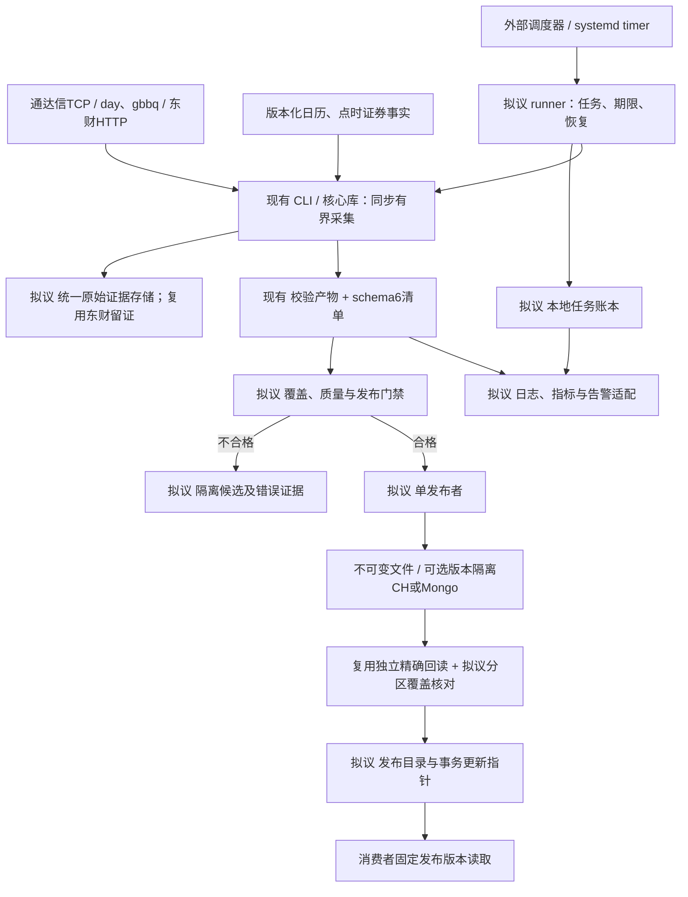

# rustdx 生产系统融合技术方案

方案日期：2026-10-23。设计基线：本仓库 `5d3f961e78a711014f19b2625a603a909f69bcc7`，Cargo版本为核心1.12.2/CLI1.8.2。原始能力参考 `rustdx-complete 1.11.0` / `rustdx-cli 1.7.2`；版本及风险证据见[发布版评估](UPSTREAM_CRATE_ASSESSMENT.md)。

**状态声明：本文件是技术设计。** 已实现能力以源码及既有验收记录为准；任务runner、持久任务账本、发布目录、发布指针、监控适配和跨主机治理均为拟议能力。本次只交付研究与方案，没有创建这些服务、修改Rust实现或执行生产部署。

## 1. 目标、适用范围与设计选择

目标是在现有行情库与CLI基础上，建立可复现、资源有界、数据可追溯、失败可恢复的生产数据链路。首期面向历史日线补数和每日收盘数据；通达信快照、财务和逐笔按已验收协议逐项接入。当前东财入口只取得收盘快照，历史缺失须从相应历史来源补齐。

采用现有强化分支作为唯一生产实现，保留Rust2024/MSRV1.89、同步I/O和有界线程。原包发布提交已在本仓库历史中，继续将原包加入生产依赖不能增加独立数据可信度。协议差异审计可以隔离双依赖，业务运行只保留一套类型、规则和错误语义。

首期选择Linux单机受管采集、一个数据发布者、不可变文件留存、ClickHouse作为分析目标；MongoDB按实际文档查询需求选用。任务可以由现有企业调度器或systemd timer触发，新增薄runner管理任务状态和发布判定。达到单机验收门禁后，才依据实测并发与恢复需求扩展跨主机。

| 设计选择 | 理由 | 代价与约束 |
| --- | --- | --- |
| 核心库处理协议与计算，CLI处理一次有界采集 | 复用已验证代码，避免把调度、身份与数据库治理塞入协议层 | 必须限制旧危险接口的生产使用 |
| runner作为独立适配层 | 增加调度、重试决策和任务账本，尽量保持CLI兼容 | 新组件需独立测试与交付，当前未实现 |
| 原始证据、校验产物、正式发布分开 | 能重放、定位差异、隔离失败候选 | 需要持久磁盘及归档管理 |
| 数据核验先于业务发布 | 成功回执不能证明字段正确，流程complete不能证明应有覆盖完整 | 增加完整回读与覆盖核对成本 |
| 单发布者起步 | 当前同机锁与平面表可以形成清晰运维边界 | 不提供发布者高可用，故障由账本恢复 |
| 新模型逐步影子验证 | 原CSV/数据库接口已有用户，避免无依据改变字段语义 | 迁移期间须维护明确契约与对照 |

本方案不包含交易下单、用户账户系统、Web产品或毫秒级行情流。若未来需要实时推送，应另行定义源授权、延迟预算、队列与消费者语义，不能由当前批处理证据推导。

## 2. 融合复用矩阵与剩余缺口

| 能力 | 本仓库现状 | 融合处理 | 需求关联 |
| --- | --- | --- | --- |
| 协议覆盖与连接池 | 已保留上游功能，完整帧重试、借出连接所有权、配置传递已强化 | 继续复用；剩余名单/分时/公司信息等协议迁移为不可变请求与checked解码 | FR-04、FR-07 |
| 任务与网络预算 | OperationContext、TCP/HTTP许可、同机OS锁、取消已实现 | runner继承同一deadline并协调多个任务；跨机出口另行限额 | FR-04 |
| 标准行情与计算 | Symbol/CanonicalBar、量单位、收益指数/价格乘数、线性指标已实现 | 将字段语义固化为数据契约，显式声明未验收品种与周期 | FR-03、FR-09 |
| 历史文件与导出 | 4096条分块、磁盘归并、确定性CSV、checked解析、原子输出已实现 | 按run_id写私有目录，保留生产证据；不重复实现解析链 | FR-05、FR-12 |
| 日期与证券事实 | 严格CalendarProvider、日期规则、SecurityHistory入口已实现 | 补完整日历和逐证券事实，构造点时名单；入口存在不等于事实齐全 | FR-01、FR-02 |
| 运行清单与观测 | schema6、每运行归档、阶段耗时和新鲜度已实现 | 账本读取清单，将CLI完成与数据发布分别记录 | FR-05、FR-14 |
| 原始响应与重放 | 东财逐页正文留证与离线重放已实现；TCP有测试采样工具 | 拟增加生产TCP有界留证接口，按任务关联请求/响应与摘要 | FR-07、FR-13 |
| 数据库交付 | day支持CH/Mongo，east支持CH；完整回执与全键/全字段回读已实现 | 保留独立验收；拟增加版本化隔离表和正式发布指针 | FR-06 |
| 调度、备份、跨机 | 有操作文档/模板，没有内置持久runner与发布服务 | 按本方案新增并独立验收 | 后续需求扩展 |

现状依据[架构评估](PROJECT_ANALYSIS.md)、[需求主文档](../requirements/REQUIREMENTS.md)、[网络预算](NETWORK.md)、[导入证据](../operations/IMPORTS.md)。后续需求扩展应进入唯一需求主文档，不把本方案的拟议状态改写成已交付功能。

## 3. 首期架构与责任边界

下图是拟议的组件与数据流视图，采用Mermaid流程图，属于软件架构示意而非正式UML。范围为单机批处理；已有组件以“现有”标注，新增组件以“拟议”标注。各数据库是可选独立目标，不隐含双写或跨库事务。

组件职责：

| 组件 | 输入/输出 | 责任 |
| --- | --- | --- |
| 核心库 | checked请求/原字节 → 类型化行情或错误 | 协议、单位、日期、纯计算、受管网络 |
| CLI | 单次采集参数 → 产物、清单、退出码 | 执行一次有界任务、质量检查、文件/数据库验收 |
| runner（拟议） | 调度事件 → job/attempt及恢复决策 | 去重、资源预约、子进程管理、持久任务账本 |
| publisher（拟议） | 合格候选 → 可消费发布版本 | 冻结候选、写入/核验、覆盖门禁、正式指针更新 |
| 数据维护流程 | 公告/独立参考 → 版本化事实 | 日历、上市/停复牌/ST事实、规则生效边界 |
| 运维适配（拟议） | 清单/账本/实际资源 → 指标和事件 | 告警、容量趋势、备份与恢复记录 |

图的阅读顺序是采集、留证与校验、隔离或候选发布、回读、指针更新。Mermaid源直接保留在本文件，支持该格式的Markdown渲染器可显示；纯文本环境使用图前后描述和职责表。图中每条新增关系均是设计关系。

## 4. 数据契约与点时覆盖

### 4.1 行情身份与数值口径

拟议的生产逻辑键包含 `dataset_id + market + code + instrument_class + period + timestamp + price_basis`。dataset_id固定产品口径与源选择策略；同一数据集内不允许股票/指数同码混合，也不把原价与前后复权视为相同数据。日线timestamp保留交易日及UTC+8定义，不能用下载机器日期替代源日期。

| 字段组 | 必须保存的语义 | 校验 |
| --- | --- | --- |
| 证券与时间 | 市场、原代码、品种、周期、交易日/源时点、采集时点 | 前导零、市场能力、周期匹配、日期覆盖 |
| 价格与成交 | OHLC、amount、volume、原单位/缩放、价格口径 | 有限值、OHLC关系、金额/量非负；转换按品种核实 |
| 调整数据 | 原始昨收、除权参考价、ReturnIndex、PriceMultiplier、锚点 | 收益指数不得直接缩放OHLC，事件顺序和锚点明确 |
| 来源与版本 | source、request_id、原始正文/文件摘要、解析器与适配器版本 | 归档内容与解析内容一致，独立重放能够复现 |
| 事实版本 | calendar_version、rule_version、security_history_version、universe_version | 版本覆盖行情日与所有导航范围 |
| 发布身份 | job_id、attempt_id、run_id、release_id、contract_version | 可从消费记录追溯到清单与原证据 |

现有CanonicalBar数值以元/股等标准口径表达；旧day/东财CSV继续使用兼容列和手单位。新数据表/文件须显式版本化后采用标准单位，不能直接重命名旧vol列。源编码本身的精度与独立跨源比对容差单独声明；同一CSV与数据库之间仍执行Float64精确一致校验。

原价保留为重算基础。前后复权随锚点和后续事件变化，修订要产生新release；历史回测还须保存事实已知时间与生效时间，避免使用今天的证券名称或未来除权信息重构当时策略输入。现有结构尚不提供完整全市场双时间事实库，属于拟议扩展。

### 4.2 应有覆盖的构造

发布前根据版本化的点时证券名单、日历和证券状态，构造本次范围内的应有键。Trading日期要求对应行情；Suspended日期保存有证据的免行情原因；退市及尚未上市边界按已核实事实裁剪；事实缺口标为Unknown。没有返回记录本身不能生成Suspended或Delisted事实。

维护数据必须保存来源URL、公告日期、实际取得内容摘要、有效区间和核实截止。内置日历只有2024–2026，2027完整休市数据仍缺；日期规则核实截至2026-10-22，不能只扩大日期范围而没有新公告。单交易所规则复核也不替代全部板块核实。[cite:8](#cite-8)[cite:9](#cite-9)

| 覆盖情况 | 生产门禁 |
| --- | --- |
| 指定范围全部应有键取得且事实有效 | 可以继续正式发布 |
| 证券有已核实停牌/退市等免行情事实 | 单独记原因与覆盖，不用空行情填充 |
| 日历、证券事实或应有键未知 | 拒绝发布到要求完整的数据集，保持上一正式版本 |
| 业务明确允许部分数据 | 创建明确标注partial的独立数据集/订阅契约，不能混入完整集 |
| 当前快照缺少历史区间 | 先历史补数；不得以收盘快照任务complete替代历史完整性 |

文件格式检查、全部导出键回读和应有业务覆盖是三道不同的检查。当前CLI只证明已导出的范围；新增publisher负责把它与应有范围比较。

## 5. 任务账本、调度与取消

### 5.1 持久任务模型（拟议）

单机优先采用本地盘上的SQLite账本，事务保存任务状态与发布指针；启用适合持久性的同步/WAL配置，备份使用数据库备份接口或一致性快照，不孤立复制主文件。需要新增的SQLite依赖仅属于runner，须通过Rust1.89、许可与打包检查；当前workspace没有此依赖。

| 对象 | 关键字段与规则 |
| --- | --- |
| Job | job_id、dataset_id、源策略、范围、计划交易日、policy_revision、状态、截止时间 |
| Attempt | attempt_id、job_id、CLI run_id、代码/二进制摘要、开始/结束、退出码、清单位置 |
| InputSnapshot | 输入摘要、字节数、源/取得时点、事实与契约版本 |
| Candidate | release_id、attempt_id、覆盖、质量、产物摘要、数据库核验、隔离原因 |
| Publication | dataset_id、catalog_version、manifest_uri/hash、上一版本、提交时点 |
| Event | 对象ID、阶段、原因、证据位置、操作者/调度身份，追加保存 |

调度去重键由数据集、源策略、采集范围、计划交易日和策略版本确定，不包含凭据。一次Job可以有多个Attempt，每次Attempt拥有独立run_id和私有产物目录；修订源或契约创建明确新候选。输入摘要在取得源后补充，不能在采集前假定内容未变化。

runner在启动前原子登记任务，检查同目标互斥、空间、事实覆盖和剩余deadline。CLI默认10800秒仅为已有配置默认值，不是生产SLA；runner给各阶段保留预算，实际CLI时限不得长于任务剩余时间。Ctrl-C/SIGTERM和取消文件触发协作取消，宽限期后终止整个子进程树；强制终止后进入恢复核查，不能凭非零退出认定未写库。

### 5.2 状态与重试

拟议Job主状态为 `queued → running → evaluated → released`，可进入failed/quarantined/reconciliation_required/cancelled；每个Attempt保留CLI自身状态。CLI `complete` 只表示其范围内流程完成，Job `released` 还要求业务覆盖、正式产物和发布指针提交完成。

| 失败位置 | 可自动动作 | 发布限制 |
| --- | --- | --- |
| 未发生输出/数据库动作的瞬时网络失败 | 剩余预算内有上限重试，端点冷却；建立新的Attempt | 不改变正式版本 |
| 解析/单位/事实/覆盖错误 | 隔离原证据与候选，等待修订输入或规则 | 不静默跳过坏数据 |
| 文件publication_pending | 核对私有文件/输出摘要，确定rename是否发生 | 文件状态不等于数据库状态 |
| 数据库unknown | 标记reconciliation_required，核查CSV、query_id与目标 | 默认不自动盲重试 |
| 数据库acknowledged但未verified | 对固定产物继续核验；失败保留恢复文件 | 未核验不能推进指针 |
| verified但指针未提交 | 核对封存产物与上一个目录版本，尝试规定的事务提交 | 不必重新采集或重复写库 |
| 指针已提交但任务结束事件丢失 | 以账本中的Publication复核后补终态 | 不创建第二次相同发布 |

无人值守任务不得依赖交互式备用ZIP输入。补数、修订和失败重跑都使用显式参数、范围与来源证据。调度服务故障恢复时扫描未结束Attempt，而非将所有running一律重跑。

## 6. 原始留证、质量校验与版本发布

### 6.1 证据存储

拟议存储采用 `dataset/job/attempt` 私有目录。至少保存实际解析字节的源文件/HTTP正文、请求语义、采集时点、SHA-256、源长度、事实版本、CSV/JSON、schema6最终清单、独立核验结果和发布目录。HTTP认证信息不进入公开日志/文件名；数据源使用与再分发权限作为部署输入核实。

东财复用已有RawPage与重放；TCP新增有界证据写入器，先保存完整帧身份、请求、响应正文和解析器版本。每帧、每任务、总留存均设字节限额，采集子线程通过有界队列或直接私有文件写入，不在内存堆积全任务报文。只保留摘要而删除原字节时必须标记不可重放，不能称为完整输入备份。

生产任务保留规范产物与原证据。现有day数据库导入默认可删除CSV；runner须显式选择保留并核实最终路径，或在独立不可变归档完成后才清理工作副本。只记录SHA-256不能恢复丢失内容。

### 6.2 发布门禁

| 门禁 | 要求 | 未通过处理 |
| --- | --- | --- |
| 输入完整性 | 同快照摘要、完整记录、数量/尾部/压缩边界 | 隔离候选 |
| 语义 | 证券/周期/单位/时点/原价与调整口径符合契约 | 返回明确错误 |
| 日期和事实 | 日历与证券状态覆盖、重复/逆序/缺口核查 | Unknown不得补事实 |
| 数值 | 有限值、OHLC关系、量额范围、事件顺序、指标预热 | 保存最小错误证据 |
| 业务覆盖 | 应有证券/日期/分区，与取得数据和免行情原因一致 | 保留上一正式版本 |
| 产物 | 确定性行序、流式回读、摘要/行数/键范围 | 不进行发布 |
| 数据库 | 完整回执，全部键/字段精确回读，候选范围没有额外逻辑键 | 不标verified、不推进指针 |
| 正式提交 | 封存内容持久化后，事务更新目录指针与发布事件 | 候选成为可回收孤立产物 |

异常值如跨源价格差异首先触发诊断，不凭一般百分比阈值自动认定哪一源正确。门禁参数按数据集契约版本化，规则修订须有依据。

### 6.3 不可变发布目录（拟议）

一个 `release_id` 表示某次候选的固定覆盖分区与内容，唯一绑定摘要、来源/事实/契约版本和核验结果。发行版本号不能只用开始时间决定新旧：重跑旧源可能比新数据更晚执行，取舍应依据源时点、覆盖和已批准的修订顺序。

为避免每日发布复制全部历史，拟议 `ReleaseManifest` 列出完整分区映射：每个日期/证券分区指向一个已经封存的release_id，未变分区可引用上一目录中的封存数据。新目录须验证分区不重叠、无意外遗漏；新候选只能替换声明的范围。`catalog_version` 表示这一完整映射的版本，区别于单次CLI run_version。

文件与清单先写私有路径、持久化内容及目录项，再登记候选；publisher对封存内容核验后，在账本一个事务中校验旧catalog_version并更新 `published_pointer(dataset_id)` 与发布事件。比较后交换（CAS）失败表示正式目录已变化，必须重新评估修订范围，不能覆盖较新目录。文件持久化与数据库写入不参与这个事务，提前完成的孤立候选可以保留核查。

消费者先固定catalog_version，再解析其分区映射，按release_id读取整个查询范围；查询中途不重新取“最新”。单独读取旧CSV路径或平面表不能提供这一语义。首期可以只发布文件目录；启用数据库版本隔离后，同样使用该目录与release_id。

## 7. 数据库模型、独立验收与恢复

### 7.1 当前兼容路径

现有表按CSV日期与含市场前缀代码使用 `(date,code)` 逻辑键，且没有完整标准行情维度。因此每张兼容表只接收一种固定周期、品种/单位与价格口径的数据集，不混用新契约键。当前同机写入锁覆盖前因子读取到验收，约束受管任务；它不能约束其他客户端、任意DNS别名或其他主机。

ClickHouse继续检查目标引擎、键、分区、Float64与版本字段，完整读完HTTP响应并使用query_id，随后独立 `SELECT ... FINAL` 回读。ReplacingMergeTree后台合并不提供即时唯一性，其版本排序也不证明源数据更准确。[cite:12](#cite-12) HTTP200可能包含迟到异常或结果正文错误，客户端断连不等于数据库未执行。[cite:13](#cite-13)

MongoDB继续要求非部分、非稀疏、simple排序规则的完整唯一索引，导入后以长驻mongosh逐批核对。day可以用MongoDB，east目前不能直入MongoDB；新增入口应单独设计与验收。

### 7.2 版本隔离模型（拟议）

| 存储 | 拟议物理身份与约束 | 发布前核验 |
| --- | --- | --- |
| 文件 | `release_id`私有不可变目录；清单指向固定摘要 | 字节摘要、规范行数/键/字段、分区完整性 |
| ClickHouse | 新表键含dataset_id、release_id及契约完整逻辑键；重试仅在未封存候选内写相同内容 | 按release范围FINAL回读全部键/字段，核对范围内完整逻辑键数量，拒绝额外键 |
| MongoDB | 新集合唯一键含dataset_id、release_id及完整逻辑键；封存后禁止upsert | 全键/全字段精确回读与release范围计数 |
| 控制账本 | dataset指针引用目录版本与manifest摘要 | 事务CAS、发布事件、引用的release均封存且verified |

只按导出的键回读不能发现同release的额外键，因此新增发布核验还需限定release的完整计数与范围检查。现有标准化CSV行序摘要可以继续复用，但schema3/4与schema5/6的摘要顺序不同，不能直接比较所有历史摘要。

单发布者拥有目标写入凭据，worker只交付候选文件；消费者使用只读身份。一个release封存后不得继续写入，修订创建新release。必须通过发布服务写入路径及权限隔离落实这一约束，不能只在文件名中增加release_id就声称不可变。

多个目标独立验收；默认一个主分析目标即可。确有双目标要求时，目录分别记录各目标的核验与可用版本，只有满足约定的必需目标集合才发布。此流程不构成跨库事务，也不承诺exactly-once执行。

### 7.3 不确定写入的恢复步骤

1. 固定发生失败的Attempt、CSV摘要、目标身份、query_id、运行与数据库状态，停止同目标新发布。
2. 核实输入/产物没有变化，取得服务端查询状态与目标范围数据；确认是否存在仍执行的写入。
3. 以保留产物独立核验全部导出键与数值，并检查候选release的总范围；决定继续验收、创建隔离新Attempt或人工修订。
4. verified且已封存时完成目录提交；不一致时隔离候选，不能将“已收到回执”当作可发布依据。
5. 记录恢复事件、保留旧正式目录；恢复后再次核查消费者实际读取的catalog_version。

现有平面表重复导入可能覆盖较新值，恢复前必须检查源时点、外部写入与版本顺序。版本隔离表通过新候选避免修改正式release，但仍须确认未完成查询及封存状态。

## 8. 资源预算、容量与性能

| 资源 | 当前事实 | 生产安排 |
| --- | --- | --- |
| 网络 | 默认受管TCP/HTTP共享8许可，同目录跨进程OS锁；裸socket和跨机不受约束 | runner限制活跃任务，统一许可目录/容量；Mongo内部连接另外观测 |
| 时限 | CLI默认10800秒，分层请求/分页/批次预算；同步系统调用不能抢占 | 任务绝对deadline、阶段剩余预算、取消宽限期及进程树回收 |
| 解析内存 | 每块4096条；day32MiB、gbbq/前因子各64MiB；结果通道容量1 | 按线程数、块/因子、文件元数据与全部子进程核算，限制目录文件数量 |
| 排序与暂存 | 非A股最多8路多轮磁盘归并；输入快照和私有CSV增加I/O | 为同时存在的源、CSV、归并中间文件、原证据与归档预留空间 |
| 数据库回读 | 默认4096键/批，可调1..16384；单批文本16MiB上限 | 批量依据目标库容量实测；保持全部字段精确验收 |
| Mongo进程 | mongosh默认V8老年代128MiB，其他内存不在限制内 | 测量完整进程树RSS，不将128MiB当总RSS预算 |
| 指标 | 常规线性窗口路径已实现，输出仍O(n) | 固定数据/窗口/版本跟踪成本，不声称未经同口径测量的加速倍数 |

容量模型采用实际测量值代入：峰值RSS包含基础进程、每worker固定块和状态、文件列表/报告O(文件数)、因子快照、数据库回读与子进程；暂存容量包含同时活跃快照、CSV、归并中间文件、压缩/解压重叠与失败保留。4096条分块不意味着整个任务内存与文件数量无关。

每次验收记录输入字节/行/文件数、线程、阶段耗时、真实RSS、磁盘峰值、回读批量和数据库版本。没有同环境原包/新分支基准时，不给倍数改善；现有小窗口基准与779,200行子集不能推断约2971万行全量的完成时间。

## 9. 可观测性、SLO与告警

当前schema6记录阶段累计调用耗时、活跃墙钟并集、任务资源和自然日新鲜度，并提供最近至多1024请求的最近秩P95。它没有内置Prometheus服务。拟议适配器从每运行清单和账本产生结构化日志、指标与告警；跨任务P95应基于原始样本或直方图合并，不能平均已有P95。

| 维度 | 指标/事件 | 判定用途 |
| --- | --- | --- |
| 任务 | queued/running/failed/reconciliation_required、阶段、超期 | 区分排队、源失败、解析失败与可能写入 |
| 网络 | 当前/峰值许可、等待、空响应、请求失败、延迟分布 | 判断出口与端点，空响应不直接判停牌 |
| 质量 | 应有/取得/免行情/Unknown键数、缺口、重复、规则覆盖 | 业务发布门禁 |
| 新鲜度 | 最新已发布交易日、预期交易日、发布时间 | 不用自然日年龄替代交易日落后 |
| 数据库 | 写入状态、verified数、回读耗时/批量、字段差异 | ack成功后仍有异常的定位 |
| 存储与恢复 | 空间、临时字节、孤立候选、备份年龄、恢复演练状态 | 归档、容量及恢复能力 |

生产SLO须定义测量对象、窗口、分母和数据集：如指定交易日收盘后，在批准的截止时点前发布完整数据的比例；已发布应有键覆盖率；源延迟与本系统处理延迟；恢复到可消费版本所需时间。外部源停机期间仍记录业务未达标，再单独归因，不能通过删除失败任务美化成功率。

当前没有长期生产观测，不设未经业务确认和测量支持的99.9%可用率、P95阈值或RPO/RTO。上线前必须给出具体SLO/RPO/RTO配置并通过演练，未给定值属于决策依赖，不能视为门禁已满足。

## 10. 部署、备份与运维

首期用固定Linux镜像、固定Rust工具链/依赖构建，保存代码提交、Cargo.lock、发布包与二进制摘要。采集身份只可写工作目录；publisher管理正式目录及目标写入；消费者只读。凭据由部署环境注入，日志与账本保存不含凭据的目标身份。

现有验收模板固定ClickHouse25.8.33.6、MongoDB8.0.16，但尚未执行Linux验收。是否用于生产须由目标版本验证决定，不能因模板存在视为可上线；本机macOS实验ClickHouse版本只作历史证据。

| 备份对象 | 方法与恢复校验 |
| --- | --- |
| 原始输入与规范产物 | 不可变归档至独立故障域，校验摘要和实际可读取内容 |
| 任务账本与发布目录 | 一致性备份，恢复指针引用的完整manifest及所有release |
| ClickHouse/MongoDB | 对选定实际版本执行一致性备份/恢复，保存schema与索引 |
| 代码与配置/事实 | 保存构建材料、无凭据配置、日历/规则/证券事实版本；凭据按部署体系恢复 |

保留期按每日字节量、源修订窗口、追溯和恢复要求确定，不在本方案虚构天数。删除release前需检查所有保留目录与活跃消费者引用；失败unknown候选在核查结束前不自动清理。源、代码与数据库是不同回退对象，源码回退不自动恢复数据。

恢复演练在隔离目标从账本/目录/数据库备份或原证据重建指定发布版本，核对键、字段、摘要与消费者目录，实测RPO/RTO。已有断连/SIGKILL重跑通过不替代备份丢失或整机故障的演练。

## 11. 跨主机扩展与失效写入隔离

跨主机只在单机容量、排队或恢复需求达到已定义阈值后启用。届时任务账本可迁入现有具备事务能力的控制数据库，worker按分区领取租约并生成独立Attempt；全局出口预算通过集中派发或网络出口控制落实。SQLite本地文件锁不能扩展为跨机协调。

**租约到期不停止旧进程，也不阻止已发出的数据库请求。** 初步扩展仍保留一个publisher，worker无正式数据库写权限，只交付隔离产物。需要worker写staging时，其身份只能写自己的attempt/release范围，正式目录不能引用未封存候选。

| 能力阶段 | 必需隔离 | 可以承诺的范围 |
| --- | --- | --- |
| 单机兼容平面表 | 同机锁、一个受管writer、禁止外部并发写 | 当前模式下受管任务互斥 |
| 多机采集、单publisher | worker私有产物，publisher独占正式写入与指针 | worker失效不直接污染正式目标 |
| 多机publisher高可用（拟议） | epoch、写入网关、release隔离、封存、事务CAS指针，消费者统一读取目录 | 经专项验收后，过期Attempt不能推进正式目录 |

高可用设计要求：

1. 发布任期使用单调epoch，每个候选具有唯一release_id；旧任期不得复用新任期数据范围。
2. 所有目标写入经网关，数据库凭据只给网关；网关检查任期与release未封存状态。worker/publisher直接连接数据库会绕过隔离。
3. 网关封存时禁止新写入，等待/核查该release所有在途请求终态，然后执行完整核验；unknown请求未解决则不能封存。
4. 事务CAS发布指针同时检查任期、旧目录版本与核验/封存证据；旧publisher恢复后CAS必须失败。
5. 消费者只读发布目录内的固定release；过期Attempt即使完成隔离staging写入，也不可被自动消费。

上述网关与控制事务当前均未实现。若不能落实任期校验、在途请求清空、封存和消费者目录约束，就维持单publisher，不宣称跨机平面表写入安全。CAS只提交控制状态，不提供ClickHouse/MongoDB/文件之间的事务。

## 12. 兼容迁移与工程落位

| 迁移对象 | 路径 |
| --- | --- |
| 原包依赖 | 应用迁至单一`jelven-rustdx-complete`新发布版或固定源码构建；隔离审计保留原包比较 |
| 旧协议对象 | checked请求/独立解码先覆盖生产入口，再逐步弃用公开字段和旧parse；主版本删除前验证下游 |
| CSV与factor | 旧列/单位保持兼容；新契约文件另标contract_version；收益与价格调整分别映射 |
| 平面数据库表 | 新版本隔离表先影子生成/全键核验，回填明确历史范围，再迁消费者到目录；不直接改旧表键 |
| 现有消费者 | 明确支持目录版本后切换；未迁消费者继续使用单机兼容模式，不获得版本化快照承诺 |
| 包版本 | 提升核心/CLI版本及依赖，真实注册表环境验证打包；同版本号源码优化不能当作已发布 |

拟议工程落位：

| 位置 | 内容与状态 |
| --- | --- |
| `src/`、`rustdx-cmd/src/` | 保留当前职责；后续增加剩余checked协议、TCP留证和可复用核验接口 |
| `rustdx-runner/` | 拟新增独立crate：job/attempt、账本、子进程、publisher适配；当前不存在 |
| `config/` | 后续任务策略、契约、无凭据配置示例；当前CLI不会自动读取这些拟议配置 |
| `deploy/` | 后续runner/publisher Linux部署与监控模板，独立于验收容器 |
| `scripts/validation/`、`tests/` | 后续发布故障、恢复、候选隔离与消费者版本回归 |
| `docs/requirements/`、`docs/validation/evidence/` | 先新增可观察需求，再保存真实验收；运行大文件不入Git |
| 部署运行存储 | raw、work、quarantine、release、manifest、ledger、backup；按环境创建并管理 |

release服务按需加入workspace，不把新依赖强加给核心库。新SQLite/控制数据库/对象存储/指标库都须说明用途与MSRV影响；当前需求没有引入异步运行时的依据。设计没有规定必须新增Web API，消费者可以通过小型读取库或固定manifest取得版本。

## 13. 分阶段执行与验收门禁

阶段以可验证结果推进，不凭估算周数承诺完成。

| 阶段 | 交付 | 核心验收 | 前置条件 |
| --- | --- | --- | --- |
| G0：冻结事实与基线 | 源码/二进制/依赖身份、目标数据集契约、应有范围 | 确认当前发布包与源码差异、单位/日期/规则范围、所有生产入口 | 选定目标源、市场/周期、部署版本 |
| G1：补齐生产正确性 | 剩余生产协议checked化、日历/证券事实、构建发布材料 | 独立固定样本、截断/非法值/数量/身份；MSRV全特性、Clippy、实际包检查 | 取得真实协议与公告证据 |
| G2：目标环境验收 | 固定Linux全量负载、数据库故障和备份恢复证据 | 全输入范围独立核验、资源峰值、重复导入、确认丢失/SIGKILL/空间不足、恢复演练 | 隔离数据库与生产规模输入 |
| G3：单机发布层 | runner/账本、证据归档、目录与单publisher | Job/Attempt去重、deadline、complete与released分离、未知覆盖拒绝、指针中断恢复 | G1/G2通过；具体SLO/RPO/RTO |
| G4：试运行与迁移 | 指定数据集灰度、消费者版本读取、监控/运维记录 | 实际连续运行达到批准窗口与指标，覆盖完整，保留可回退正式版本 | 新旧表/文件对照通过 |
| G5：可选跨机 | 多机采集；有明确需要时再增加publisher高可用 | 租约失效、旧worker恢复、在途写入、重复消息、CAS冲突、网络分区，消费者无混合版本 | G4通过且实测确有扩展需求 |

G2/G3必须增加以下故障断点验收：

| 故障断点 | 预期不变量 |
| --- | --- |
| 原始留证前后、解析/归并时强制终止 | 旧正式目录不变，未完成私有文件可识别，重跑不混用来源 |
| 数据库提交前、成功正文中断、回读中断 | unknown/acknowledged与verified区分，恢复文件存在，不误发布 |
| verified后、封存前、指针事务前后终止 | 未封存不发布；已提交指针可恢复终态，消费者固定一致目录 |
| 同任务重复调度、旧补数晚于新修订完成 | 不按执行时间覆盖新源，修订冲突可识别 |
| 日历到期、证券状态缺口、缺一个应有交易日 | 拒绝完整数据集发布，不伪造停牌或日历事实 |
| 磁盘满、归档丢失、数据库备份恢复 | 不误标complete/released，恢复后摘要与消费范围可核验 |
| 跨机租约过期与旧进程恢复（仅G5） | 旧任期无法写正式release或推进目录；未封存内容不可消费 |

本仓库已有128文件/779,200行、两库两次精确回读及4项故障恢复，是G2的准备证据，见[第三轮验收](../history/OPTIMIZATION_ROUND3.md)。它们不是上述新发布层门禁已通过；最新约2971万行全量、固定Linux、长期P95、全市场证券事实和备份恢复仍需新增实证。

上线决策依赖包括目标数据库版本/拓扑、采集频率与源权限、市场/证券范围、全量规模、消费者一致性需求、SLO/RPO/RTO与留存空间。当前可以完成设计，实际部署前必须将这些输入转为配置和真实门禁结果；不把未知值包装成默认生产承诺。

## 14. Sources与现状依据

本方案的新增设计是建议，不是来源中的既有产品能力。原包事实见[评估报告](UPSTREAM_CRATE_ASSESSMENT.md)及[本次证据](../validation/evidence/upstream-review-20261023.json)。

[cite:8] 上交所2026交易规则与生效公告：<https://www.sse.com.cn/lawandrules/sselawsrules2025/stocks/exchange/c/c_20260424_10816482.shtml>。

[cite:9] 上交所主板风险警示股票涨跌幅调整说明：<https://www.sse.com.cn/aboutus/mediacenter/hotandd/c/c_20260424_10816474.shtml>。

[cite:12] ClickHouse ReplacingMergeTree替换、版本与合并语义：<https://clickhouse.com/docs/engines/table-engines/mergetree-family/replacingmergetree>。

[cite:13] ClickHouse HTTP完整响应、异常与断连语义：<https://clickhouse.com/docs/interfaces/http>。

现状主文档：[需求](../requirements/REQUIREMENTS.md)、[项目结构](PROJECT_STRUCTURE.md)、[协议](PROTOCOL_REQUESTS.md)、[网络](NETWORK.md)、[导入](../operations/IMPORTS.md)、[东财重放](../operations/EAST_REPLAY.md)、[观测](../operations/OBSERVABILITY.md)、[运维](../operations/RUNBOOK.md)、[验证](../validation/VALIDATION.md)、[版本交付](../release/RELEASES.md)。这些文档与实际验收轮次共同限定“已实现/已验证”的范围。
