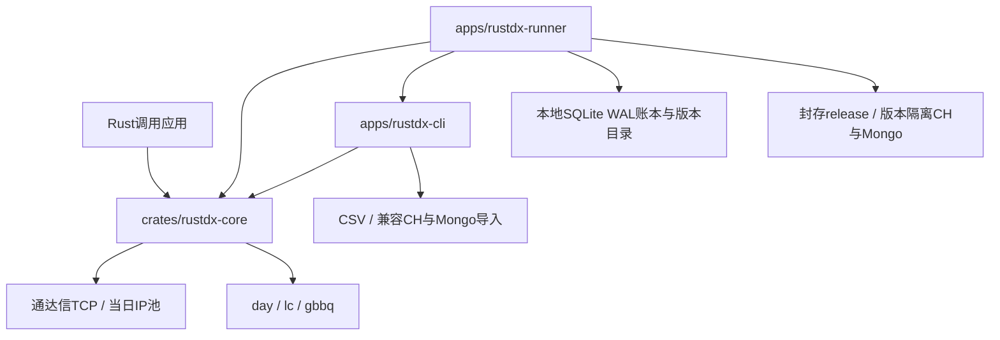

# rustdx 当前架构

更新日期：2026-10-24。本文描述当前源码，需求见[FR-01至FR-18](../requirements/REQUIREMENTS.md)，发布与恢复设计见[技术方案](PRODUCTION_FUSION_PLAN.md)。历次风险和修复结果保存在[历史架构评估](../archive/architecture/REVIEWS_THROUGH_20261024.md)。

## 1. 分层与依赖

核心库提供协议、解析、规则与计算；CLI组织文件或预算约束的显式TCP日线采集；runner管理本机任务、事实覆盖、不可变版本、消费与恢复。SQLite和数据库发布编排留在应用层，核心不依赖控制层。

## 2. 核心边界

| 领域 | 实现入口（相对crates/rustdx-core） | 不变量 |
| --- | --- | --- |
| 网络与协议 | src/tcp、src/pool.rs、src/operation.rs | 同步I/O；许可、绝对期限、取消及重连共同约束请求 |
| 行情业务 | src/tcp/stock及client子模块 | 26同码覆盖；请求、原始结果、语义资格和完整性分别表达 |
| 标准数据 | src/data、src/builder.rs | 市场、周期、单位、价格口径显式传入 |
| 本地文件 | src/file | 新不可信输入用checked入口；旧兼容入口有单独边界 |
| 参考事实 | src/calendar、src/limit | 日历、规则核实截止、证券状态覆盖独立检查 |
| 计算与缓存 | src/indicators.rs、src/cache.rs | 指标遵循本库口径；缓存键与有效期由调用方管理 |

Client维护证券目录精度，行情结果缓存显式使用；有任务预算的缓存合并使用checked入口。行情DTO不都拥有市场或输入代码，应用的长期存储应采用完整、拥有所有权的证券键。日历所有入口对未知覆盖返回错误，复权拒绝跨证券日线/事件。

## 3. 两种数据交付路径

CLI兼容路径：私有输入快照 → 4096条分块解析 → 质量检查/收益因子 → CSV回读及原子替换 → 可选数据库写入/全导出键精确回读 → schema7清单。CH使用兼容ReplacingMergeTree/FINAL，Mongo使用(date,code) upsert。

runner版本路径：冻结源与事实/CLI → 应有键核对 → 原日线独立重放 → 日期分区封存 → 唯一release insert-only写入 → 全字段和release总范围核对 → SQLite事务CAS推进目录。消费固定catalog_version；其数据库表与兼容路径分离。

runner来源可选本地day或新计划最多10000只沪深A股的显式TCP日线，保持已结束日期范围、
实际获取日和单位材料；TCP原始压缩帧、分页与标准字段独立回读后复用覆盖/发布。
schema8声明股单位和未核对业务覆盖；旧day schema6/7继续手单位。
具体来源合同见[应用接入](../development/APPLICATION_INTEGRATION.md#9-tcp日线采集与runner发布)。

CLI complete证明本次采集流程完成；runner released另要求业务覆盖、封存、全部目标验证和目录提交。失败不表示已写数据库被回滚。

## 4. 可靠性与资源

受管TCP主连接、池、订阅及HTTP共用预算。本地文件和运维入口默认不启动行情TCP，`--tcp-warmup`显式预热通用池；TCP来源自行核验冻结节点。网络配置先于首次初始化。队列等待、目录预热、分页、重试均消耗任务预算。

day线程默认最多8、可选1–64，每线程结果通道容量1。记录块4096条；源文件、响应、回读、质量详情及runner工作空间均有上限。周期磁盘监测不等于硬配额，完整进程树RSS需独立测量。

TCP日线窗口最多8线程，启动前预留原始行、正文、receipt和wire预算，窗口全部join后顺序回放写出。长期容量和历史版本引用使用[留存预览](../../scripts/ops/retention_preview.py)只读计算；所有账本登记版本及原始证据受保护，不自动清理。

同目录OS锁与SQLite事务只保证本机受管流程。Unix本地持久文件系统提供锁、rename和fsync；worker清空继承环境，当前仍与publisher同UID。

## 5. 已知缺口与扩展条件

| 缺口 | 当前事实 | 扩展前条件 |
| --- | --- | --- |
| 0feb日期与0547主动推送 | 0feb补码日期selector已修复，固定日期跨节点实帧已有；通用响应日期资格及0547盘中窗口未验收 | 独立日期资格、实际交易窗口、多节点及恢复证据 |
| 全市场事实与2027日历 | 提供模型与维护工具，完整新年度/全市场事实未取得 | 公告原字节、覆盖审计及日期边界回归 |
| runner采集来源 | 本地A股原价day或有总预算的新计划052b日线；复用覆盖与发布链 | 全市场事实/负载另验，分钟/快照/订阅仍须独立执行与发布合同 |
| Linux与生产规模 | 提供部署模板，本机已有有限验证 | 目标平台、账号权限、真实全量、长期指标与故障演练 |
| 跨主机与高可用 | 当前无跨机协调 | 明确外部协调和失效写入隔离方案后单独实现 |
| 数据库灾难恢复 | 本地账本/文件可隔离恢复 | 服务端一致性备份、恢复或新命名空间重建及精确验收 |

目录整理本身保留公开API；当前 <!-- version:project -->2.0.0<!-- /version --> 源码包含明确破坏性迁移，见[迁移说明](../release/MIGRATION.md)。同步有界设计继续保留。新目录规则见[工程结构](PROJECT_STRUCTURE.md)，实际检查范围见[当前验收矩阵](../testing/PRODUCTION_ACCEPTANCE.md)。
