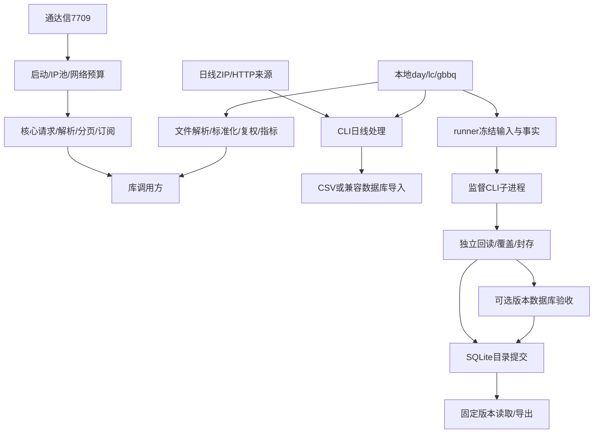

# rustdx 当前项目分析与优化建议

评审日期：2026-10-22（会话环境日期）。评审对象是当前未提交工作区，包含目录迁移和26命令接入。执行范围为静态代码审阅、本机离线工程检查、本地模拟服务和真实 CLI 子进程回归。

## 1. 当前判断与评审依据

项目已经形成核心行情库、历史日线工具、单机发布控制层三部分。同步 I/O、有界线程、显式网络预算，以及冻结输入、全字段回读、不可变版本发布的设计适合当前单机数据任务。下一阶段的重点是补齐业务证据与跨接口契约，并控制历史数据规模增长后的查询、内存和证据成本。

当前工程检查通过，但仍存在可从源码确认的合同缺口和容量限制。20项建议中，5项列为P0，10项列为P1，5项列为P2。P0表示相关能力扩大使用或发布前应关闭，其中包含业务验收事项；优先级并不等于故障已经在线发生。

HEAD为 `408e30eb172704070e384fb35fb0e56549a1fbc5`。根目录为虚拟Cargo工作区。当前Git状态有32条已跟踪修改、220条删除记录、23条未跟踪记录；未跟踪目录按一条记录计数。大量删除对应迁移后的新目录，不能仅据Git状态判断源码丢失。索引中没有已暂存变更。[目录迁移说明](file:///Users/bytedance/Documents/rustdx/docs/release/PROJECT_RESTRUCTURE.md)

生产Rust源文件清单为核心库90个、25,652行，应用31个、10,060行，合计35,712行。统计不含测试、示例、基准和缓存。审阅重点覆盖关键调用链、资源增长点和失败处理，并非逐行形式化审计。源码快照、检查命令和结果保存在[本轮机器证据](../../testing/evidence/current-project-review-20261022.json)。

仓库已有带日期的采样与验收材料用于识别已声明的边界；这些材料不计入本轮实际执行结果。本轮没有新增公共行情采样、真实数据库验收、远端CI执行、插桩fuzz或吞吐基准。

## 2. 架构、职责与现有能力

| 组件 | 当前版本与路径 | 已有职责 | 主要剩余边界 |
|---|---|---|---|
| 核心库 | `jelven-rustdx-complete 1.12.2`；`crates/rustdx-core` | 26个同码入口、协议解析与分页、订阅、文件解析、复权、日历、涨跌幅规则及指标 | 增强参数、来源语义和全市场业务证据 |
| CLI | `jelven-rustdx-cli 1.8.2`；`apps/rustdx-cli` | 日线采集、校验、CSV、兼容ClickHouse/MongoDB导入及schema7清单 | TCP采集入口、凭据传递、规模观测 |
| runner | `rustdx-runner 0.1.0`；`apps/rustdx-runner` | 本地day任务、冻结输入、SQLite账本、覆盖检查、版本发布、固定版本消费和恢复 | TCP Job、数据库热路径、目标Linux与真实规模验收 |
| 集成测试 | `tests/integration` | 跨模块和外部接口测试 | 明确区分实际执行、提前跳过和ignored |
| fuzz | `tools/fuzz`；独立工作区 | 文件、旧行情/K线/财务/成交等解析器输入检查 | 新增命令和订阅状态序列尚未全部纳入 |

版本与职责依据：[根workspace](file:///Users/bytedance/Documents/rustdx/Cargo.toml)、[核心Cargo](file:///Users/bytedance/Documents/rustdx/crates/rustdx-core/Cargo.toml)、[CLI Cargo](file:///Users/bytedance/Documents/rustdx/apps/rustdx-cli/Cargo.toml)、[runner Cargo](file:///Users/bytedance/Documents/rustdx/apps/rustdx-runner/Cargo.toml)、[核心导出](file:///Users/bytedance/Documents/rustdx/crates/rustdx-core/src/lib.rs)、[runner实现说明](file:///Users/bytedance/Documents/rustdx/apps/rustdx-runner/README.md)。

TCP结果目前由库调用方消费。runner任务契约固定为 `a-share/day/raw/cny/shares/v1`，采集来源是本地day目录；图中没有已实现的TCP采集Job。[runner契约](file:///Users/bytedance/Documents/rustdx/apps/rustdx-runner/src/config.rs#L9-L48)

以下能力已经存在，应继续复用：当日IP池与启动预热、30秒空闲心跳、共享网络许可、目录精度、成交事件分类与金额资格、26项命令入口、CLI分块和磁盘归并、CLI持久MongoDB回读、runner发布与恢复。现有数据库验收workflow也已将runner和核心目录纳入触发路径。[TCP实现](file:///Users/bytedance/Documents/rustdx/crates/rustdx-core/src/tcp/mod.rs#L237-L263)、[CLI回读](file:///Users/bytedance/Documents/rustdx/apps/rustdx-cli/src/io/mongo_readback.rs#L165-L218)、[数据库workflow](file:///Users/bytedance/Documents/rustdx/.github/workflows/database-acceptance.yml)

## 3. 优化清单与优先级

成本为相对估计，不代表确定工期。建议将P0/P1作为下一阶段待办，P2按实际测量与产品需求推进。

| 编号 | 优先级 | 优化事项 | 主要影响 | 相对成本 |
|---|---|---|---|---|
| O01 | P0 | 统一旧、新命令的响应身份校验 | 错配报文可能进入正文解码 | 中 |
| O02 | P0 | 明确0feb交易日期的业务资格 | 请求日期不能证明数据所属交易日 | 中 |
| O03 | P0 | 完成0547真实盘中推送验收 | 本地会话通过尚不足以支撑实时服务承诺 | 中 |
| O04 | P0 | 补齐日历、点时事实和目标生产验收 | 跨年与全市场发布依赖完整依据 | 中至高 |
| O05 | P0 | 固定可复现源码与正式发布版本 | 同版本包与工作区能力不同 | 低至中 |
| O06 | P1 | runner改用稳定键分页与持久MongoDB会话 | 深分页和反复启动进程 | 中至高 |
| O07 | P1 | 发布前预估数据库I/O和证据预算 | 大任务可能中途遇到固定上限 | 中 |
| O08 | P1 | 证据增量计量与冻结配置复用 | 每次请求/监督循环重复遍历文件 | 中 |
| O09 | P1 | TCP批量增加流式交付与字节预算 | 有界并发仍保留全部结果 | 中 |
| O10 | P1 | 标准行情保存可重建的来源元数据 | 标准周期丢失原始category和单位依据 | 中 |
| O11 | P1 | K线区间返回完成状态和来源连续性 | 短页停止及跨会话拼接边界不透明 | 中 |
| O12 | P1 | 数据库CI实际执行runner验收 | 当前数据库job主要验证CLI路径 | 中 |
| O13 | P1 | 增加TCP采集适配器和runner契约 | 行情API与持续发布尚未连通 | 高 |
| O14 | P1 | 节点能力分层与全局探测协调 | 普通探活不能证明特殊命令可用 | 中 |
| O15 | P1 | CLI认证URI退出进程参数 | 部分MongoDB调用将URI放入argv | 低至中 |
| O16 | P2 | 统一阶段指标与结构化错误 | 传输、解码、超时和取消难以统一对账 | 中 |
| O17 | P2 | 指标参数合同与增量状态 | 公式约定、跨块和重复全量计算 | 中 |
| O18 | P2 | 扩展fuzz并建立性能回归基线 | 新解析器覆盖和规模回归不足 | 中 |
| O19 | P2 | 缓存增量字节计数和磁盘总限额 | 全表扫描、复制和过期文件积累 | 低至中 |
| O20 | P2 | 收敛兼容接口与公共合同测试 | 可变旧对象、无错误parse和长模块 | 中 |

## 4. P0：数据正确性与发布依据

### O01：旧命令的传输身份校验需要统一

**源码确认：** 新命令的 `exchange_checked` 在返回正文前检查响应前缀、opcode和消息号；通用 `send_recv_decompress` 仅调用 `request_frame`。`KlineRequest::recv_stock`、`FinanceRequest::recv`、`QuotesRequest::recv_with_metadata` 等仍走后一路径。参数和正文经过checked校验，并不同时保证响应身份已匹配。[身份校验](file:///Users/bytedance/Documents/rustdx/crates/rustdx-core/src/tcp/frame.rs#L27-L51)、[两条传输路径](file:///Users/bytedance/Documents/rustdx/crates/rustdx-core/src/tcp/mod.rs#L684-L692)、[通用返回](file:///Users/bytedance/Documents/rustdx/crates/rustdx-core/src/tcp/mod.rs#L824-L827)、[旧checked快照](file:///Users/bytedance/Documents/rustdx/crates/rustdx-core/src/tcp/stock/requests.rs#L104-L114)、[K线入口](file:///Users/bytedance/Documents/rustdx/crates/rustdx-core/src/tcp/stock/kline_request.rs#L196-L203)。

**影响：** 错消息号、错命令或异常前缀的完整报文，在正文碰巧满足当前解码器时存在被接受的路径。本轮确认的是控制流缺口，没有声称已在公共主站观察到错配。

**建议与验收：** 按固定真实帧核实各旧命令的回显规则，统一匹配入口或建立明确的逐命令例外表。对旧快照、财务、K线和成交入口分别回放合法正文配错消息号/命令/前缀的报文，要求返回错误、连接失效且不暴露数据。保留明确的原始研究接口，避免把严格校验和裸协议研究混在同一合同中。

### O02：0feb须保留独立的交易日期资格

**源码确认：** `MinuteSeries` 同时保存请求日期、selector和 `server_trading_date`，后者当前始终为 `None`。分钟标签由索引合成，报文没有逐点时间。现有接入文档还记录了日期对照冲突。[结果与解码](file:///Users/bytedance/Documents/rustdx/crates/rustdx-core/src/tcp/stock/recent_minutes.rs#L48-L136)、[接入合同](file:///Users/bytedance/Documents/rustdx/docs/development/APPLICATION_INTEGRATION.md)。

**影响：** 若应用把 `requested_date` 当作已验证交易日，可能把主站缓存的数据归入错误日期。当前保留 `None` 的做法应维持。

**建议与验收：** 增加明确的日期资格/不可用原因，标准化和发布适配器要求日期证据达到所用数据集合同。核对交易日、休市日、窗口外日期、多个主站和多个品种，并与已核实的历史分时或终端数据交叉比较；不能只以非空或相同selector作为日期通过条件。

### O03：0547实时业务需要盘中独立验收

**当前状态：** 订阅已有完整基线、游标、队列限额、原子合并、失效和rebuild。已有材料将真实盘中主动推送保留为未验收；本轮只重新执行了离线及本地服务测试。[订阅实现](file:///Users/bytedance/Documents/rustdx/crates/rustdx-core/src/tcp/stock/quote_subscription.rs#L87-L177)、[现存验收记录](file:///Users/bytedance/Documents/rustdx/docs/archive/validation/QUOTE_PUSH_VALIDATION_20261024.md)。

**建议与验收：** 在实际交易窗口内用多个节点采集完整基线后仅被动读取，保存请求轨迹、消息号、连接ID、游标和五档变化。检查长时间连接、半帧、断线重建、队列压力和接收延迟；配对刷新响应不计为主动推送。只有完成业务验证后，才给实时消费者约定可用性与新鲜度目标。

### O04：维护事实覆盖并验收目标部署

**源码确认：** 内置日历明确覆盖2024-01-01至2026-12-31。外部日历provider已经存在，越界严格返回错误。runner依赖点时名单、证券生命周期和公告原字节，Unknown会阻断覆盖验收；当前生产矩阵仍保留真实全市场、Linux、权限和数据库服务端恢复等事项。[日历范围](file:///Users/bytedance/Documents/rustdx/crates/rustdx-core/src/calendar.rs#L43-L64)、[外部provider](file:///Users/bytedance/Documents/rustdx/crates/rustdx-core/src/calendar/provider.rs#L172-L227)、[生产矩阵](file:///Users/bytedance/Documents/rustdx/docs/testing/PRODUCTION_ACCEPTANCE.md)。

**建议与验收：** 官方发布下一年度事实后更新版本化日历，维持提前告警和越界拒绝；不要预造未来休市表。按真实目标证券维护上市、停牌、复牌、退市和名单有效期。在目标Linux及固定数据库版本上验收权限、硬配额、进程树资源、全市场覆盖和恢复，分别测量控制层及数据库服务端的RPO/RTO。

### O05：源码发布基线应与包版本对应

**当前状态：** 核心仍为1.12.2、CLI仍为1.8.2，工作区已包含同版本已发布包之外的接口和目录迁移。当前HEAD无法单独复现全部工作区内容。[版本说明](file:///Users/bytedance/Documents/rustdx/README.md)、[发布说明](file:///Users/bytedance/Documents/rustdx/docs/release/RELEASES.md)、[发布脚本](file:///Users/bytedance/Documents/rustdx/scripts/release/publish.sh)。

**建议与验收：** 将迁移与API行为变更形成可审阅提交，再依据公共签名、默认行为和数据合同变化确定版本升级。发布包之前核验包清单、下游最小依赖工程、MSRV和迁移说明，固定提交/锁文件/二进制摘要。当前外部应用使用源码path或固定提交时也应记录该身份。本次仅提供评审，没有提交或发布。

## 5. P1：规模、采集闭环与验证

### O06：runner数据库回读与进程成本

**源码确认：** 每次MongoDB `Session::exchange` 都spawn新的mongosh；回读使用ClickHouse `OFFSET` 和MongoDB `.skip()`，每批512行。CLI回读已经复用一个持久进程。[进程启动](file:///Users/bytedance/Documents/rustdx/apps/rustdx-runner/src/database.rs#L202-L268)、[深分页](file:///Users/bytedance/Documents/rustdx/apps/rustdx-runner/src/database.rs#L298-L323)、[MongoDB排序](file:///Users/bytedance/Documents/rustdx/apps/rustdx-runner/src/database_mongo.js)、[CLI可复用实现](file:///Users/bytedance/Documents/rustdx/apps/rustdx-cli/src/io/mongo_readback.rs#L165-L218)。

**建议与验收：** 使用稳定全排序键的keyset分页或受控游标，明确字典序与索引前缀关系；采用可终止的持久MongoDB会话或符合现有同步架构的驱动。必须保持缺键、多余键、重复、全字段精确比对和unknown写入处理。测量不同规模的查询数、启动次数、P95、吞吐和RSS后评估收益。

### O07：固定I/O上限应在写入前做容量检查

**源码确认：** 每个release/target的数据库操作序号限制为50,000，批次固定512行。新目标写入完成后还会进行全量512行回读；配置 `max_rows` 允许远大于该推导容量的值。[常量](file:///Users/bytedance/Documents/rustdx/apps/rustdx-runner/src/database.rs#L24-L25)、[序号上限](file:///Users/bytedance/Documents/rustdx/apps/rustdx-runner/src/database.rs#L93-L100)、[写入及验收](file:///Users/bytedance/Documents/rustdx/apps/rustdx-runner/src/database.rs#L449-L496)、[配置范围](file:///Users/bytedance/Documents/rustdx/apps/rustdx-runner/src/config.rs#L207-L225)。

**静态推导：** 新ClickHouse目标至少需要预检1次、空范围计数1次、写入 `ceil(N/512)` 次、回读同样次数、最终计数及越界查询2次，即 `2 × ceil(N/512) + 4` 次。50,000次上限对应至多12,798,976行；恢复、后续导出等还会消耗同一目标的记录序号。这是源码推导的上界，未包含磁盘、时间和其他限制，也不是实测吞吐。

**建议与验收：** 在首次INSERT前按已封存行数预估操作数、证据字节和文件数，拒绝无法完成的配置。将I/O预算与批次字节上限、任务规模和后续恢复需求联动。多个目标共用release证据树，还须考虑遍历的200,000条目上限；不要只提高序号常量。[文件计量上限](file:///Users/bytedance/Documents/rustdx/apps/rustdx-runner/src/storage.rs#L209-L227)

### O08：热路径减少完整目录扫描

**源码确认：** 每次数据库请求重新读取并验证冻结Job，扫描release数据库证据树；worker监督约每100ms也扫描任务目录。[exchange](file:///Users/bytedance/Documents/rustdx/apps/rustdx-runner/src/database.rs#L84-L111)、[监督循环](file:///Users/bytedance/Documents/rustdx/apps/rustdx-runner/src/supervisor.rs#L143-L181)。

**建议与验收：** 冻结配置校验后复用不可变对象，正常请求使用持久增量计量；启动、恢复和封存时完整对账。保留传输前意图、fsync和终态全目录核验。基准需要覆盖文件数增长，确认统计误差不会绕过空间限制。

### O09：TCP批量应支持流式消费

**源码确认：** K线批量创建与输入长度一致的结果槽位，并保存每只证券的完整历史；扩展命令批量也保存全部结果后统一返回。线程和连接有上限，但总结果内存随证券数和历史长度增长。[K线batch](file:///Users/bytedance/Documents/rustdx/crates/rustdx-core/src/tcp/stock/client/batch.rs#L49-L118)、[扩展batch](file:///Users/bytedance/Documents/rustdx/crates/rustdx-core/src/tcp/stock/client/extended_queries.rs#L300-L370)。

**建议与验收：** 保留Vec兼容入口，新增回调或有界通道，支持页/证券级交付以及 `max_rows/max_bytes`。把消费者等待计入绝对deadline，保留输入身份与逐项错误，定义有序交付所需的缓冲上限。规模测试验证慢消费者、取消、失败和输出确定性下的峰值RSS。

### O10：标准模型需要保留采集口径

**源码确认：** `CanonicalBar` 仅增加period、source、price_basis；`Period` 将category 4/9合为Day、7/8合为Minute1。转换显式接收量单位，但输出不保存原始category、参数或单位依据。[模型](file:///Users/bytedance/Documents/rustdx/crates/rustdx-core/src/data/model.rs#L38-L53)、[CanonicalBar](file:///Users/bytedance/Documents/rustdx/crates/rustdx-core/src/data/model.rs#L103-L126)。

**建议与验收：** 增加不破坏旧Bar的采集上下文：command、category/parameter、源单位与依据、精度、endpoint、获取时间、数据日期资格和复权版本。缓存及归档键共同使用这些字段。相同标准周期、不同请求编码必须可区分；未知单位不进入统一股数数据集。

### O11：K线区间应返回透明的覆盖结果

**源码确认：** 区间收集器短页即结束，最后排序、去重、过滤并返回Vec，收集器不追踪connection ID和完整覆盖状态；传输层允许自动重连。成交分页已经具备更严格的来源连续性设计。[K线收集](file:///Users/bytedance/Documents/rustdx/crates/rustdx-core/src/tcp/stock/client/pagination.rs#L8-L57)、[重连路径](file:///Users/bytedance/Documents/rustdx/crates/rustdx-core/src/tcp/mod.rs#L695-L725)、[成交全量入口](file:///Users/bytedance/Documents/rustdx/crates/rustdx-core/src/tcp/stock/client/transactions.rs#L19-L55)。

**建议与验收：** 增加拥有请求窗口、实际窗口、termination、source和coverage的区间结果；旧Vec入口维持兼容。根据各命令的真实短页证据定义结束策略，并明确跨主站/跨会话重试是否须从头重采。分别测试真实窗口耗尽、缺页、短页、重复边界和重连，不能把去重视为缺口已经修复。

### O12：runner真实数据库路径进入CI执行内容

**源码确认：** 数据库workflow的触发路径已经包含runner，但主要命令仍构建/测试CLI，并运行CLI导入脚本。常规CI执行runner本地故障用例时明确跳过真实数据库测试。[数据库workflow](file:///Users/bytedance/Documents/rustdx/.github/workflows/database-acceptance.yml)、[常规CI](file:///Users/bytedance/Documents/rustdx/.github/workflows/ci.yml)、[真实测试入口](file:///Users/bytedance/Documents/rustdx/apps/rustdx-runner/tests/control_plane.rs#L670-L671)。

**建议与验收：** 在隔离固定数据库环境里预建版本表/索引，配置runner专用测试环境，执行版本隔离、额外键拒绝、确认丢失、目录失败和隔离恢复。复用现有用例，记录外部服务失败原因和证据。远端CI成功与本机本地模拟结果分别维护。

### O13：行情库接入持续采集与发布

**当前状态：** CLI子命令以day及数据检查为主，runner来源固定本地day。26项查询入口还没有共同的TCP采集Job和增量发布合同。[runner配置](file:///Users/bytedance/Documents/rustdx/apps/rustdx-runner/src/config.rs#L9-L48)、[CLI命令](file:///Users/bytedance/Documents/rustdx/apps/rustdx-cli/src/cmd/mod.rs)。

**建议与验收：** 先增加少量证券日线/五分钟的source adapter和独立数据合同，再复用原始留证、标准化、覆盖、封存、目录发布。定义未闭合K线、午休、交易日、停牌、补采和修订语义。少量证券端到端采集与重复补采通过后再扩市场；复用同步架构和网络预算。

### O14：节点能力与探测总预算

**源码确认：** 每次IP探测最多8线程，测试TCP、握手和证券数量。`IpPool` 可独立创建，探测不经过业务许可；同机多池/多进程的总探测量不由这个“8”统一限制。[探测实现](file:///Users/bytedance/Documents/rustdx/crates/rustdx-core/src/tcp/ip/probe.rs#L80-L143)、[探测阶段](file:///Users/bytedance/Documents/rustdx/crates/rustdx-core/src/tcp/ip/probe.rs#L174-L195)。

**建议与验收：** 为行情、竞价、资金流、推送维护有依据的能力与新鲜度状态，引入独立的总探测配额和可取消协调。必须保留刷新所需的独立配额，防止业务许可占满后无法刷新。验证多进程同时启动、09:00刷新、空池和指定节点能力不足时的行为。

### O15：CLI认证URI退出argv

**源码确认：** CLI的索引准备、mongoimport、持久mongosh回读都把MongoDB URI作为命令参数；URI含认证信息时同样进入argv。runner已使用清理环境后的凭据注入。[CLI索引/导入](file:///Users/bytedance/Documents/rustdx/apps/rustdx-cli/src/io/sinks.rs#L85-L119)、[CLI回读](file:///Users/bytedance/Documents/rustdx/apps/rustdx-cli/src/io/mongo_readback.rs#L172-L189)、[runner现有做法](file:///Users/bytedance/Documents/rustdx/apps/rustdx-runner/src/database.rs#L211-L225)。

**建议与验收：** 按工具能力使用受控凭据配置或环境注入，并定义脱敏日志与临时文件权限。认证URI不再出现在进程参数、清单或异常输出；持久会话仍具备原有超时、取消和进程清理能力。

## 6. P2：性能观测、指标与维护

### O16：统一阶段指标和错误分类

网络统计已有连接、请求、P95和空响应；CLI已有阶段观测。普通 `request_frame` 的成功统计发生在上层正文解析之前，runner部分路径又把操作错误统一映射为Cancelled。[网络统计](file:///Users/bytedance/Documents/rustdx/crates/rustdx-core/src/tcp/governance.rs#L54-L67)、[传输统计](file:///Users/bytedance/Documents/rustdx/crates/rustdx-core/src/tcp/mod.rs#L668-L681)、[runner操作检查](file:///Users/bytedance/Documents/rustdx/apps/rustdx-runner/src/database.rs#L51-L53)。

建议保留分层语义：传输成功、身份匹配、解码成功、业务合格、发布成功分别计量；错误保留阶段、命令、源端和可重试性，明确取消与deadline耗尽。用固定任务对账墙钟时间、并发累计时间、行数、证据字节和数据新鲜度，避免一个总“成功率”掩盖业务失败。

### O17：指标合同与增量状态

MACD已经可用，当前DIF/DEA对应 `macd/signal`，histogram为DIF−DEA；EMA以每段首个有限值初始化，缺口重置。RSI使用滑动均值，KDJ采用 `2/(d_period+1)` 平滑系数。这些公式约定影响与其他软件逐值对照。[MACD/EMA](file:///Users/bytedance/Documents/rustdx/crates/rustdx-core/src/indicators.rs#L182-L205)、[MACD实现](file:///Users/bytedance/Documents/rustdx/crates/rustdx-core/src/indicators.rs#L269-L312)、[RSI](file:///Users/bytedance/Documents/rustdx/crates/rustdx-core/src/indicators.rs#L363-L391)、[KDJ平滑](file:///Users/bytedance/Documents/rustdx/crates/rustdx-core/src/indicators.rs#L724-L735)。

建议建立公式版本、参数、初始化、预热、缺口和复权合同，按需求增加状态化EMA/MACD及显式终端显示选项。禁止在每个文件块重置指标；源行情修订需重算受影响结果。验收应证明批量与增量一致，并以明确参数的独立期望进行比较。新增指标数据集属于产品扩展，可在TCP采集合同之后实施。

### O18：扩展fuzz和性能回归基线

现有fuzz目标覆盖文件、旧快照、财务、成交和K线等解析，但没有直接调用044d、0452、054b、054c、056a、0feb、0ffc、F10及退市日线的全部新解码器。CI性能任务目前保存指标基准输出。[fuzz目标](file:///Users/bytedance/Documents/rustdx/tools/fuzz/fuzz_targets/checked_parsers.rs)、[CI](file:///Users/bytedance/Documents/rustdx/.github/workflows/ci.yml)。

建议按命令拆分fuzz目标、使用真实夹具种子，增加订阅状态序列的模型测试；短时smoke和持续插桩分开记录。性能基线覆盖批量RSS、目录冷加载、数据库深分页、证据文件数及指标窗口长度。阈值应来自稳定环境测量，并保存最小失败输入与源码身份。

### O19：缓存保持容量治理且降低维护成本

内存缓存已有4096项/64MiB默认上限，但每次set清理全表、计算总字节，并按到期时间扫描驱逐；get返回Vec副本。文件缓存每项限64MiB，过期读取返回None，删除依赖显式cleanup，没有总目录容量合同。[MemoryCache](file:///Users/bytedance/Documents/rustdx/crates/rustdx-core/src/cache.rs#L148-L235)、[FileCache](file:///Users/bytedance/Documents/rustdx/crates/rustdx-core/src/cache.rs#L330-L409)。

建议维护增量字节计数，明确TTL与驱逐策略；高频读取可增加Arc字节视图。文件缓存添加总字节/条目预算和受控过期清理，核对多进程并发清理行为。先测量真实命中率、值大小和锁等待，再决定是否引入新缓存依赖。

### O20：收敛兼容接口并加强公共合同

当前同时存在旧可变协议对象、checked请求、owned结果、嵌套批量Result和多种分页集合。`Tdx::parse` 不返回错误，默认 `try_parse` 调用parse后直接Ok，部分旧对象的parse又忽略自身try_parse错误；主要内置网络入口已重写并传播错误。[Tdx合同](file:///Users/bytedance/Documents/rustdx/crates/rustdx-core/src/tcp/mod.rs#L797-L811)、[旧对象实例](file:///Users/bytedance/Documents/rustdx/crates/rustdx-core/src/tcp/stock/transaction.rs#L99-L109)。

建议分阶段弃用容易误用的兼容入口，推荐checked入口，并统一公开结果的身份、完成状态和错误合同。按查询域继续拆分长模块；统一线程创建失败/锁异常为Result，保留明确的不变量。增加下游编译、错误传播和语义合同回归，避免仅凭统一字段名修改合法历史单位或旧序列化行为。

## 7. 本轮验证结果

环境为macOS、Rust1.89.0、仓库内Cargo/Rustup目录；依赖离线且锁定。格式、Clippy和测试使用当前工作区，没有更改Rust源码来通过检查。

| 检查 | 本轮结果 | 范围 |
|---|---|---|
| `cargo +1.89.0 fmt --all -- --check` | 退出0 | 全workspace |
| `cargo +1.89.0 clippy --workspace --all-targets --all-features --offline --locked -- -D warnings` | 退出0 | 全target/feature，警告视为错误 |
| `cargo +1.89.0 test --workspace --all-targets --all-features --offline --locked` | 438通过、0失败、6 ignored | 离线配置；外部提前return的用例可能仍显示ok |
| `cargo +1.89.0 test --workspace --doc --all-features --offline --locked` | 66通过、0失败、18 ignored | 文档测试单独统计 |
| runner `control_plane --include-ignored`，跳过真实数据库案例 | 12通过、0失败、1 filtered | 含实际CLI、丢失确认模拟、封存恢复及隔离恢复；与全workspace重复的用例不再累加 |
| `RUSTDOCFLAGS='-D warnings' cargo doc --workspace --all-features --no-deps --offline --locked` | 退出0 | 严格Rust文档构建 |
| 当前维护文档的相对文件链接 | 555个目标、0个缺失 | 不含archive/evidence，未核对外部链接与全部锚点 |
| `git diff --check` | 退出0 | 现有未暂存差异 |

`RUSTDX_SKIP_INTEGRATION_TESTS=1`已设置。438是测试框架报告的通过数，其中有主动跳过外部服务后返回的用例；不能当作438项线上验收。runner专项没有运行需要真实ClickHouse/MongoDB配置的测试。日志摘要、命令、退出码及日志SHA-256见机器证据。

已有文件链接和严格文档检查通过，当前无需把“文档大量断链”列为优化项。真实服务、目标Linux、未来事实和性能收益保持各自的待验证范围。

## 8. 建议推进顺序与完成条件

1. **收紧可验证合同：O01、O02、O05。** 先补响应身份回归和日期资格，固定可复现版本；并行安排O03、O04所需的外部事实及实盘验证。
2. **修复现有规模热路径：O06、O07、O08、O09、O12。** 数据库预算检查先于大批次INSERT；分页、会话和流式交付分别测量，保持原有完整验收语义。
3. **扩大采集能力：O10、O11、O13、O14。** 来源元数据与覆盖合同先于TCP发布Job；从少量证券扩到市场范围。
4. **长期维护：O15至O20。** 认证URI传递在使用生产凭据前完成；观测、指标、fuzz、缓存和API整合按实际负载安排。

建议近期先落地O01、O07、O12：三项边界明确、可独立验证，分别提高传输正确性、大任务可预期性和runner发布路径的持续验收能力。后续以真实采集需求决定TCP Job和指标数据集的范围。

本报告交付分析和优化待办。现有Rust源码、历史原始报文及冻结证据均保持本轮审阅时的内容；未执行提交、推送、部署或注册表发布。
