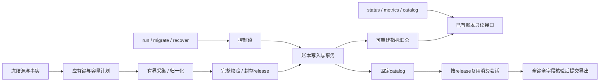

# rustdx 当前系统分析与下一轮优化方案

分析基线：`47045cd554de2f3237a7f2f2821146b47807c43b`，`main`；2026-10-25。核心库与CLI为2.0.0，runner为0.1.0；Rust 2024、MSRV 1.89、同步I/O和有界线程。本轮工作是审查与方案设计，没有修改生产代码或远程配置。

## 1. 总体判断

系统已经形成“协议核心库—采集CLI—单机版本发布控制层”的完整链路。响应身份、复权证券身份、绝对期限、缓存等待、结果预算、原始留证、业务覆盖、不可变release和目录CAS均有明确实现，上轮17项优化的工程成果应继续保留。当前最需要投入的是**跨环境检查稳定性、管理操作的边界、恢复后可运维性，以及长期运行时的读写成本**。

本轮发现的四组新工程问题已有直接证据：远端CI的期限测试失败；备份目录别名绕过隔离判断且完成清单不计入总预算；状态查询初始化账本；留存预览不能识别恢复账本中的原运行路径。另有数据库消费、指标聚合、目录扫描和采集预留方面的源码级扩展成本，需要测量后优化。数据状态检查仍拒绝当前默认事实覆盖，不能把工程完成解释为生产全量可用。

审查覆盖关键调用链、现有测试/配置/交付证据和远端CI，并非逐行人工审计全部源码。代码位置、命令、结果及来源摘要保存在[本轮证据](../../testing/evidence/system-review-20261025/summary.json)。上轮结果见[17项执行记录](../../development/OPTIMIZATION_PROGRESS.md)和[最终检查](../development/OPTIMIZATION_FINAL_20261025.md)；两轮结论按各自时间和范围解释。

## 2. 系统规模与当前验证状态

### 2.1 工程组成

| 组成 | Rust源文件 | 行数，含注释和内联测试 | 当前职责 |
| --- | ---: | ---: | --- |
| 核心库 | 98 | 29,864 | 协议、网络治理、行情语义、文件、日历/规则、指标与缓存 |
| CLI | 24 | 7,830 | 文件/TCP采集、来源清单、CSV、兼容数据库导入 |
| runner | 14 | 5,115 | 单机锁、SQLite账本、事实覆盖、发布、消费、恢复 |
| 合计 | 136 | 42,809 | 不包含外部测试、示例和冻结源码快照 |

Git跟踪25,758个文件，其中证据24,719个、724,341,038字节；其他文件16,209,637字节。证据占跟踪文件逻辑字节约97.8%，当前Git压缩包约116.27MiB。这是仓库分发和检查成本问题，不代表生产运行内存。来源：[源码与仓库清单](../../testing/evidence/system-review-20261025/repository-inventory.json)。

### 2.2 本轮取得的验证

| 检查 | 实际结果 | 解释 |
| --- | --- | --- |
| Rust1.89，locked/offline构建CLI和runner | 通过 | 当前源码重新构建，产物在仓库外 |
| runner库测试 | 7通过 | 数据库容量、回读、子进程与错误分类 |
| Python回归 | 10通过 | 字段/事实、留存和性能比较 |
| 管理操作边界探针 | 发现下述问题 | 只操作新建私有目录和历史账本副本 |
| 默认数据覆盖检查 | 退出1 | 规则核实期限、日历维护和证券状态缺口 |
| 与上轮最终源码清单比较 | 191文件相同，只有`.gitignore`改变 | 两份Finder元数据排除；上轮全工程结果仍按原范围引用 |

本轮没有再次执行完整workspace测试、Clippy、实盘采样或目标数据库验收。上轮522项工作区测试、57项文档测试等结果是历史已执行证据，不能当作本轮重新执行。没有生产Rust修改，因此不为报告编辑重复运行所有门禁。来源：[检查记录](../../testing/evidence/system-review-20261025/checks.json)、[源码身份](../../testing/evidence/system-review-20261025/source-identity.json)。

### 2.3 远端CI已经出现的新事实

针对上述提交，GitHub Actions已启动[运行40137692144](https://github.com/jelven007/rustdx/actions/runs/40137692144)。北京时间2026-10-25 06:21:24的查询结果为：

| 任务 | 查询时状态 |
| --- | --- |
| macOS Build / Test / Clippy | Test失败，后续Clippy/格式检查跳过 |
| Ubuntu / Windows矩阵 | 已取消；Windows注解明确由macOS失败触发 |
| Behavior / Consumers / Packages | 成功 |
| Same-host indicator regression | 成功 |
| fuzz | 成功 |
| MSRV | 仍在运行，不能推定最终结果 |

macOS日志显示197项核心测试通过，`operation::tests::absolute_deadline_and_worker_cancellation`失败：`operation.rs:174`的40ms等待返回`TimedOut`，而测试总预算仅60ms。此证据支持“短墙钟预算的测试依赖调度及时性”，尚不支持“生产取消机制失效”。原记录：[CI状态](../../testing/evidence/system-review-20261025/ci-final-summary.json)、[失败日志](../../testing/evidence/system-review-20261025/ci-121002606726.log)、[取消注解](../../testing/evidence/system-review-20261025/ci-121002606786.json)。

## 3. 优先级清单

P1表示发布稳定性、运行边界或业务使用前应解决的问题；P2表示长期规模、效率和可维护性改进。工作量S/M/L是相对工程判断，不是交付工期承诺。编号A01–A12用于本轮，原F01–F17不重新编号。

| 编号 | 优先级 | 优化项 | 证据性质 | 工作量 |
| --- | --- | --- | --- | --- |
| A01 | P1 | 稳定期限测试，补齐独立CI结果 | 远端失败日志确认 | S |
| A02 | P1 | 备份/恢复路径隔离和完整字节预算 | 本机已复现 | M |
| A03 | P1 | 查询账本与创建/迁移账本分离 | 本机已复现，写入口确认 | M |
| A04 | P1 | 恢复后的留存路径解析与凭据检查 | 路径已复现；proof遗漏为源码确认 | M |
| A05 | P1 | 规则核实、年度日历与证券事实维护 | 当前命令明确拒绝覆盖 | L，依赖外部事实 |
| A06 | P2 | 按release复用数据库消费会话与校验 | 调用链确认，规模耗时未测 | M |
| A07 | P2 | 指标增量汇总及账本查询索引 | SQL/定时器确认，长期规模未测 | M |
| A08 | P2 | 减少归一化过程的全目录扫描 | 源码确认，性能收益未测 | M |
| A09 | P2 | 采集前容量规划与预留利用率 | 当前示例预算推导可核对 | M |
| A10 | P2 | 源码与大型证据分发、审核分层 | Git文件/字节实测 | L |
| A11 | P1 | 正式交付门禁与数据库CI触发闭环 | 工作流配置与当前运行确认 | M |
| A12 | 按业务上线范围 | 分钟/订阅等新任务及目标生产验收 | 已知范围与外部验收缺口 | L |

## 4. 正确性与运行边界

### A01：期限测试使用可同步的状态，不依赖20ms调度余量

当前测试将“等待后的剩余预算”和“跨线程取消”放在同一个60ms上下文中，先等待40ms，再创建线程。共享runner的调度延迟即可耗尽剩余时间；实际失败发生在创建取消线程之前。矩阵采用默认fail-fast，导致一次失败损失其他平台的验证结果。来源：[期限测试](../../../crates/rustdx-core/src/operation.rs#L169-L188)、[CI配置](../../../.github/workflows/ci.yml#L15-L61)及上述远端日志。

建议把期限、父子约束、取消分别验证：用Barrier/通道确认工作线程已经进入等待，再发取消；取消用例使用充分独立的总期限；期限数学由可注入时钟或确定性状态判断测试，保留少量真实时间集成测试。不能简单删断言、吞错误或靠自动重试掩盖失败。矩阵设置`fail-fast: false`，格式/Clippy/严格文档作为独立任务运行，并设置任务超时；检查Action运行时升级告警，升级后固定经验证版本。

验收：同一提交取得各平台独立结论；取消不等到资源归还、父期限不被延长等原行为仍受测试保护。FR-04、FR-10。

### A02：备份目的地先解析实际路径，预算覆盖完整交付物

`backup`和`restore`通过`Path::starts_with`比较用户输入路径，未先解析已有父目录。隔离探针把一个外部路径设置为运行根目录的符号链接，传入`alias/nested-backup`后命令退出0，实际备份位于运行根目录内部，违反函数声明的隔离合同。它不是对任意同UID恶意修改的完整攻击测试。来源：[backup/restore](../../../apps/rustdx-runner/src/ops.rs#L58-L174)、[边界结果](../../testing/evidence/system-review-20261025/admin-probes.json)。

另一个探针将预算设为当前空账本的94,208字节，备份仍成功写出94,451字节；多出的243字节是`backup.json`。SQLite备份本身也是复制结束后才核对大小。来源：[预算结果](../../testing/evidence/system-review-20261025/backup-budget-probe.json)。

建议先规范化源根和目的地的已有父目录，拒绝实际落入源根的目标；在创建前检查目的地不存在，保持原有“不覆盖”语义。对要求更强的部署隔离，再使用目录句柄和禁止跟随链接的文件操作。预算需覆盖SQLite、源文件、库存和完成标记，并在SQLite分步复制期间检查已分配大小；失败产物不得出现完成标记。文件系统硬配额仍承担硬上限。

验收：直接子目录、父目录别名、`..`及恢复路径均被正确判断；等于/小于/大于预算边界有明确结果，成功输出总字节不超限。FR-18、NFR-02。

### A03：只读管理命令不能隐式初始化和迁移

`status/metrics/catalog/PinnedDataset::open`均调用`Ledger::open`。该函数具有创建数据库、设置WAL以及执行schema迁移的行为；迁移不由这些调用方的控制锁保护。对一个已存在的空目录执行`status`，实际返回`[]`并创建schema3账本。操作人员输错一个存在的目录时，可能得到“空系统”的成功响应。来源：[账本打开](../../../apps/rustdx-runner/src/ledger.rs#L31-L103)、[命令分派](../../../apps/rustdx-runner/src/main.rs#L174-L237)、[探针](../../testing/evidence/system-review-20261025/admin-probes.json)。

建议划分`open_existing_readonly`和`open_writer`：查询要求账本已存在，验证schema后读；创建/迁移在控制锁下显式执行。旧schema由明确迁移命令处理，提供版本提示。SQLite只读打开仍可能涉及WAL/shm，若要求对源目录完全零写入，应采用经过验证的快照读取模式，不能使用忽略已提交WAL的替代方式。

这也能统一留存工具的前提：目前它认为共享控制锁排除了账本写入，但管理查询可能走迁移/写入打开。验收必须覆盖新目录、旧schema、只读权限、并发迁移及已提交WAL可见性。FR-15、FR-18。

### A04：恢复后的路径和留存依赖要有统一模型

账本保存的是原Attempt绝对路径；恢复保留历史账本，`retention_preview.py`却直接用该路径对当前root执行`relative_to`。本轮把历史恢复账本按原字节复制到隔离目录后，预览立即因旧绝对路径不属于新root而失败，尚未进入文件完整性校验。这证明了路径解析缺口，不把该精简副本声称为完整恢复演练。来源：[预览代码](../../../scripts/ops/retention_preview.py#L153-L166)、[恢复实现](../../../apps/rustdx-runner/src/ops.rs#L124-L176)、[账本副本结果](../../testing/evidence/system-review-20261025/admin-probes.json)。

另外，实际数据库Receipt字段为`target/proof`，预览遍历的是`request/response/evidence`，也没有检查`targets.proof`。`target_io`通常仍保护整个数据库release目录，因此不能据此声称当前工具会误删证明文件；但它没有完成所宣称的全部凭据完整性核验。来源：[Receipt定义](../../../apps/rustdx-runner/src/database.rs#L62-L67)、[留存依赖遍历](../../../scripts/ops/retention_preview.py#L173-L198)。

建议新增“原始路径—当前逻辑对象路径”的解析层，恢复记录保留原路径和原摘要，新的运行定位使用`attempts/<id>`等受约束相对路径；旧冻结证据不重写。对Receipt的`proof`及其引用按版本解码、核对摘要。验收包括原root、恢复root、原路径已不存在、proof篡改、孤立候选和全部历史目录。工具继续只预览，删除策略另立合同。FR-13、FR-18。

### A05：把事实维护变成有负责人和失败升级的运营流程

本轮执行默认`data-status --warn-days 90 --strict`：日历覆盖截至2026-12-31、剩67天，状态due；规则核实截至2026-10-22，状态unverified、剩余−3天；证券历史状态missing，命令退出1。规则核实期限过了不等于交易所规则已经失效；默认缺证券数据也不证明部署方不存在自有外部数据。来源：[实际状态](../../testing/evidence/system-review-20261025/data-status.json)。

建议分别管理规则复核、年度休市日历、上市/退市、ST与停复牌、点时名单五类事实。每类保存原公告、发布/核实日期、适用区间、覆盖统计、责任人和下次复核时间；候选先独立逐日/逐证券核对，再切换版本。把缺口和变更送入现有运营处理流程，超时升级；不能仅延长截止日期。

验收由实际消费范围决定：先给明确范围提供完整事实，再扩大覆盖。2027官方资料和全市场历史资料仍需取得，不编造公告或推断未来休市日。FR-01、FR-02、FR-08、FR-15。

## 5. 长期运行与规模优化

### A06：数据库按release复用会话，消费审计与发布证明分开计量

数据库导出按日期循环调用`read_verified_partition`；每次重新读release manifest、验证receipts、扫描数据库证据目录、创建会话，结束时再扫描。每个日期还执行整个release的`count()`及分页末尾检查。多日读取同一release会重复这些固定工作。来源：[导出循环](../../../apps/rustdx-runner/src/consumer.rs#L282-L321)、[验证过程](../../../apps/rustdx-runner/src/database.rs#L400-L451)、[分区会话](../../../apps/rustdx-runner/src/database.rs#L754-L789)。

数据库消费还会追加`target_io`，与发布/恢复共用每release/target最多50,000次I/O的总上限；容量预留只承诺一次完整消费回读。重复读取会持续消耗此预算，文件导出不受这一网络I/O预算影响。来源：[I/O序号限制](../../../apps/rustdx-runner/src/database.rs#L139-L166)、[容量合同](../../../apps/rustdx-runner/src/database/capacity.rs#L6-L56)。

建议在一次固定catalog读取中按release复用会话、凭据检查和证据计量；覆盖多个日期时保留准确键范围及完整release计数校验。发布证明保持不可变，发布后的查询审计单独设会话ID、容量和留存合同，避免历史消费耗尽发布证据命名空间。同步把`PinnedDataset.catalog`改为只读访问，减少调用方修改已核验分区映射的机会。

验收比较相同固定版本、相同查询范围的全部键/字段/CSV摘要，覆盖额外键、重复键、跨批次和中断；记录数据库请求数、证据字节和墙钟时间，再判定收益。FR-16、FR-17。

### A07：持久指标采用增量汇总，账本查询补有依据的索引

`observation_metrics`每次导出都按`created,attempt`读取并解析全部历史观测JSON；表当前只有`(attempt,owner)`主键。`statuses`对最近1000个Job逐个统计Attempt，而活动Attempt的部分唯一索引不覆盖全部终态历史。随历史增长，定时指标读取和状态查询成本会增长；本轮未做多年数据压测。来源：[指标实现](../../../apps/rustdx-runner/src/ops.rs#L304-L397)、[账本表](../../../apps/rustdx-runner/src/ledger.rs#L31-L103)、[状态SQL](../../../apps/rustdx-runner/src/ledger.rs#L417-L434)。

建议保留原观测作为审计记录，在同一事务增量更新可重建汇总；metrics读取聚合结果，缺失观测继续单列。按`EXPLAIN QUERY PLAN`和真实查询频率选择`attempts(job)`、Job时间排序等索引，避免无差别加索引。无必要的历史排序可以消除。

验收要求旧观测重建与增量总数一致、取消/失败/unavailable不混淆、迁移可回退；在明确历史规模下给metrics设置耗时和RSS目标。FR-14、FR-18。

### A08：归一化仅计量变化部分，封存时完整复核

归一化每处理4096行就执行一次`tree_bytes(directory)`，它遍历整个工作区，包括不再变化的raw/facts/collector；监督器还每秒独立扫描。较多输入文件和较长历史会产生重复遍历。来源：[归一化检查](../../../apps/rustdx-runner/src/pipeline.rs#L449-L457)、[目录遍历](../../../apps/rustdx-runner/src/storage.rs#L210-L260)、[监督器](../../../apps/rustdx-runner/src/supervisor.rs#L169-L223)。

建议冻结输入后记录其固定字节，只增量跟踪SQLite/日志/分区等变化部分；为无法准确跟踪的临时文件保留低频重计。封存前继续对静止树完整扫描并核对摘要，硬配额仍有效。先测目录遍历次数和耗时占比，不预设吞吐提升百分比。

验收包括暂存文件消失、预算耗尽、SQLite journal/WAL增长、取消响应和最终计量一致；不能以减少扫描放松最终发布检查。FR-15、NFR-02。

### A09：采集计划先解释实际可用并发与预算余量

当前窗口并发由原行、正文、归档和wire预算共同限制。随仓库提交的TCP示例配置`max_parallel=2`，但单证券receipt按最大65,536原行预留32MiB；64MiB归档上限除以“32MiB+1024”最多只允许一个槽位，扣除事实文件后不会更高。这是当前配置和公式推导，不是实测吞吐或错误：`max_parallel`本来就是上限。来源：[窗口预算](../../../apps/rustdx-cli/src/tcp_day/acquisition.rs#L86-L139)、[示例配置](../../../config/runner/tcp-day.example.json)、[计算记录](../../testing/evidence/system-review-20261025/reservation-analysis.json)。

建议提供不联网的计划预检：列出应有键、实际可用并发、各类预算限制项、最小磁盘/报文数、最坏剩余时间和无法完成的原因。按日期范围和协议分页上限合理设单证券预算，同时继续把范围外行、重叠页、空页确认和失败留证计入。记录预留/实际使用比后，再评估可回收预留和更灵活的有界调度。

验收覆盖小范围、高原行历史、慢证券、缺键、故障和预算边缘；扩大到真实全市场前记录完整进程树RSS与磁盘，保留有界窗口和顺序输出。FR-04、FR-13、FR-15。

## 6. 工程交付与业务扩展

### A10：源码检查与大型证据分发分层

当前97.8%的跟踪文件逻辑字节是历史证据。预检`inventory/source_archive`读取并打包整个Git清单，前后再次核对；日常源码包审核因而承担大量历史材料I/O。`.gitattributes`把整个证据目录设为`-diff`，还包括其中的源码快照和新机器报告，普通代码评审难以看到文本变化。来源：[Git属性](../../../.gitattributes)、[预检实现](../../../scripts/release/preflight.py#L32-L86)、[仓库统计](../../testing/evidence/system-review-20261025/repository-inventory.json)。

建议设计三层分发：代码/小夹具随Git；摘要、来源索引和有限机器报告随Git且可审阅；大型原始资料进入有校验、版本、保留承诺的对象/制品存储。工程预检只归档固定工程范围，证据完整性审核单独执行；所需小样本保持离线可用。现有历史字节和提交保留，新迁移记录说明去向与摘要；不未经授权清理Git历史或本地原件。

验收从干净检出运行离线回归、实际包消费和证据获取/摘要验证；缺少大型材料时明确报告验证范围。已有12份超限collector本地保留限制须继续在交付中可见。FR-10、FR-11、FR-13。

### A11：正式交付绑定完整门禁，避免主分支推送绕过数据库验收

数据库工作流只监听匹配路径的PR及手工触发；本次直接push到main触发了CI，没有同SHA数据库验收运行。其现有历史数据库结果仍有价值，但不能替代新提交的远端结果。主CI当前也没有独立严格Rust文档构建。来源：[数据库工作流](../../../.github/workflows/database-acceptance.yml#L1-L17)、[CI工作流](../../../.github/workflows/ci.yml)、[本次运行列表](../../testing/evidence/system-review-20261025/actions-runs.json)。

建议日常通过PR及必需检查进入主分支；如继续允许直推，则在发布流程显式要求当前SHA的数据库验收、MSRV、平台测试、Clippy、格式、严格文档和实际包消费结果。下载的Mongo工具应核对已批准摘要，而不只在下载后记录SHA；工具、Action和数据库镜像版本在交付清单中统一登记。

核心2.0→注册表可见→CLI注册表依赖验证→CLI发布，形成独立发布阶段；本地patch解包通过继续作为本地结论，不能冒充注册表消费。执行中先修A01，避免把未经完整检查的提交标为可交付。FR-06、FR-10、FR-11、FR-17。

### A12：新任务类型与目标生产验收按消费合同推进

核心26个同码接口不等于runner已有26种持续数据任务。当前发布合同仍是已结束沪深A股原价日线；0feb通用日期/量资格、0547真实盘中主动推送、其他财务字段和更新版本仍有限定。目标主机资源、权限隔离、持续负载及业务批准的恢复目标也未在本轮取得。来源：[当前验收矩阵](../../testing/PRODUCTION_ACCEPTANCE.md)、[应用合同](../../development/APPLICATION_INTEGRATION.md)、[部署模板](../../../deploy/runner/rustdx-runner.service)。

建议先用现有日线合同完成明确生产范围；需要分钟/快照/订阅时，各自定义应有键、时间标签、最终性、来源修订、断流/溢出状态和版本发布规则。保留原始字段与qualification，新增准入工具读取证据矩阵，Unknown不能被默认数值替代。0feb独立参照绑定只证明特定结果的日期控制，不自动证明量/均价或任意证券。

部署验收固定生产同等配置，测量进程树RSS、FD、线程、磁盘、阶段延迟和业务覆盖；演练停止/重启、确认丢失、固定旧版本读取及恢复。现有单机SQLite、同步I/O、有界线程继续适用；跨主机调度与高可用在业务明确要求后另定租约、写入隔离和切换合同。FR-03、FR-04、FR-15至FR-18。

## 7. 实施顺序与验收里程碑

| 阶段 | 顺序和依赖 | 交付结果 | 结束条件 |
| --- | --- | --- | --- |
| 第一阶段：稳定与恢复 | A01、A02、A03；随后A04。A05同步启动事实维护，A11补触发闭环 | 确定性测试、路径/预算修复、读写分离、恢复路径映射、同SHA门禁 | 各平台结果完整；边界回归通过；恢复root可预览；事实缺口保持明确 |
| 第二阶段：长期运行成本 | A06、A07、A08；A09先出计划预检再调度优化 | 会话复用、查询审计预算、指标汇总、增量容量计量 | 固定数据全部字段/CSV不变，性能结论有同环境测量 |
| 第三阶段：分发与生产范围 | A10、A11正式发布部分、A12；依赖第一阶段和实际业务范围 | 工程/证据分层、发布清单、目标生产验收 | 干净检出可复核；注册表/部署按实际动作验收；新任务不继承旧资格 |

建议的控制层边界如下，属于实施目标，尚未修改源码：

第一阶段的收益是减少误操作和不完整验证，第二阶段的收益由测量判定，第三阶段解决分发和业务生产范围。优先级不因“接口数量已齐”而降低，也不以重写并发模型作为前提。

## 8. 复核入口和范围限制

本轮证据包括：[源码身份](../../testing/evidence/system-review-20261025/source-identity.json)、[本机检查](../../testing/evidence/system-review-20261025/checks.json)、[管理边界](../../testing/evidence/system-review-20261025/admin-probes.json)、[备份预算](../../testing/evidence/system-review-20261025/backup-budget-probe.json)、[数据状态](../../testing/evidence/system-review-20261025/data-status.json)、[远端状态](../../testing/evidence/system-review-20261025/ci-final-summary.json)和[文件摘要清单](../../testing/evidence/system-review-20261025/inventory.json)。

源码层面的重复读取、全表扫描和并发预留推导不等于生产负载测量；报告没有承诺固定性能提升。隔离目录探针不使用真实行情作为构造数据。远端状态按记录时点解释，运行中的MSRV需要后续查询。没有修改历史冻结字节、创建新生产数据版本、部署或自动执行本方案。
