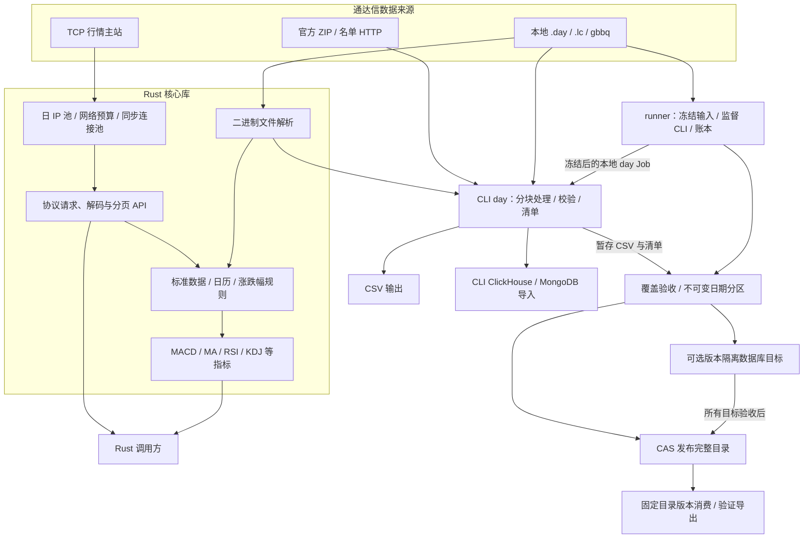

# rustdx 技术架构与优化建议

评审日期：2026-10-24。依据当前工作区源码及仓库内已有验证材料。

**当前项目是以通达信为主要数据来源的 Rust 核心库、日线 CLI 和单机发布控制层。** 核心库提供 TCP 行情查询、文件解析和指标计算；CLI 完成日线采集、校验、导出和入库；runner 在本地 `.day` 采集之上提供覆盖检查、版本发布、固定版本消费和恢复。当前 runner 尚未接入 TCP 采集 Job，MACD 已有库函数，但没有 CLI/runner 自动输出入口。

本次建议按“数据正确性 → 采集与发布闭环 → 性能 → 运维与发布”推进。具体建议见第 7 节；本次仅产出评审文档，没有实施这些优化。

## 1. 评审基线

HEAD 为 `408e30eb172704070e384fb35fb0e56549a1fbc5`。工作区存在大量既有未提交改动，本报告以**实际文件内容**为准，不能只用该提交或已发布包复现。随附[评审证据 JSON](../../testing/evidence/architecture-review-20261024.json)记录 25 组、56 个源码/文档文件的 SHA-256、版本基线及既有证据边界。后续源码变化时，应重新核对相关结论。

| 组件 | 包名 / 入口 | 当前版本 | 职责 |
| --- | --- | --- | --- |
| 核心库 | `jelven-rustdx-complete` / `rustdx_complete` | 1.12.2 | 通达信 TCP、文件解析、数据适配、交易日历、规则、指标、资源治理 |
| CLI | `jelven-rustdx-cli` / `rustdx` | 1.8.2 | `day`、`data-check`、`data-status`、`show`，日线采集及导入证据 |
| runner | `rustdx-runner` | 0.1.0，`publish=false` | 严格 Job、进程监督、SQLite 账本、完整覆盖、版本发布和恢复 |
| 集成测试 | `tests-integration` | 1.1.0，`publish=false` | 跨模块和真实接口相关验证 |

工作区共有四个成员，前三个业务包使用 Rust 2024、MSRV 1.89。当前采用同步 I/O 和有界线程并发，没有 Tokio 运行时。源码中的后续能力尚未随核心库/CLI 版本发布，使用当前实现需要从源码构建。[S01](#s01)、[S25](#s25)

## 2. 总体架构

图中的箭头表示调用或数据关系。`RELEASE → CATALOG` 是不配置数据库目标的文件发布路径；配置数据库目标时，所有目标验收通过后才提交目录。TCP 查询结果目前供库调用方使用，尚无 `TCP → runner Job` 的实现。TCP 原始帧归档与离线重放已有基础能力，但不等同于生产采集已接入。[S02](#s02)、[S09](#s09)、[S13](#s13)、[S14](#s14)、[S22](#s22)

### 2.1 核心库：查询、解析和计算

`src/lib.rs` 导出 `tcp`、`file`、`data`、`calendar`、`limit`、`indicators`、`operation`、`cache`、`pool` 等模块。TCP 侧提供快照、股票/指数 K 线、历史范围、批量查询、分时、逐笔成交、财务、除权除息、证券列表、F10、板块等能力；文件侧解析日线、分钟线及相关文件。指标计算在本地执行，不是向通达信查询 MACD。[S02](#s02)、[S08](#s08)、[S20](#s20)

网络层负责完整帧读取、受限解压、连接池、重试、截止时间、取消，以及进程内/同机共享许可。部分请求已有不可变、参数检查的请求对象和独立解码器；旧对象仍保留公开可变字段及兼容解析入口，接口严谨程度尚未完全统一。[S03](#s03)、[S05](#s05)

日 IP 池已经在当前工作区实现：北京时间每日 09:00 刷新，启动、错过刷新或日期变化时补刷；节点须通过三轮独立的连接、握手和 `0x044e` 探活。每次 `probe_all` 最多八个线程，各阶段预算为三秒。探测预算独立于业务连接许可，避免长期业务连接占满许可后阻塞刷新。[S04](#s04)

IP 排序使用连接、握手和探活总耗时的中位数，并非纯 RTT，也不证明节点支持资金流、竞价或推送命令。业务新建、重连和池化连接检查当前有效节点，不回退到过期节点；空池返回错误。快照可序列化，但当前状态保存在内存中，多个独立池/进程的探测总并发也尚未统一约束。[S04](#s04)

### 2.2 CLI：历史日线采集和导入

`day` 接受本地目录、本地 ZIP、URL，或默认官方 `hsjday.zip`，支持名单/代码过滤及可选复权相关输入。管道使用 4096 行分块、有界工作通道和确定性输出顺序；异常证券排序使用磁盘归并，跨块保留质量及因子状态。CSV 采用原子发布与精确回读。[S09](#s09)、[S10](#s10)

CLI 在工作前持有输出/目标锁，下载缓存锁覆盖后续解析与导出。清单当前为 schema 7，记录来源和输出摘要、阶段、资源、日期窗口、质量状态、数据库确认等信息；外部动作前落盘检查点。JSON 用于清单和质量报告，行情输出目标为 CSV、ClickHouse 或 MongoDB。[S09](#s09)、[S11](#s11)

ClickHouse 导入使用 `ReplacingMergeTree(version)`，逻辑键为日期和代码；MongoDB 使用对应唯一索引和 upsert。两者都执行精确回读。**CLI 的 MongoDB 回读已经采用每次导入一个持久 `mongosh` 进程**，不能把这项现有优化重复列为全项目缺失能力。[S10](#s10)、[S12](#s12)

### 2.3 runner：任务控制和可信发布

runner 的当前输入是显式本地 `.day` 目录，Job 契约为 `a-share/day/raw/cny/shares/v1`。它冻结证券全集、日历、规则/证券状态依据、原始文件及 CLI 二进制；缺少必要证券状态时在启动 worker 前拒绝任务。冻结后的 CLI 在清理环境的子进程中执行，数据库凭据由父进程发布器持有。[S13](#s13)、[S14](#s14)

CLI 成功清单须为 schema 6 或 7，输出、来源、行数和摘要符合冻结输入，并且没有由 worker 执行数据库导入。runner 再转换为 A 股原始日线、人民币元和股的固定契约，以 SQLite 应有键集合检查覆盖，生成不可变日期分区。[S14](#s14)

账本采用 SQLite WAL、`synchronous=FULL`，账本 schema 2。Job、Attempt、Release、外部 I/O 意图及事件持久记录；发布完整目录使用 CAS 更新，消费者固定目录版本读取。发布控制依赖本机 Unix 锁和本地账本，尚不是跨机器高可用调度系统。[S15](#s15)、[S17](#s17)

## 3. 两条运行链路

### 3.1 TCP 查询链路

调用方提交市场、代码、周期和范围 → 获取当日有效节点及连接许可 → checked/兼容请求 → 完整帧与解码 → 分页、排序、去重和范围过滤 → 调用方显式选择单位/价格口径 → 可选本地指标计算。[S02](#s02)、[S05](#s05)、[S06](#s06)、[S07](#s07)

当前历史 K 线分页单页 800 条、最多 82 页，并检测重复/无进展。短页触发结束的语义仍需按命令与主站验证。TCP 批量查询限制工作线程和连接数，但把全部证券的结果向量保存到批次结束才返回。[S06](#s06)

### 3.2 runner 发布链路

runner 的数据库目标与 CLI 直接导入采用不同契约：

| 项目 | CLI 直接导入 | runner 版本发布 |
| --- | --- | --- |
| ClickHouse | `ReplacingMergeTree(version)`，回读使用 `FINAL` | 完整版本键 `MergeTree`，禁止 TTL，insert-only |
| MongoDB | 日期/代码唯一键，upsert | 完整版本键唯一索引，insert-only |
| 数据身份 | 日线逻辑键 | dataset、release、contract、date、market、code、instrument_class |
| 完成依据 | 导入确认与精确回读清单 | 所有目标验收、回执与目录 CAS 提交 |
| 写入确认丢失 | 依清单和恢复规则判定 | 不盲目重发未知写入；保留证据并隔离/新修订处理 |

runner 每批写入 512 行。请求文件和 `target_io` 意图先持久化，再发送到数据库；数据库成功回读后才允许更新目录。这个顺序能避免“崩溃后无记录地重复写”，但不会使多个数据库形成原子事务。某个目标写成功、另一个失败时，未发布的 release 数据可以已经存在，消费者通过已提交目录选择版本。[S10](#s10)、[S15](#s15)、[S16](#s16)

恢复可继续已封存数据的验收，不自动重启确认不明的写入。备份覆盖 SQLite 在线备份、文件和证据归档，隔离恢复不连接数据库或自动切换目录；数据库服务端灾难恢复仍需单独验证。[S17](#s17)、[S22](#s22)

## 4. 数据、指标与资源边界

### 4.1 标准化已经存在，来源语义仍有缺口

`CanonicalBar` 已包含标准 Bar、周期、来源及价格口径；`ReturnIndex` 与 `PriceMultiplier` 是不同类型，避免收益指数与价格乘数互换。TCP 转换要求显式输入 `VolumeUnit`，这一设计应保留。[S07](#s07)

但 `CanonicalBar` 不保存原始 category、原始单位及单位依据，`4/9` 都映射为日线，`7/8` 都映射为一分钟。当前真实样本已证明同为日线的 category 4 和 9 可以有不同成交量单位，所以“相同标准周期”不足以重建采集语义。[S07](#s07)、[S19](#s19)

10 月 24 日已有单主站、四个证券的局部验证：已测股票/ETF `9/1` 日线量为手，`4/1` 日线及 `0/1` 五分钟量为股/份；144 条日线的 OHLC 和金额与官方 `.day` 精确一致。该结论限于已测请求与品种，指数分钟量、其他周期/市场/主站仍待验证。不能全局把 TCP 成交量统一除以或乘以 100。[S19](#s19)

其他待补语义包括部分快照价格精度、财务字段与 EPS 的解释冲突，以及历史分时日期、文件路径长度和文件分块参数的严格拒绝。它们应按固定协议证据逐项修复，未知字段保留原值及未知标记。[S20](#s20)

### 4.2 MACD 的现有能力

| 项目 | 当前实现 |
| --- | --- |
| 调用入口 | `rustdx_complete::indicators::macd(closes, 12, 26, 9)` |
| `macd` 字段 | DIF，即快 EMA 减慢 EMA |
| `signal` 字段 | DEA，即 DIF 的 EMA |
| `histogram` 字段 | `DIF - DEA`，没有乘 2 |
| 初始化/缺口 | 每段首个有限值作为 EMA 初值；非有限输入返回缺口并重置状态 |
| 系统输出 | 库调用方可计算；CLI/runner 不自动生成指标列或指标数据集 |

与通达信界面逐值比较时，需统一柱状图倍数、历史起点、EMA 初始化、复权口径和缺口规则。当前库计算成功不等于已验证与某个终端显示完全一致。[S08](#s08)

### 4.3 有界并发与有界总内存的区别

| 路径 | 已有资源控制 | 当前增长点 |
| --- | --- | --- |
| CLI `.day` | 4096 行分块、有界通道、磁盘归并、确定性输出 | 文件列表及逐文件报告仍随文件数增长 |
| TCP 查询 | 截止时间、取消、连接许可、受限帧和解压 | 批量结果保存全部证券/历史行，总内存随总返回量增长 |
| 日 IP 池 | 每次最多 8 个探测线程，独立探测预算 | 多实例/多进程总探测并发、启动预热及命令能力 |
| runner 数据库 | 512 行批次、8 MiB 响应上限、意图留证、预算 | 每次 MongoDB 操作启动进程，OFFSET/skip 分页，每次请求重扫证据目录 |
| runner 发布 | 账本、锁、封存、全键/全字段验收 | 单机协调与完整验收成本，没有跨机 HA |

CLI MongoDB 持久回读已经优化；runner 的 `Session::exchange` 仍每次重新加载 Job、扫描数据库证据目录，并为 MongoDB 启动新的 `mongosh`。runner 回读使用 ClickHouse `OFFSET` 和 MongoDB `.skip()`。这些是源码确认的增长点，实际耗时占比及可获得收益需通过基准测量。[S04](#s04)、[S06](#s06)、[S10](#s10)、[S12](#s12)、[S16](#s16)

## 5. 当前设计的优势

1. **职责清楚。** 通用协议和指标在库中，批量文件处理在 CLI 中，发布和恢复在 runner 中，便于分别验证与复用。
2. **发布有可追溯依据。** 冻结输入、摘要、覆盖检查、全字段回读和固定版本消费，形成从来源到消费者的证据链。
3. **历史文件路径已有内存控制。** 分块与磁盘归并已实现，优化应集中到剩余增长点。
4. **失败不会轻易伪装成成功。** 外部写入前留意图、确认不明不盲目重试、所有目标验证后发布，明确区分数据已写入与数据集已发布。
5. **同步架构适合当前单机批任务。** 有界线程、连接池和进程监督与现有需求一致，后续可以沿模块边界扩展。[S02](#s02)、[S03](#s03)、[S10](#s10)、[S14](#s14)、[S15](#s15)、[S16](#s16)

## 6. 已有验证与适用范围

| 证据 | 已证明的范围 | 不能据此推出 |
| --- | --- | --- |
| 真实历史 CLI 验证 | 官方 ZIP 子集 128 文件、779,200 行，独立逐行解析及两库全键/数值回读 | 当前 runner 已完成同规模全市场生产验收 |
| runner 组件验证 | 本机实际 CLI、两库，600 只模拟证券/1,200 行及故障恢复 | 真实全市场证券状态、目标 Linux 环境、长期吞吐 SLO |
| K 线单位验证 | 一个主站、四个证券、选定 category/参数及帧格式 | 全周期、全品种、全主站的统一单位规则 |
| 当前回归材料 | 当前源码的离线工程检查、模拟接口及实际文件验证 | 新的完整 ZIP 或生产数据库验收 |
| CI 配置 | Linux/macOS 工作区检查，Windows 排除 runner；已有 CLI 数据库流程 | 目标平台流程已运行成功或已覆盖 runner 数据库发布 |

本次没有重新运行 Cargo 测试、真实 TCP 探针、数据库验收或性能基准；没有修改 Rust 源码。上表引用既有结果，详细范围以原证据为准。[S18](#s18)、[S19](#s19)、[S22](#s22)、[S23](#s23)、[S25](#s25)

内置日历覆盖 2024–2026，规则核实截至 2026-10-22。2027 日历、全目标证券生命周期事实、长期 P95、生产权限配置和数据库服务端恢复仍待补齐。现有数据库 acceptance workflow 未将 `rustdx-runner/**` 加入触发路径，执行内容主要是 CLI 验收。[S18](#s18)、[S23](#s23)、[S24](#s24)

## 7. 优化建议

P0 表示应在扩大全市场/生产使用前补齐；P1 表示直接改善能力闭环或规模效率；P2 表示依据后续测量推进。成本为相对评估，不代表确定工期。

| 编号 | 优先级 | 建议 | 主要收益 | 相对成本 |
| --- | --- | --- | --- | --- |
| O01 | P0 | 完整保留数据来源语义，收紧旧协议参数/分页边界 | 防止单位、精度、范围和字段误解释 | 中 |
| O02 | P0 | 补齐日历/证券事实与目标平台验收 | 避免错误覆盖和未经验证的生产发布 | 中至高 |
| O03 | P1 | 增加 TCP 采集适配器、CLI K 线入口和 runner Job | 将已有行情 API 接入持续采集与发布 | 高 |
| O04 | P1 | 提供 TCP 批量流式接口和行/字节预算 | 控制大批次/长历史峰值内存 | 中 |
| O05 | P1 | 增加版本化 MACD 派生数据集与可选输出 | 从“库能算”扩展到“系统可直接消费” | 中 |
| O06 | P1 | 优化 runner 回读分页、MongoDB 会话及证据计量 | 降低长历史验收和进程/目录开销 | 中至高 |
| O07 | P1 | 增加 IP 就绪状态、命令能力及总探测协调 | 稳定启动与特殊命令路由 | 中 |
| O08 | P1 | 沿用 runner 凭据隔离，强化生产进程权限 | 减少 CLI 凭据暴露，明确 worker 边界 | 中 |
| O09 | P2 | 统一观测口径、按需复用契约并固定源码发布 | 减少诊断和版本漂移成本 | 低至中 |

### O01：优先保证采集语义可重建

在现有标准行情外附采集元数据：原始 command/category/参数、市场与证券类型、原始单位和核实依据、主站、采集时间、数据所属交易日、价格精度与价格口径。可以先在清单中附加，避免立即破坏公共结构体；新增契约版本时再决定是否纳入标准行。

将仍走旧对象的日期、路径和分块参数逐项改为明确拒绝；验证响应身份与分页结束条件；财务冲突字段保留原值，待证据确定后再映射。已有单位转换和全字段验收继续保留。

**验收：** 固定原始帧/文件，独立解析核对字段；覆盖同周期不同 category、股票/ETF/指数、缺页/重复页/异常日期及精度样本；未知单位不能被静默当成股。成本中，前提是固定证据；契约迁移须同步消费者。[S05](#s05)、[S06](#s06)、[S07](#s07)、[S19](#s19)、[S20](#s20)

### O02：补事实和目标环境证据

补齐 2027 交易日历和目标证券生命周期事实，为规则和公告依据增加有效期及过期处理；未知状态保持阻断。将 runner 路径纳入数据库 CI 触发，并增加版本隔离、目录 CAS、确认丢失、断连、进程强杀和隔离恢复的目标 Linux 验收。

**验收：** 固定生产配置/数据库版本，验证首次、重复、并发冲突和失败恢复；缺失日历/状态不能通过覆盖验收；运行结果留存，且区分模拟证券与真实历史。成本中至高，依赖外部事实及目标服务。[S18](#s18)、[S22](#s22)、[S23](#s23)、[S24](#s24)

### O03：把 TCP API 接入发布链路

新增按证券、周期和日期窗口采集的 source adapter、CLI K 线入口及 runner TCP Job，复用“冻结任务 → 原始留证 → 标准化 → 质量/覆盖 → 封存 → 发布”。分钟数据必须定义未闭合 K 线、交易日、午间休市、停牌、补数及重复请求的处理。

已有[九命令接入计划](../development/NINE_COMMANDS_IMPLEMENTATION_20261024.md)包含 `0452/051b/0547/054b/054c/056a/0fd1/0feb/0ffc` 的库级接入设计，当前尚未实施。它与生产 TCP Job 是不同工作层次，应按实际采集需求排顺序。

**验收：** 先在少量股票上完成日线/五分钟端到端采集、归档、独立核对、覆盖、重复补采和故障恢复，再扩大范围。成本高，依赖 O01、O02 及命令能力核实。[S09](#s09)、[S13](#s13)、[S14](#s14)、[S21](#s21)

### O04：给 TCP 批量结果施加背压

保留现有返回 `Vec` 的兼容接口，增加回调、迭代器或有界通道接口，允许边查询边写入；明确 `max_rows`、`max_bytes`、排队预算及每证券错误。结果排序可使用受限缓冲或磁盘合并，避免为确定性而重新缓存全部历史。

**验收：** 在证券数/历史长度增长时测量峰值 RSS，慢消费者能阻止上游继续积压；队列、取消、超时、单证券失败与确定性输出符合契约。成本中；背压等待必须计入任务截止时间。[S06](#s06)、[S10](#s10)

### O05：把 MACD 做成可消费的派生数据

新增可选指标输出或独立数据集，记录来源 release、证券/周期、复权版本、12/26/9 参数、EMA 初值、历史起点、预热和缺口规则。DIF、DEA 和 histogram 的字段含义显式声明；如需要通达信常见柱状图显示倍数，提供明确的 `2 × (DIF - DEA)` 选项，保留当前库默认约定。

增量计算需保存状态或重新读取足够历史；不能在每个 4096 行块开始时重置 EMA。复权历史变化须触发受影响派生数据重算，原始行情契约继续独立版本化。

**验收：** 批量与增量逐值一致；跨块、缺口、预热、复权变化和历史修订有固定样本；与目标通达信终端对照时记录其具体参数和初始化方式。成本中，先可交付 CLI 可选输出，随后接入 runner 派生发布。[S07](#s07)、[S08](#s08)、[S10](#s10)、[S13](#s13)

### O06：优化 runner 数据库热路径

优先把 OFFSET/skip 改为稳定全排序键的 keyset 分页或受控游标；验证所选索引与排序关系，避免深分页反复跳过历史行。MongoDB 可采用受控持久 `mongosh` 会话或同步驱动，需保留进程终止、超时及结果大小控制。CLI 的持久回读已有实现，可借鉴其管道治理。

证据预算改用持久增量计量，在启动/恢复时对账；正常请求不必每次遍历整个证据目录。Job 配置可使用已冻结并验证的内存对象。所有改动仍须保持“持久意图先于发送”、完整响应证据、全字段/数量/多余行检查及未知写入处理。

**验收：** 测量不同历史规模的查询次数、吞吐、P95、RSS、进程启动数和证据字节；故障场景前后发布语义一致。成本中至高；提速幅度当前未测，不能提前承诺倍数。[S12](#s12)、[S16](#s16)、[S17](#s17)

### O07：让 IP 池具备明确就绪与能力状态

增加可观测的预热/刷新/空池状态，让任务提前启动探测或等待明确的就绪结果，区分预热耗时和单次连接超时。节点能力按行情、竞价、资金流或推送配置与验证；普通 `044e` 探活不能替代特殊命令验证。

多个池/进程可增加统一探测上限与去重，但保留独立于业务连接的预留配额，避免把刷新重新放进已占满的业务许可。能力池目前属于计划，须以实际探测证据建立。

**验收：** 多实例、跨 09:00、空池、失效节点和业务连接占满时行为确定；观测包含快照新鲜度、各阶段耗时和命令能力依据。成本中。[S03](#s03)、[S04](#s04)、[S21](#s21)

### O08：统一生产凭据与进程隔离

当前 CLI 的 MongoDB URI 会传入部分外部命令参数；runner 则使用环境注入凭据、归档无凭据请求，并由父进程负责数据库发布。生产入口应逐步统一为受控凭据注入，避免带认证信息的 URI 出现在 argv 和日志。

runner 的 `env_clear` 和进程组主要提供执行控制；同 UID 的 worker 不是恶意进程隔离边界。目标部署可使用独立用户、文件权限或服务沙箱，把 worker 对账本、证据和发布凭据的访问权限缩小到实际需要。

**验收：** 进程列表/归档/日志不含认证 URI；worker 可完成采集且无法修改发布账本或取得发布凭据；在目标 Linux 权限模型下验证。成本中，取决于部署方式。[S10](#s10)、[S12](#s12)、[S14](#s14)、[S16](#s16)、[S22](#s22)

### O09：按测量完善观测与版本管理

统一 TCP、解码、标准化、写入、回读、封存和发布的阶段耗时、行数、错误、重试、峰值 RSS、证据字节与来源新鲜度；区分并发耗时累计和实际墙钟时间。SLO 基于目标机器与真实数据测量制定。

重复清单/契约逻辑增长时，可提取轻量共享模块；保持核心库、CLI 和 runner 的现有职责。发布固定源码摘要、契约版本和迁移说明。Parquet/压缩可在磁盘或导出测量证明必要后加入；异步运行时、跨机调度和服务拆分应由明确需求驱动。

**验收：** 同一任务的阶段统计能对账，消费者能追溯源码/契约/release，发布包与文档行为一致。成本低至中。[S01](#s01)、[S11](#s11)、[S15](#s15)、[S25](#s25)

## 8. 建议实施顺序

1. **正确性与生产依据：O01、O02。** 先固定单位、字段、日期及参数证据，补目标平台流程。
2. **用户可见能力：O03、O05。** 基于实际需求接入 TCP 采集和 MACD 输出；IP 特殊能力按所需命令同步建设。
3. **规模效率：O04、O06、O07。** O04 应在全市场 TCP 扩容前完成；O06 可在现有日线 runner 上独立测量与实施。
4. **部署与版本：O08、O09。** 生产启用前完成凭据/权限事项，持续完善观测和源码发布。

如果近期目标是“获取通达信行情并直接使用 MACD”，最短功能路径是在现有核心库上增加可选指标导出；长期路径是把 TCP 采集和派生指标都纳入 runner 的版本发布契约。两者均需先明确周期、单位与价格口径。

## 9. 来源索引

以下路径相对于本报告。`S01–S25` 与证据 JSON 分组一致；SHA-256 以 JSON 为准。源码证明“实现了什么”，既有验证文件证明“在什么条件下验证过”。

| 来源 | 主要文件 |
| --- | --- |
| S01 | [核心 Cargo](../../../Cargo.toml)、[CLI Cargo](../../../apps/rustdx-cli/Cargo.toml)、[runner Cargo](../../../apps/rustdx-runner/Cargo.toml)、[集成测试 Cargo](../../../tests/integration/Cargo.toml) |
| S02 | [核心入口](../../../crates/rustdx-core/src/lib.rs)、[TCP 实现](../../../crates/rustdx-core/src/tcp/mod.rs) |
| S03 | [operation](../../../crates/rustdx-core/src/operation.rs)、[pool](../../../crates/rustdx-core/src/pool.rs)、[网络预算](../../architecture/NETWORK.md) |
| S04 | [IP 池](../../../crates/rustdx-core/src/tcp/ip/daily.rs)、[探测](../../../crates/rustdx-core/src/tcp/ip/probe.rs)、[日 IP 池文档](../../architecture/DAILY_IP_POOL.md) |
| S05 | [协议请求与兼容边界](../../architecture/PROTOCOL_REQUESTS.md) |
| S06 | [TCP batch](../../../crates/rustdx-core/src/tcp/stock/client/batch.rs)、[分页](../../../crates/rustdx-core/src/tcp/stock/client/pagination.rs) |
| S07 | [标准模型](../../../crates/rustdx-core/src/data/model.rs) |
| S08 | [指标实现](../../../crates/rustdx-core/src/indicators.rs) |
| S09 | [CLI 命令](../../../apps/rustdx-cli/src/cmd/mod.rs)、[day 管道](../../../apps/rustdx-cli/src/cmd/day.rs) |
| S10 | [分块](../../../apps/rustdx-cli/src/io/streaming.rs)、[sinks](../../../apps/rustdx-cli/src/io/sinks.rs)、[schema](../../../apps/rustdx-cli/src/io/schema.rs)、[verify](../../../apps/rustdx-cli/src/io/verify.rs) |
| S11 | [CLI 清单和质量状态](../../../apps/rustdx-cli/src/quality.rs) |
| S12 | [CLI 持久 MongoDB 回读](../../../apps/rustdx-cli/src/io/mongo_readback.rs)、[JS](../../../apps/rustdx-cli/src/io/mongo_readback.js) |
| S13 | [runner 配置和契约](../../../apps/rustdx-runner/src/config.rs) |
| S14 | [runner pipeline](../../../apps/rustdx-runner/src/pipeline.rs)、[supervisor](../../../apps/rustdx-runner/src/supervisor.rs) |
| S15 | [账本](../../../apps/rustdx-runner/src/ledger.rs)、[发布模型](../../../apps/rustdx-runner/src/model.rs) |
| S16 | [runner 数据库](../../../apps/rustdx-runner/src/database.rs)、[MongoDB JS](../../../apps/rustdx-runner/src/database_mongo.js) |
| S17 | [consumer](../../../apps/rustdx-runner/src/consumer.rs)、[storage](../../../apps/rustdx-runner/src/storage.rs)、[ops](../../../apps/rustdx-runner/src/ops.rs) |
| S18 | [CI](../../../.github/workflows/ci.yml)、[数据库验收流程](../../../.github/workflows/database-acceptance.yml) |
| S19 | [K 线单位验证](../validation/KLINE_VOLUME_UNITS_20261024.md)、[原证据](../../testing/evidence/kline-volume-units-20261024.json) |
| S20 | [功能核对](../validation/TDX_7709_FUNCTIONAL_AUDIT_20261024.md)、[当前命令实现](../validation/ELTDX_3_2_2_CURRENT_IMPLEMENTATION_20261024.md) |
| S21 | [九命令接入计划，尚未实施](../development/NINE_COMMANDS_IMPLEMENTATION_20261024.md) |
| S22 | [runner 说明](../../../apps/rustdx-runner/README.md)、[组件实施](../development/PRODUCTION_IMPLEMENTATION.md)、[组件原证据](../../testing/evidence/runner-implementation-20261023.json) |
| S23 | [生产验收](../../testing/PRODUCTION_ACCEPTANCE.md)、[数据库验收](../../testing/DATABASE_ACCEPTANCE.md)、[真实历史原证据](../../testing/evidence/round3-real-day-databases.json) |
| S24 | [数据维护](../../operations/DATA_MAINTENANCE.md)、[日期化规则](../../requirements/LIMIT_RULES.md)、[需求](../../requirements/REQUIREMENTS.md) |
| S25 | [当前回归](../validation/TDX_ONLY_VALIDATION_20261024.md)、[回归原证据](../../testing/evidence/tdx-only-20261024.json)、[发布边界](../../release/RELEASES.md) |
