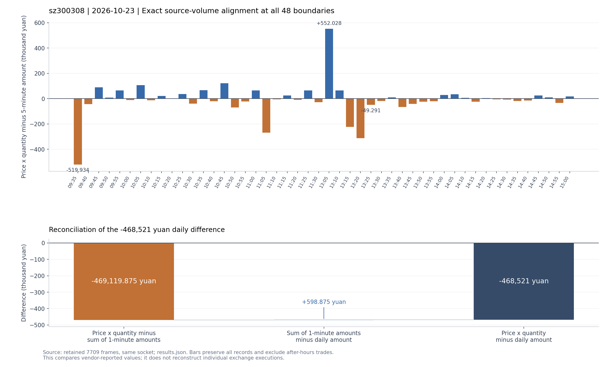

# 0fc6 价格×数量合计差异归因

对象：`sz300308` / 2026-10-23。补采时间为 2026-10-24 13:11:35.783–13:11:36.885（UTC+8），服务器 `115.238.56.198:7709`。

本次分析针对明细价格×数量合计比日线成交额少 **468,521 元**的现象。证据强支持主要机制为：**用时点价格乘期间聚合成交量，不能恢复期间每笔实际价格与数量的乘积之和**。还发现整手数量粒度的具体线索；K 线编码精度只解释小量级差异，无法单独解释约 46.9 万元。

该结论来自同一供应商的实帧、不同协议与统计周期核对。逐笔价格权重和数量取整规则没有交易所数据独立认证，下文将实测事实与推断分开。

## 对账关系与差额所在层次

补采在一个 socket 上完成，禁止重连，记录本地及远端地址；保存 13 个完整帧：握手、0fc6 全量 4 页、旧版 0fb5 全量 4 页、1 分钟/5 分钟/两种日线各一帧。[原始抓取清单](../../testing/evidence/enhanced-history-amount-20261024/capture.json)

0fc6 共 4,876 条原始事件，与前轮全量规范字段及顺序完全相同。旧版 0fb5 也返回 4,876 条，其分钟、价格、数量、状态和保留字段逐条相同。新旧抓取的日线及五分钟正文逐字节一致，排除了本轮采样期间源数据变化。补采 480 根一分钟线，取目标日的 240 根。[逐项验证结果](../../testing/evidence/enhanced-history-amount-20261024/results.json)

金额统一排除盘后，并保留开盘、收盘撮合：

| 口径 | 金额，元 |
| --- | ---: |
| 0fc6 常规时段价格×数量合计 | 27,918,010,839 |
| 240 根一分钟线成交额合计 | 27,918,479,958.875 |
| 48 根五分钟线成交额合计 | 27,918,479,888 |
| 同日日线成交额 | 27,918,479,360 |

对账恒等式为：

```text
明细乘积 − 日线成交额
= (明细乘积 − 一分钟成交额合计) + (一分钟成交额合计 − 日线成交额)
= −469,119.875 + 598.875
= −468,521 元
```

一分钟合计与五分钟合计只差 70.875 元，五分钟合计与日线差 528 元。因此主要差额已经存在于“明细价格×数量”和分钟成交额之间；仅把分钟线再合并成日线，不会产生这笔约 46.9 万元的差额。



图中蓝色表示明细乘积高于五分钟成交额，橙色表示低于。上图使用真实 48 个区间，下图使用上述对账数值；没有补造缺失记录。可下载[矢量图](../../testing/evidence/enhanced-history-amount-20261024/amount-attribution.svg)。

## 主要机制：聚合数量配上时点价格

连续竞价 237 个分钟各有 20 条非快照记录。常规时段 4,744 条事件中，4,742 条的原始笔数字段 `order_count > 1`。239 个有成交的一分钟区间，**最后一条明细价格全部等于该分钟 K 线收盘价**；这与时点/末笔价格特征一致。明细中没有该条聚合期间的实际成交额或成交均价字段。[实测统计](../../testing/evidence/enhanced-history-amount-20261024/results.json)

在一条聚合记录内，价格可能已经变化。记记录价格为 P，实际各笔数量为 q、价格为 p，即使记录数量准确，通常也有：

```text
记录价格 P × 期间总数量 Σq ≠ 期间实际成交额 Σ(p × q)
```

当记录价格高于期间成交均价，乘积会高估；低于期间均价，则会低估。准确的记录数量也不能补回丢失的价格权重。

本次一分钟差额 **120 个为正、119 个为负，1 个为零**。高估累计 3,100,355.125 元，低估累计 −3,569,475 元，净额为 −469,119.875 元。上午净差额 −365,741 元，下午 −103,378.875 元。并不存在一个始终低估的固定比例。

所有 240 个一分钟、48 个五分钟累计数量边界都与完整明细中的某个唯一前缀**精确相等**，再按时间约束选出对应切片。没有对记录排序、去重、拆分，或猜测秒数；下面各区间的源数量完全对齐：

| K 线结束标签 | 两边数量，股 | 明细乘积，元 | 一分钟成交额，元 | 明细乘积 − 成交额 |
| --- | ---: | ---: | ---: | ---: |
| 09:31 | 2,352,700 | 1,348,792,824 | 1,349,406,464 | −613,640 |
| 11:03 | 180,600 | 101,391,629 | 101,661,112 | −269,483 |
| 13:01 | 1,051,000 | 596,667,842 | 595,969,984 | +697,858 |
| 13:07 | 598,300 | 354,628,354 | 354,418,176 | +210,178 |
| 15:00 | 409,400 | 250,810,722 | 250,838,288 | −27,566 |

13:01 区间的乘积加权价约为 567.7144 元，而 `分钟成交额 / 源数量` 约为 567.0504 元，每股相差约 0.664 元，乘 1,051,000 股便得到 697,858 元差额。其记录价格从 561.33 元变化到 572.15 元，末价与分钟收盘一致。这说明使用记录价格代替期间实际价格权重，会在快速变价和较大成交量时放大误差。

表中时间是 K 线结束标签：13:01 切片对应明细 13:00 标签的 20 条记录。09:31 切片还包含 09:25 开盘撮合；不能把首分钟的 −613,640 元全部归于开盘撮合。

若把明细价格假设成“期间成交均价四舍五入到分”，且数量准确，则每股舍入误差最多半分。**230 个分钟的差额超过该模型的半分×数量上界**，该假设不能单独解释数据；这不是简单少保留一位小数的问题。[数值诊断](../../testing/evidence/enhanced-history-amount-20261024/diagnostics.json)

## 次要机制线索：整手数量不能恢复每一股

240 根一分钟线源数量全部落在 100 股网格上，与 0fc6 整手字段逐区间对齐。这证明双方量字段采用相同粗粒度，不能证明二者保存了每笔实际股数。

最后一个分钟只有一条非快照收盘事件，价格 612.63 元，记录量 4,094 手，即 409,400 股；一分钟 OHLC 也均为 612.63 元，但成交额为 250,838,288 元。若假定该分钟的成交均使用固定收盘价，且金额编码误差不超过一个相邻编码步长（16 元），可反推唯一的整数股量候选 **409,445 股**：

```text
记录数量：409,400 × 612.63 = 250,810,722 元
反推候选：409,445 × 612.63 = 250,838,290.35 元
源金额：                    250,838,288 元
```

候选数量比源数量多 **45 股**；候选成交额与源金额只差 −2.35 元，落在 16 元编码步长内。该分钟 −27,566 元差額可以按上述假设解释为：

```text
−45 股 × 612.63 元 + 2.35 元 = −27,566 元
```

**409,445 股是金额与固定价推算的候选，不是取得的交易所成交数量。** 该线索支持源数量整手粒度引入偏差，但不能证明服务器具体使用四舍五入、截断、累计量差分中的哪一种规则。[收盘候选及假设](../../testing/evidence/enhanced-history-amount-20261024/results.json)

该分钟实测差额约占全天净差额的 5.884%；其余分钟净差额为 −441,553.875 元。其余分钟同时存在价格聚合与可能的数量粒度影响，不能把全部剩余差额直接认定为价格误差。

另外，14:58 的一条事件虽只有一个记录价格，但其成交额除价格无法在一个金额编码步长内得到整数股量。不能将“只有一条记录”自动等同于“期间全部实际成交只有一个价格”，也不能套用收盘固定撮合推算到全部记录。

## 已排查的其他原因

| 候选原因 | 实测与判断 |
| --- | --- |
| 浮点乘法或求和精度 | 用整数 `price_acc_raw × volume` 求和得到 27,918,010,839 元；本次 f64 价格×数量结果与整数合计精确相同，计算浮点误差为 0。 |
| K 线解码公式错误 | 新采样全部 1,164 个量/额编码字段与直接 IEEE binary32 解码一致，零编码按零处理。 |
| 仅金额编码舍入 | 日线金额相邻编码步长 2,048 元，240 个分钟步长合计 2,416.125 元。若每项最多一个步长误差，分钟与日线的合计上界为 4,464.125 元，远低于 468,521 元；239 个有成交分钟的差额都超过自身金额编码步长。该上界有明确假设，不是供应商统计误差保证。 |
| 分钟切片错位 | 240 个分钟和 48 个五分钟累计源数量前缀全部精确匹配，并完整覆盖常规事件。 |
| 0fc6 字段错读或新接口特有错误 | 同一连接旧版 0fb5 全量共同字段逐条一致；两次 0fc6 全量也一致。 |
| 漏页、拼页重复或状态过滤错误 | 两次全量与前轮结果一致；保留相同字段事件的重复次数，竞价快照量为零。 |
| 盘后量混入 | 已排除盘后 45 条。若混入会增加 11,088,603 元，与这笔 468,521 元差额不符。 |
| 股/手统一缩放错误 | 各分钟量完全对齐，明确使用 100 股/手。100 倍单位错误不符合差额规模和正负分布。 |

上述金额步长推算仅涉及表示精度；一分钟与日线合计实际差 598.875 元，与该精度量级相容，没有证据证明这 598.875 元全部由舍入产生。

## 能确认与尚不能精确分离的部分

已确认源接口乘积与分钟报告成交额不相等、差额集中在分钟统计内部、最后记录价格与分钟收盘一致、数量字段为整手粒度，并定位所有区间的精确贡献。**主要机制为聚合记录价格与成交量的配对损失，收盘段另有具体数量精度线索。**

0fc6 未提供每条聚合记录的实际成交额、期间成交均价、秒或交易所编号。现有数据不能把全天 468,521 元唯一分成“价格权重损失多少、数量取整多少”，也不能反推每笔交易。要验证精确比例，需逐笔成交价和股量，或与这些聚合记录边界一致的实际成交额。

需要全天成交额时，可直接采用日线/分钟线的源成交额字段；使用明细乘积时应标为估算值，保留整手量及原始字段。不能通过统一加一分钱、按净差额反向缩放价格或对数量乘校正系数来修复这些正负相抵的期间误差。

## 支持资料与复核

- [完整机器结果及 240/48 个区间](../../testing/evidence/enhanced-history-amount-20261024/results.json)。
- [输入与参考源码摘要](../../testing/evidence/enhanced-history-amount-20261024/inputs.json)、[补充数值诊断](../../testing/evidence/enhanced-history-amount-20261024/diagnostics.json)、[原始支持包](../../testing/evidence/enhanced-history-amount-20261024/README.md)。
- [前轮完整性验证](ENHANCED_HISTORY_DAY_COMPLETENESS_20261024.md)及[原始留证](../../testing/evidence/enhanced-history-day-20261024/README.md)。
- [eltdx 3.2.2 固定参考模型](../../testing/evidence/eltdx-3.2.2-command-guide-20261024/src/eltdx/models/trade.py)：`trade_amount_yuan` 本身也只是 `price × volume ×100` 派生值，没有新增 wire 成交额；该社区代码不是交易所认证。
- [离线分析脚本](../../../scripts/validation/analyze_enhanced_history_amount.py)：固定输入摘要、独立解压和两种明细解码、累计量唯一前缀匹配、整数合计与对账恒等式校验。

默认复核不联网：

```sh
python3 scripts/validation/analyze_enhanced_history_amount.py \
  docs/validation/evidence/enhanced-history-amount-20261024
```

本轮没有修改 Rust 源码；采集及分析使用 Python stdlib，绘图使用临时环境内 matplotlib 3.9.4。图表为实测数据生成，结果、原始帧、源码摘要及日志均已保存。证据来自同一供应商的不同表示，不能将其视为三个独立市场数据源。
