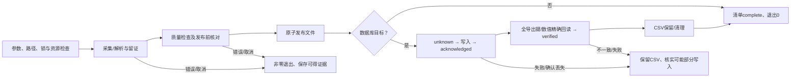

# rustdx 产品需求文档

文档版本：3.1。更新日期：2026-10-25。适用对象：当前仓库源码。本文件是需求的唯一主文档，FR-01至FR-18编号继续有效；需求、实现、验证与运营责任按同一编号追踪。工程目录采用核心库、应用、外部测试和工具工作区分层。

核心库与CLI的Cargo版本均为 <!-- version:project -->2.0.0<!-- /version -->，可执行程序为`rustdx`；当前未上传发布。crates.io的1.12.2/1.8.2属于历史发布内容，当前优化须从源码或本地审核包构建，部署记录同时保存源码及二进制摘要。破坏性日历/心跳/财务签名按[迁移说明](../release/MIGRATION.md)处理。功能实现、测试通过、真实源验证、目标生产验收是不同结论，不能互相代替。

## 1. 产品定位与目标

rustdx为Rust调用方和数据运营人员提供行情获取、通达信文件解析、行情计算及可追溯的数据发布能力。核心任务是把明确来源与口径的数据转为可验证的文件或数据库记录，使调用方能判断结果有效性、任务完成程度和失败后的恢复条件。

已确认的问题包括市场代码混叠、量与复权口径混用、未知交易日或证券状态被当作事实、部分数据失败后仍显示成功，以及数据库回执与实际数据不一致。产品要求相应落实为：显式行情语义、有覆盖边界的规则、不可信输入拒绝、发布前质量检查、独立数据库回读和保留恢复证据。

目标以可观察结果定义：

- 调用方取得带市场、周期、时间、单位和价格口径的行情，错误与未知结果可区分。
- 运营人员完成指定范围的通达信历史日线发布，并依据清单审核日期、证券覆盖和质量问题。
- 运维人员识别已经发布、可能写入、已获回执和已精确验收的动作，失败后保留可核查产物。
- 维护者可以从干净源码检出复现离线回归，追溯规则、数据样本和各轮验收范围。

技术架构与源码职责见[架构评估](../architecture/PROJECT_ANALYSIS.md)，工程目录见[项目结构](../architecture/PROJECT_STRUCTURE.md)。实现方案不作为本文件的业务状态定义。

## 2. 范围与交付边界

| 范围 | 当前产品能力 | 边界 |
| --- | --- | --- |
| Rust核心库 | 26个同码TCP命令、day/lc/gbbq解析、标准行情适配、价格复权、指标、日历、涨跌幅、连接池及可选缓存 | 普通TCP市场为深圳/上海；F10/退市日线接受市场2参数，其在线范围未验收；同码覆盖不等于全业务契约验收 |
| CLI采集 | `day`目录/官网ZIP/URL/本地ZIP、名单筛选 | day输出CSV或ClickHouse/MongoDB，JSON用于质量报告 |
| CLI维护 | `data-check`核对/发布日历及证券历史，`data-status`覆盖巡检，`show`版本/调试 | 更新依赖原始证据，不自动补齐未来年度或全市场证券状态 |
| 数据库交付 | day写入ClickHouse/MongoDB；全部导出键与数值独立回读 | 同机受管目标互斥，不提供跨主机协调、跨库事务或自动回滚 |
| 单机生产控制层 | `rustdx-runner`本地day Job、持久账本、事实覆盖、不可变release、目录CAS、版本隔离数据库及固定版本导出 | 仅A股原价日线标准元/股契约；Unix本地持久盘，真实市场事实由维护流程提供 |
| 恢复与部署 | 状态/Prometheus文本、SQLite在线备份、原字节归档、隔离恢复；Linux/systemd模板 | 模板未在目标Linux执行；无跨机调度/发布者高可用，长期SLO另验收 |
| 工程交付 | 虚拟Cargo工作区、源码、依赖锁定、测试夹具、验证脚本、配置示例、部署模板、维护文档 | 已实现0547订阅会话；真实盘中主动推送待验收。没有内置Web服务、账号权限系统、交易下单或采集定时服务 |

P0表示核心正确性与完成/恢复所必需，P1表示采集、追溯和运营支持，P2表示分析及工程保障的既有分类。编号与优先级用于需求追踪，不代表低优先级规则可以在交付时跳过。

最小完整采集任务包含：有效输入与输出目标、路径和资源检查、采集/解析、质量检查、发布前核对、原子发布、可选数据库写入与精确回读、最终清单及退出状态。恢复路径属于这一任务的必要部分。

## 3. 使用者与职责

这些是工作职责，不是软件中的登录角色。实际读写权限由操作系统、部署环境及数据库账号决定。

| 使用者 | 触发任务 | 可执行动作 | 必须核实的事实 |
| --- | --- | --- | --- |
| 库使用者 | 应用或分析程序请求行情/计算 | 配置受管网络、查询数据、适配标准行情、计算规则/指标 | 市场/品种、源单位、查询范围、当日证券状态及计算口径 |
| 数据运营人员 | 历史补数、日常收盘采集、收益接续 | 选择来源/名单/日期、运行采集、查看清单与产物 | 应有证券、预期行情日、告警接受范围、前因子衔接 |
| 数据维护者 | 覆盖临近到期或规则/状态变化 | 整理公告、交叉核验、显式发布维护数据 | 来源真实性、完整区间、规则生效时间及公告语义 |
| 运维人员 | 部署、资源异常、任务失败 | 注入凭据、管理调度/备份、核查目标与留存CSV、恢复运行 | 活跃任务、可能部分写入、目标版本、外部写入者及较新数据 |
| 代码维护者/验收人员 | 修改或交付源码 | 编译、测试、审查、维护需求映射与版本记录 | 源码提交、执行环境、实际执行检查和未验收范围 |

修改输出或数据库是用户启动任务授权的结果。自动化只进行本次明确选取范围内的处理；不确定写入交由运营/运维核实，不静默重试。运行归档和数据备份保留期由部署方确定，项目没有自动清除历史归档策略。

## 4. 业务对象与共同规则

### 4.1 对象与字段

| 对象 | 关键字段/语义 | 校验和使用规则 |
| --- | --- | --- |
| 证券标识 | 市场前缀、原始代码、品种上下文 | 保留前导零；sh000001与sz000001不同，指数/股票不因数字相同而合并 |
| 标准行情 | 来源、证券、周期、UTC+8时点、OHLC、金额、量、价格口径 | 价格/金额为元、量为股；适配须核实源单位与市场，有限值及OHLC关系须有效 |
| 文件导出 | CSV行情、JSON质量报告、行数、日期边界、逻辑键、字节摘要 | day CSV量保持手；已有列兼容；factor为累计收益指数，不直接缩放OHLC |
| 日历数据 | version、source、start/end、完整休市日期 | 覆盖包含查询和导航搜索范围；周末休市，调休工作周末不自动变成交易日 |
| 日期规则上下文 | 行情日期、板块、当日ST、经核实上市阶段 | 不以今天的简称推断历史；规则范围、日历范围和证券事实范围分别检查 |
| 证券历史 | 版本、核实截止、证券状态区间、公告URL/日期/字节摘要 | 无重叠，状态为Trading/Suspended/Delisted；缺口未知，仅Trading生成交易规则上下文 |
| 收益与价格调整 | ReturnIndex、PriceMultiplier、上一日状态 | 两种数值不互换；收益接续保留原始OHLC，价格复权另按历史锚定 |
| 运行清单 | schema、run_id、参数/来源、阶段、产物、数据库状态、观测 | 当前schema7；最新清单及每run_id归档分别持久化，不构成跨文件事务 |
| 原始响应证据 | 请求、页序、采集时点、解析器版本、正文/证据摘要 | 描述实际收到的正文；摘要证明完整性，不证明第三方内容真实性 |
| 数据库验收 | 全部导出键、字段、行数/边界、批量、耗时、字段摘要 | 只证明本次输出范围，不能据此声称整库历史或全市场已完整 |
| 生产Job/Attempt | 业务身份、源/策略修订、计划日、deadline、私有目录、CLI身份/退出码 | Job去重、活动Attempt唯一；CLI complete与业务released分别记录 |
| Release/目录 | release_id、contract_version、完整日期分区映射、catalog_version、上一版本、核验凭据 | 封存后登记；CAS事务提交指针/状态/事件；消费者固定目录后读取 |
| 数据库候选证据 | dataset/release/契约及日期/市场/代码/品种，持久请求/响应、query_id、全部行/字段及总范围 | 所有配置目标确认且精确verified才能被目录引用；unknown不自动重写 |

CSV表头、兼容列及接口类型的具体定义见[迁移说明](../release/MIGRATION.md)和[开发说明](../development/DEVELOPMENT.md)。调用方必须区分原价、价格复权和累计收益，不能仅按字段名推断口径。

### 4.2 完成条件

库任务须返回有效类型化结果或明确错误；符合协议的空集合只表示未返回记录，不证明停牌、退市或应有范围完整。

文件采集成功须同时满足退出码0、清单`complete`、非空有效产物已原子发布、输出摘要/行数/边界已记录，以及适用的质量校验通过。CSV发布前须流式回读；JSON来自已校验记录并保存字节摘要。采集前参数/路径错误可能没有清单。

数据库任务还须获得完整成功回执，独立回读本次全部导出键和全部导出数值，状态达到`verified`，并完成规定的CSV保留或清理。仅`acknowledged`不能视为验收通过；清单保存或清理失败仍是任务失败，即使数据已经写入。

生产业务可用性由维护/运营提供已核实的点时名单、日历和证券状态。runner据此核对全部应有键与免行情原因，Unknown拒绝完整发布；只有封存产物、可选目标全部verified及目录事务提交完成才是`released`。以上条件不替代输入事实真实性及全市场范围审核。全部键均已明确免行情时，可发布有证据的空分区，必须记录没有执行collector，不能伪造CLI complete。

### 4.3 状态与转换

任务状态、阶段、产物状态和数据库状态分别记录，不将它们合并为一个成功标志。下表为业务摘要，完整字段和值以[导入说明](../operations/IMPORTS.md)为准。

| 对象/状态 | 进入条件 | 后续动作与限制 |
| --- | --- | --- |
| 任务running | 已建立运行清单并开始执行 | 正常转complete/failed；异常终止可保留最后检查点 |
| publication_pending | 待发布产物及摘要已经记录 | 原子替换后确认published；中断时须核查文件摘要 |
| published | 已确认新文件发布 | 文件任务结束，或继续写入数据库；不代表数据库已有数据 |
| database.not_started | 尚未发起数据写入 | 目标DDL/索引准备可能已执行；不能推断目标不存在 |
| database.unknown | 即将或已发起可能部分写入的动作 | 等待回执或失败；禁止当作未写入自动重试 |
| database.acknowledged | 完整成功回执/导入工具退出0 | 继续独立回读；回读失败保留CSV |
| database.verified | 全部导出键和数值精确通过 | 才允许执行保留/清理CSV |
| cleanup_pending | 数据库已verified，保留/清理待完成 | 核查文件后完成；无需再次写库 |
| 任务complete/failed | 流程成功/以错误结束 | 保留具体阶段；failed不代表数据库回滚 |

### 4.4 共同异常规则

| 情况 | 必需行为 |
| --- | --- |
| 非法参数、输出别名、覆盖输入、目标锁冲突 | 在相关采集/发布前拒绝，非零退出；不保证创建报告 |
| 截断、非法日期/数值、解压或解析失败 | 返回错误；checked接口不留下可误用的部分结果 |
| 全空文件集合/无可发布收盘日线 | 失败，保留旧成功输出；单个空源可记录告警 |
| 日历/规则/证券状态范围不足 | 返回错误或明确覆盖告警/未知，依接口严格模式处理 |
| 超时、Ctrl-C/SIGTERM、取消文件出现 | 协作取消；保留已确认动作及证据，清理受管暂存/子进程 |
| SIGKILL等强制终止 | 允许保留running/unknown与暂存；后续现场核查，不能期待最终清单 |
| 写入确认丢失或回读失败 | 保留CSV并非零退出，不承诺事务回滚，不自动重试 |
| 恢复/重复导入 | 先核实源、摘要、目标、较新数据及写入阶段，再由操作者决定重跑 |

## 5. 功能需求

### FR-01 日历、行情日期与覆盖维护

**P0；源码已实现，数据覆盖有限。** 库使用者查询交易日、前后交易日、区间或最近N日时，严格接口须验证整个搜索范围，越界返回明确错误。CLI可显式选择带版本/来源/完整区间的外部日历，清单保存实际使用数据。

内置休市表只覆盖2024–2026。旧兼容接口保留范围外工作日估算，该结果不能证明严格连续性。缺失交易日记录标记为待核实；day默认告警，`--strict`拒绝缺口及日历覆盖不足。

维护者以`data-check calendar`逐日核对候选与独立参考，覆盖区间完全一致且来源不同才能通过；显式`--output`通过后原子发布，不自动覆盖内置数据。`data-status`按核对日检查覆盖，默认UTC+8今日、提前90自然日告警；due/unverified/missing/incomplete时严格模式仍保存报告但返回非零。证券历史须核对公告实际字节摘要，未知区间返回None；格式通过不等于事实已审计。

**验收依据：** 年度365天交叉核对、导航越界、参考不一致、原子更新拒绝、临界日和缺失状态回归。当前2026两交易所参考共242交易日；2027完整数据及全市场状态未取得。见[数据维护](../operations/DATA_MAINTENANCE.md)。

### FR-02 日期化涨跌停

**P0；源码已实现，规则与证券事实覆盖有限。** 历史计算须提供行情日期、板块、当日ST状态及经公告确认的上市阶段；昨收和报价使用未复权整数分。结果区分有幅度限制、无幅度限制与非法/不支持输入，价格按规则舍入。

主板ST自2026-07-06起为10%，此前和其他板块/IPO阶段按[日期规则](LIMIT_RULES.md)选择。旧核准制IPO首日不得套用普通昨收比例；未覆盖特别制度或查询日期超出范围时返回错误。规则核实截止2026-10-22，不能因更新日历而延长。

**验收依据：** 生效日两侧、板块/ST/上市阶段、半分舍入、无幅度结果及范围外拒绝回归。当前没有项目附带的全市场上市/ST/退市事实，调用方负责提供有证据的历史上下文。

### FR-03 行情语义、标准适配与复权

**P1；语义适配已实现，字段独立核验范围有限。** 调用方将通达信TCP/day/lc数据用于计算或比较时，须保留市场与前导零，明确来源、周期、时间、价格口径和量单位。标准量为股；既有day CSV量保留手。TCP源单位须按品种/周期和请求参数显式核实，分钟文件适配须提供带市场的证券标识。

累计收益ReturnIndex与价格缩放PriceMultiplier不可互换。收益计算承接前收/前因子与跨停牌事件，原始OHLC不改写；价格前/后复权按后端可用历史末/首日锚定，先计算完整可用历史再筛选区间，可用历史首日未必是上市日。

财务按字段携带单位、语义状态和证据，已验证值与候选值分别消费；报价使用证券目录精度，未知精度不补造价格。0fc5/0fc6保留原始事件与状态；末价乘聚合量属于估算，052d源成交额单独处理。0feb请求日不等于响应交易日，0537分钟标签不证明源时间。

精确日线新增052b通用入口，股量为非负u32整数股，金额按非负有限binary32解码；旧052b指数金额算法漏掉隐含首位已修复。052d category9股尾数损失及category4量化不能靠四舍五入恢复。两节点3只在市A股、2026-10-19至22共24条的全部8字段已与官网day精确核对，其他范围仍单独验收。见[TCP股数修复](../archive/development/TCP_DAILY_INTEGER_SHARES_FIX_20261024.md)。

字段状态须区分结构解码、单位换算、业务派生、候选/未知及范围内独立核验，不能以接口返回成功代替业务资格。当前财务默认证据只覆盖固定样本10字段；事件ConfirmedByProfile表示协议规则支持；F10正文读齐不表示指标已结构化。实际API和逐字段范围见[返回字段解析状态](../reference/RESPONSE_FIELD_SEMANTICS.md)。0feb按交易日标准化/发布前须执行日期资格门禁，当前Unsupported，不允许改写公开日期绕过。

0feb请求使用日期schema2的负YYYYMMDD补码，保留请求版本和原始selector；旧schema1编码错位的历史数据不得按旧注释日期直接用于业务。两节点六证券六交易日的日期对照已完成，范围与原字节依据见[修复报告](../archive/development/RECENT_MINUTES_DATE_SELECTOR_FIX_20261024.md)；通用响应日期资格、保存窗口和成交股数单位仍需独立验收。

**验收依据：** 市场/周期/单位、非法值、连续派息、停牌事件、前因子继承、财务资格、多精度报价、事件/金额、日期门禁及新旧CSV回归；跨源量额容差须独立声明，不应用于数据库精确验收。共同规则见[外部应用调用约定](../development/APPLICATION_INTEGRATION.md)，必需业务字段的独立核验条件见[字段专项验收](../testing/PRODUCTION_ACCEPTANCE.md#4-返回字段专项验收条件)。

### FR-04 有界行情采集、时限与取消

**P1；源码已实现。** 受管TCP主连接、池、重连和HTTP任务共享进程许可；CLI同目录OS锁共享同机额度，默认8。调用方在首次初始化前配置策略，重复或晚配置返回错误。批次有界排队、批次内有界并行，结束释放批量连接。

052b日线range与既有区间入口共用页/原始行/解压字节/总时限及来源连续性检查；短页继续，越过下界或确认空页才完成，预算耗尽保持不完整。新CLI及runner采集使用来源v2，旧052d来源v1仅保留离线重放。

CLI和runner本地文件和管理命令默认不启动行情TCP；
显式--tcp-warmup全量测速初始IP池并建立TCP客户端：
保留40种子及集成方CRUD，每节点三轮、最多8并发、TCP/握手/探测各3秒；
三轮全通过按耗时排名生成当日池，后续每天北京时间09:00刷新。
所有库内TCP新建/指定地址/重连/复用使用当日池，空池或启动失败阻止业务。
预热客户端可交接，其他TCP/HTTP申请许可时释放，单许可也可运行。
启动测速和等待初始化锁继承整任务时限/取消，失败不发布部分结果。
旧全局`--no-tcp-startup`保留并禁止预热，TCP来源自行核验冻结端点；
普通行情集成应用在main可调用启动API。完整策略见[启动与IP池](../architecture/DAILY_IP_POOL.md)。

连接、完整帧、分页、批次和整任务超过适用总体时限时返回错误，重试不得延长绝对deadline。自动选服轮换起点、冷却失败端点。CLI全局`--timeout`默认10800秒，取消文件、Ctrl-C/SIGTERM触发协作取消；同步计算/系统调用不能被硬实时抢占。

Mongo每子进程预约一个任务许可，内部socket不逐个计数。裸socket、不同许可目录、跨主机及任意外部写入不在保证范围。统计须给出计数范围与窗口样本数，不能把解析错误计为网络帧失败。

**验收依据：** 独立进程额度、重连峰值、慢正文deadline/取消、批次排队和释放、配置冲突、两二进制离线默认/显式预热、三轮筛选/八并发、池CRUD/09:00/跨日、预热交接/单许可、CLI端到端及子进程策略传递/回收。见[网络预算](../architecture/NETWORK.md)。

### FR-05 日线文件采集与原子发布

**P0；源码已实现。** 用户启动day，可输入多个目录、官网包、单URL或单本地ZIP，按名单、市场、代码前缀筛选；Excel列从0计数。参数非法、空名单、来源冲突或全空有效集合失败。仅获取数量上限`-n`在每目录文件名排序后生效。

day记录以最多4096条分块，质量状态和收益因子跨块连续。输出顺序固定为目录参数顺序、文件名升序及文件内日期升序，修改线程数须得到相同CSV字节。每源质量详情有上限并保存省略数量，省略不放宽严格判定。

A股源重复/逆序日期拒绝；非A股按兼容规则告警，默认允许发布时排序并对同日保留源最后一条，strict拒绝。跨输入同证券日期区间重叠另行拒绝，即使缺口可能互补。发布前流式回读行数、键所属区间和边界，记录摘要后原子替换；发布前失败保留旧成功输出。

输出/报告/保留文件须检查输入覆盖、别名和并发输出锁。正常完成、失败及协作取消清理受管暂存并解除发送等待；强制终止残留须核查。记录相关内存有界，文件列表/报告仍随源文件数增长，暂存产生实际磁盘需求。

**验收依据：** 坏输入保留旧输出、空集、路径冲突、跨块质量/收益、1/4/8线程确定性、非A股归并、输入重叠及取消清理。见[导入说明](../operations/IMPORTS.md)和[分块回归](../../apps/rustdx-cli/tests/day_streaming.rs)。

### FR-06 数据库导入、精确验收与恢复

**P1；源码已实现，本机及固定Linux真实服务验收已取得，目标生产验收待完成。** 用户选择数据库目标后，先检查/准备表与索引，再处理数据。ClickHouse要求兼容字段/Float64精度、日期分区、逻辑排序键及服务端版本；Mongo要求完整非稀疏/非部分`(date,code)`唯一索引及simple排序规则。不兼容目标拒绝，CLI不自动迁移原表。

ClickHouse把已发布CSV有界转为RowBinary，传输Float64小端位值，避免服务端十进制解析漂移；显式字段列不包含客户端version，省略字段使用表内默认值。日期必须可表示为Date UInt16，CSV单行最多1024字节；坏输入不能作为成功导入。具体传输和清单语义只在[导入说明](../operations/IMPORTS.md)维护。

可能部分写入前持久化unknown，完整成功回执后记录acknowledged。回执后默认4096键一批，可配1–16384，独立逐键精确比较open/high/low/close/amount/vol，以及实际导出的preclose/factor。缺键、重复、字段类型错误、值变化、查询失败、迟到进程错误均拒绝verified。

同机同目标锁覆盖前因子读取至验收完成。ClickHouse通过FINAL读取即时逻辑结果，客户端run_version不替代表内服务端version；Mongo导入upsert并以一个长驻mongosh回读，最终EOF和退出码0也须通过。

只有verified后可清理CSV；day可用`-k`保留为目标名加`.csv`。写入/回读失败保留CSV、非零退出，不自动重试不确定写入。恢复须核实全部本次输出、query_id/工具记录及较新数据，不承诺回滚或跨库事务。

**验收依据：** 1,040键6/8字段和复权；65,536行首次/重复；779,200行真实历史两库各两次全键精确回读；四项TCP确认丢失/SIGKILL恢复。第五阶段最终源码在固定Linux执行上述范围，RowBinary修复浮点漂移，CSV摘要不变。第六阶段另完成600只合成证券/两runner版本、每库2,400行的原生全备空目录恢复，全字段/元数据/历史导出一致，重复恢复拒绝后数据未改变；不推广为原平面CLI表、生产规模或Mongo物理卷/日志恢复。见[数据库验收](../testing/DATABASE_ACCEPTANCE.md)、[第五阶段](../archive/development/REMAINING_ACCEPTANCE_STAGE5_20261024.md)、[第六阶段](../archive/development/REMAINING_ACCEPTANCE_STAGE6_20261024.md)；[第三轮](../archive/history/OPTIMIZATION_ROUND3.md)保留当时macOS范围。

### FR-07 不可信二进制与协议请求

**P0；26个同码入口已覆盖，旧兼容入口仍有边界。** 不可信day/lc/gbbq与协议数据须通过返回错误的checked入口。截断、非法日期、极端偏移、非法数值或超请求数量不能冒充有效结果；尾字节按各命令契约处理，允许保留的未知尾部须显式暴露。旧可复用对象失败清空旧解析结果，gbbq重复读取不能二次解密。

K线、快照、财务和当日/历史逐笔新请求参数私有，校验后编码与参数一致；股票/指数分开解码，快照核对证券身份，财务核对非有限值/日期，逐笔核对数量、时分、正价格和非负量。

受管收帧、握手、心跳与IP探测须核对响应前缀、命令及消息号；错配不得返回正文或计为成功，连接不可复用且不自动重试。完整错配帧可保留为原始证据，并追加失败事件；离线重放在正文解析前执行同一身份校验。

Client对应入口使用checked请求；F10目录/字节范围与052b退市日线已补齐现代请求、单页/全量/批量消费入口。旧公开字段对象并未全部迁移；旧parse无Result，部分低层构造可panic。完整枚举按各命令原始条数/字节推进，成功结果仍须检查complete、termination及来源一致性；短页规则不能跨命令套用。

板块高层入口须检验02c5声明大小和32位MD5、06b9精确块长与端点/连接/北京时间观察日连续性；共享总时限，最高64MiB。成分槽位不整除、数量越槽、非法GBK或六位代码无效返回错误，不交付空/部分成功。完整文件入口保存原字节、声明/计算MD5及每块来源；空文件也验算。两节点概念/指数4文件、80帧、105,826条成分已独立重放核对，见[完整性修复](../archive/development/BLOCK_FILE_INTEGRITY_FIX_20261024.md)。供应商分类、未知头槽及通用资源合同不据此验收；旧parse仅作兼容。

通用06b9须另用300字节路径checked请求，按声明块长推进且保留未知尾部，拒绝超请求/截断/偏移溢出。所有下载块须保持同源/连接/UTC+8观察日；最高64MiB、4096块、128MiB累计响应，共享总时限。短/空块才是完整；预算耗尽不得将前缀升级完整。统计ZIP须完整下载，原始中央目录、大小/数量/加密、必需CFG的CRC/GBK/键唯一性均检查；原始列及未识别行保留，命名统计值和日期维持候选语义。见[资源与推送验收修复](../archive/development/RESOURCE_CONTRACT_PUSH_ACCEPTANCE_FIX_20261024.md)。0547实盘验收另外检查精确交易窗口、无被动请求、持续游标与市场字段变化，以及最终完整同步快照；休市或合成回归不关闭实盘项。

协议头身份、证券/数量/数值合法性与字段业务核验分别追踪。未命名槽、未回显日期和已命名候选字段须保留可追溯状态；不因checked解码、非空、分页complete或订阅Synchronized而自动升级为全字段已核验。字段消费流程统一遵循[应用接入第2.1节](../development/APPLICATION_INTEGRATION.md#21-字段消费步骤)。

**验收依据：** 固定pytdx参考、eltdx3.3.0注册表对照、两节点98帧独立重放、F10指定范围/退市分页、截断/错身份/非法值及既有ASan fuzz。完整接口与边界见[命令参考](../reference/COMMAND_API.md)；本次结构调整不重跑实盘或fuzz。

### FR-08 交易所官方名单

**P1；源码已实现，源可用性没有SLA保证。** 官方名单通过HTTPS、有界响应与超时获取，核对分页总量、重复和无进展；鉴权/反爬/接口变化显式失败，不返回成功的部分名单。

**验收依据：** 官方名单解析、分页/总量、重复、无进展与非法代码回归；源实时可用性需单独在线验证。见[运营说明](../operations/OPERATIONS.md)。

### FR-09 技术指标

**P2；源码已实现。** 库调用方输入有效序列及参数时获得本库明确口径的SMA/EMA/MACD/RSI/KDJ/布林带等结果，预热位置、非有限值、非法参数和缺口恢复行为明确。

布林带与KDJ常规有效输入总工作量为O(n)，扩大窗口不引入逐行全窗口扫描。RSI横盘值为50；KDJ采用本库EMA系数与首有效RSV初始化，不推定与其他软件默认一致。浮点末位差异通过独立公式误差范围判定。

**验收依据：** 独立公式、缩放不变量、预热/缺口/非法参数及窗口20/200/2000性能观测。测量不构成所有输入或生产负载的耗时承诺。见[验证方法](../testing/VALIDATION.md)。

### FR-10 工程验证与可复现验收

**P2；本机及隔离Linux工程检查已执行，跨平台CI按实际执行状态记录。** 维护者修改后须保持Rust2024/MSRV1.89与同步有界架构，执行相应格式、Clippy及回归。测试夹具和独立参考结果进入版本控制，使干净检出能够执行离线验证；临时测试数据不能成为隐含依赖。

CI配置覆盖Linux/macOS/Windows、all-features、MSRV、解析fuzz、独立调用方及实际解包消费；性能门禁固定硬件/工具链/输入/profile/锁并在同机交替对照，观察数据另列。数据库CI使用固定镜像与独立表。报告必须注明提交/二进制、日期、平台、依赖版本、输入规模、命令、退出码、跳过项与限制。已配置未运行的CI不计为通过。

**验收依据：** 最终1,048文件输入在Rust1.89/Linux执行workspace与文档测试、Clippy拒绝警告及fmt；538份运行期证据保留原字节，容量测试先封存再验独立数据库预算。macOS另执行22项I/O及12项分页回归，Rust统计中的环境跳过另记；数据库与网络外部检查单独记录。见[验证方法](../testing/VALIDATION.md)及[第五阶段](../archive/development/REMAINING_ACCEPTANCE_STAGE5_20261024.md)。

### FR-11 文档、目录与源码交付

**工程交付要求；本次目录重组。** 仓库应具有清晰的核心库、应用、外部测试、工具、配置、部署、脚本、运行数据和文档边界。核心包落位crates/rustdx-core，CLI/runner落位apps，外部测试落位tests/integration，独立fuzz落位tools/fuzz。移动后同步Cargo、测试、CI、示例及文档引用；保持公开包名、导入名、二进制名和对外API。

需求、架构、开发、验证、运营、运维、迁移和发布文档互相可定位，功能与专项规则采用稳定编号和主文档定义；历史结果保留轮次归属，不覆盖为最新结论。

目录迁移保存文件映射、删除原因和原始摘要。重复的已实施计划及无关元数据删除，历史实施结果与固定证据保留。远端推送、正式部署及crate发布按实际授权范围执行；源码回退不会回滚数据库。

**验收依据：** 本地链接/路径存在、脚本定位根目录、夹具字节不变、打包排除运行产物、需求到实现/证据的映射。见[项目结构](../architecture/PROJECT_STRUCTURE.md)、[版本交付](../release/RELEASES.md)。

### FR-12 可选缓存与下载来源复用

**P1；源码已实现。** 库使用者可显式启用内存/文件行情缓存，Client自动维护精度目录。行情缓存键须由调用方包含市场、代码、命令/周期、范围、单位、价格口径及数据版本；TTL策略由业务确定，不能据缓存命中推断实时有效。

内存缓存默认4096条/64MiB，可设置条数和字节容量并清理过期值；文件缓存checked入口传播I/O错误、校验原键并原子写入，旧格式按未命中处理。同键get_or_fetch合并并发获取；固定64锁可能碰撞串行。checked合并入口的等待、二次读取、fetch和返回共用任务期限/取消，条带重入返回错误；fetch闭包须协作取消，旧入口边界见迁移说明。

day下载缓存按来源隔离，来源锁持有至解析完成。续传核实版本及Content-Range，远端缓存须凭ETag或Last-Modified确认；本地替代ZIP先验证再发布，失败不破坏旧缓存。非交互环境重试耗尽后失败。

**验收依据：** 缓存容量/过期/碰撞键、原子写入、并发获取及ZIP续传/来源锁/解压失败保护回归。见[开发说明](../development/DEVELOPMENT.md)。

### FR-13 来源留证与离线重放

**P1；源码已实现，有界TCP日线Job已接入。** day来源摘要必须对应实际解析的同一份字节；源摘要不能替代输入备份。归档须保留day、实际日历、gbbq及前因子，搬迁后的绝对路径须重新定位。

TCP可选FrameObserver从首次握手起同步保存传输前请求及解压前完整帧，跨重连保留observer；留证错误使请求失败。归档限制总字节与记录数，逐文件fsync，最终库存含SHA-256；离线重放先校验库存和请求，再调用checked解析。截断帧记失败，不能作为完整响应重放。runner通过显式`tcp_day`配置和总预算schedule执行最多10000只沪深A股、8线程的已结束日线采集，窗口先预留原行/正文/归档预算，归档与全部输出字段再次核对；旧无schedule请求仍为32只串行合同，本地day配置继续使用文件来源。

**验收依据：** day输入摘要和旧输出保护；TCP压缩/重连、坏解压、截断、篡改和传输前限额拒绝。见[导入证据](../operations/IMPORTS.md)、[runner接口说明](../../apps/rustdx-runner/README.md)。

### FR-14 阶段观测与数据新鲜度

**P1；源码已实现，生产阈值待部署数据确定。** 每任务清单记录来源准备、下载、解压、快照、解析、排序、写入和回读观测；并发线程归属同一任务，任务之间隔离。失败/取消及panic展开计入阶段失败。

分别输出累计调用耗时和阶段活跃墙钟时间并集；并发或嵌套不能将累计耗时当CPU或相加为总时长。临时字节只统计受跟踪私有快照/排序/归并/待发布文件的逻辑字节，正常结束应归零，不等于RSS、全盘临时空间或数据库占用。

freshness给出无质量错误且非空来源末日、自然日年龄、未来日期来源数及完整告警/错误计数；日期年龄不能推断停牌/退市、交易日缺失或全市场完整性。生产告警阈值和长期P95由真实负载确定。

**验收依据：** 并发/嵌套时间并集、跨任务隔离、失败释放、临时路径跨线程持有、实际历史新鲜度及质量汇总。见[观测定义](../operations/OBSERVABILITY.md)。

### FR-15 单机任务、期限与业务覆盖

**P0；新增组件已实现，本机及隔离Linux工程回归通过。** 操作者以严格JSON配置启动本地day或显式有界TCP日线Job；数据集、契约、策略/来源修订、计划日和范围确定去重身份，凭据不进入业务身份。SQLite WAL账本在启动前事务登记Job与唯一活动Attempt；一个根目录只有一个控制进程，追加事件不可修改。

冻结实际源/事实/CLI字节。以版本化日历、点时名单和证券状态构造应有键；Trading必须取得行情，已核实停牌/退市等独立记录免行情，Unknown、缺键及意外键拒绝完整发布。原日线精确重放，量从旧CSV手转为整数股。当前契约仅A股、日线、原价、人民币元/股；全部已核实免行情时允许空分区并记录`collector_executed=false`。

worker在私有目录运行，继承任务剩余deadline并为发布预留预算；取消宽限后终止独立进程组。未登记封存release的中断隔离，不自动重采；活动/不明确进程组须先由服务管理器处理。

**验收依据：** 去重/活动Attempt唯一、严格配置/Unknown传输前拒绝、缺一个应有日期、全免行情、真实CLI及强制终止/恢复回归；第五阶段Linux31项runner测试全执行，证券事实仍为模拟输入。见[实施记录](../archive/development/PRODUCTION_IMPLEMENTATION.md)及[第五阶段](../archive/development/REMAINING_ACCEPTANCE_STAGE5_20261024.md)。

### FR-16 不可变版本、目录提交与消费

**P0；新增组件已实现，本机及隔离Linux工程回归通过。** release绑定来源、事实、契约及全部产物字节，私有rename后fsync并只读封存，再持久登记。目录保存全部日期分区映射，未变分区引用已有release；候选只能替换声明范围，必须增加`source_revision`且不得降低`source_as_of`，完整目录无交易日缺口。

事务同时校验上一catalog_version、更新指针、任务终态与发布事件；CAS或事件失败保持上一正式版本。已verified但目录未提交的候选可恢复核验并继续提交，不重新采集；历史目录及已发布Attempt不能撤改。

消费者固定catalog_version后读取全部查询范围，文件/数据库核验成功才原子替换导出CSV；中途不重新读取最新指针。只有使用该目录接口的消费者获得此一致性语义。OS只读及受管流程不代替恶意同UID隔离。

**验收依据：** 两次源修订、旧版本固定导出、CAS/事件失败回滚、封存后恢复不重采、旧修订隔离；第五阶段在Linux真实两库跨批次验证。见[runner说明](../../apps/rustdx-runner/README.md)及[第五阶段](../archive/development/REMAINING_ACCEPTANCE_STAGE5_20261024.md)。

### FR-17 数据库版本隔离与不确定写入

**P0；新增组件已实现，本机及固定Linux真实服务/模拟行情回归通过。** publisher只向DBA预建的新表/集合插入唯一release，保留dataset、契约及日期/市场/代码/品种完整键；旧平面表兼容不变。ClickHouse使用普通MergeTree，MongoDB使用完整唯一索引/simple排序规则；运行期不DDL、upsert或删除。

每批512行，传输/spawn前fsync请求并事务登记intent，完整限额内成功响应持久后才acknowledged。然后逐行逐字段精确比较，并核对release完整计数、重复及额外键；全部配置目标verified后，目录引用固定核验凭据。恢复重新核验另留证据，不能改写已verified凭据使孤立目录失配。

unknown、确认丢失或目标未开始均不自动INSERT；停止在途请求并核查后，可显式隔离候选，用新release重做。晚到旧请求不作用于新release。固定版本数据库导出仍执行精确核验，异常保留旧输出。多目标不是跨库事务；INSERT权限本身不能阻止持有者向封存release追加，权限/外部写入治理属于部署门禁。

**验收依据：** 真实ClickHouse/MongoDB、600只明确模拟证券/1,200行跨512行批次、两release、数据库verified后目录失败恢复、旧目录读取、额外键/重复拒绝、确认丢失不重写。初始组件证据与最新Linux执行分列，见[组件证据](../testing/evidence/runner-implementation-20261023.json)及[第五阶段](../archive/development/REMAINING_ACCEPTANCE_STAGE5_20261024.md)。

### FR-18 控制层观测、备份与隔离恢复

**P1；新增组件已实现；Linux模板与生产运维待目标验收。** 输出结构化任务状态和Prometheus文本，包含任务状态、未结束Attempt、事件、发布时间、刷新时点及剩余磁盘；textfile输出原子替换。告警阈值按实际Job预算/日历和批准SLO配置，模板数值不是生产承诺。

备份持控制锁，拒绝活动/不明确worker，使用SQLite在线备份取得已提交WAL；一并复制attempt、release、catalog及数据库请求/响应，库存完整后才写完成标记。恢复到全新隔离目录，核验摘要、SQLite完整性/外键、所有release/历史目录及数据库证据，再写恢复验证标记，不自动切换生产。

该备份保留可重建文件与控制账本，不包含数据库服务端数据卷/日志；数据库灾难恢复另行备份或新命名空间重建。第六阶段的独立演练脚本另编排静止边界下两库原生全备与空目录恢复，没有把数据库备份加入控制层backup入口。工作空间监测允许采集中暂存消失，封存时静止重计；硬限额由文件系统配额落实。worker当前与publisher同UID，清空环境只防止凭据继承。

TCP日线来源v2按新请求与schema2收据封存；旧v1归档保持原字节/摘要/字段值并可离线重放，不将有损旧股量改写成精确结果。本轮没有重跑数据库服务端恢复，新增证据只覆盖日线股数修复及相关工程回归。

**验收依据：** WAL在线备份、隔离恢复、字节篡改拒绝及固定目录导出，Linux真实两库案例也执行控制层恢复；第六阶段配合ClickHouse原生ZIP/MongoDB BSON完整备份恢复到空目录，两个固定版本全字段、约束/索引和导出一致，新服务启动至完整核验约5.81秒。生产RPO/RTO、Mongo物理卷/journal/oplog/PITR继续待验。临时systemd在限额下运行CLI版本命令退出0，不等于生产runner/metrics模板安装或目标账户/调度通过。见[部署恢复说明](../../deploy/runner/README.md)、[第五阶段](../archive/development/REMAINING_ACCEPTANCE_STAGE5_20261024.md)及[第六阶段](../archive/development/REMAINING_ACCEPTANCE_STAGE6_20261024.md)。

## 6. 非功能要求与运行约束

本节给出已有实现约束与必需验收，数值不作为外部服务SLA或生产容量承诺。

| 编号 | 要求 | 验收/限制 |
| --- | --- | --- |
| NFR-01 正确性 | 不以部分失败、未知状态或成功回执冒充有效/完整数据 | 失败保护、状态转换、全导出键精确回读；源真实性仍需独立证据 |
| NFR-02 资源有界 | 采集线程、通道、记录块、输入/响应大小及回读批量有明确上限 | day默认最多8线程，可选1–64；4096条块；单day32MiB、gbbq/前因子64MiB、采集外部日历1MiB；名单/回读正文16MiB |
| NFR-03 时限与可恢复性 | 分层时限受整任务剩余deadline限制，协作取消可退出并保留已确认动作 | CLI默认10800秒；数据库单操作300秒；同步调用非硬实时抢占；SIGKILL允许最后检查点残留 |
| NFR-04 可追溯性 | 参数/来源、字节摘要、产物、写入/验收、阶段/新鲜度可关联run_id | day schema7，TCP日线schema8；来源合同/单位分别校验；Git提交与二进制摘要另记录 |
| NFR-05 并发与一致性 | 同输出冲突拒绝，同机同目标锁覆盖完整导入任务 | 跨主机、外部写入、任意DNS别名及不同许可目录需部署协调 |
| NFR-06 安全边界 | checked输入拒绝坏数据；凭据由部署注入，运行数据/凭据不进入源码包 | 没有产品RBAC；HTTP目标认证与TLS由目标配置；摘要不是签名 |
| NFR-07 兼容性 | 保持包名和CSV语义；破坏性API升级主版本并显式迁移 | Rust2024/MSRV1.89；2.0签名及旧parse/静态分类边界见迁移说明 |
| NFR-08 可维护性 | 文档按职责定位、夹具版本化、脚本可复现、验证范围如实记录 | 固定验收日志放evidence；运行日志/全量数据/私有配置不提交，跨平台按实际CI结果判定 |

SLA、生产吞吐、P95告警值、完整进程树内存、磁盘余量、RPO/RTO和归档期限均为`[TBD：由目标环境与业务要求确定]`。现有bench和两次导入测量只用于回归与容量评估。

## 7. 需求追踪与当前证据

| 需求 | 主要实现入口（仓库相对路径） | 持久验证依据 |
| --- | --- | --- |
| FR-01、FR-02 | `crates/rustdx-core/src/calendar/`、`crates/rustdx-core/src/limit/`、`apps/rustdx-cli/src/cmd/data_check.rs`、`data_status.rs` | [维护说明](../operations/DATA_MAINTENANCE.md)、[日期规则](LIMIT_RULES.md)、calendar_datasets/maintenance回归 |
| FR-03、FR-08 | `crates/rustdx-core/src/data/`、`crates/rustdx-core/src/tcp/stock/client/adjustment.rs`、`apps/rustdx-cli/src/fetch_code.rs` | [迁移说明](../release/MIGRATION.md)、[字段状态与证据](../reference/RESPONSE_FIELD_SEMANTICS.md)、CLI及通达信固定样本 |
| FR-03、FR-07 | `crates/rustdx-core/src/tcp/stock/finance_semantics.rs`、`trade_models.rs`、`recent_minutes.rs`、`quote_metadata.rs`、`money_flow.rs` | [字段状态](../reference/RESPONSE_FIELD_SEMANTICS.md)、[消费步骤](../development/APPLICATION_INTEGRATION.md#21-字段消费步骤)、[专项验收](../testing/PRODUCTION_ACCEPTANCE.md#4-返回字段专项验收条件) |
| FR-04、FR-07、FR-13 | `crates/rustdx-core/src/tcp/stock/{block_info,resource_metadata}.rs`、`tests/block_integrity.rs` | [板块完整性修复](../archive/development/BLOCK_FILE_INTEGRITY_FIX_20261024.md)、[原帧MD5/全字段独立核对](../testing/evidence/block-integrity-fix-20261024/independent.json)；同源/总时限及畸形文件拒绝 |
| FR-04、FR-07、FR-10、FR-13 | `crates/rustdx-core/src/tcp/stock/{resource_file,resource_stats}.rs`、`tests/resource_contract.rs`、`examples/validate_quote_push.rs` | [通用资源与推送门禁](../archive/development/RESOURCE_CONTRACT_PUSH_ACCEPTANCE_FIX_20261024.md)、独立ZIP/CFG重放；盘中仍待验 |
| FR-04、FR-12 | `crates/rustdx-core/src/operation.rs`、`crates/rustdx-core/src/tcp/governance.rs`、`crates/rustdx-core/src/pool.rs`、`crates/rustdx-core/src/cache.rs`、`apps/rustdx-cli/src/download.rs` | [网络预算](../architecture/NETWORK.md)、network_budget/shared_network/reliability回归 |
| FR-05、FR-06 | `apps/rustdx-cli/src/io/`（含RowBinary）、`quality.rs`、`paths.rs` | [导入说明](../operations/IMPORTS.md)、[数据库验收](../testing/DATABASE_ACCEPTANCE.md)、[第五阶段](../archive/development/REMAINING_ACCEPTANCE_STAGE5_20261024.md)、[第六阶段备份恢复](../archive/development/REMAINING_ACCEPTANCE_STAGE6_20261024.md)、day_streaming/CLI回归 |
| FR-07 | `crates/rustdx-core/src/file/`、`crates/rustdx-core/src/tcp/stock/*_request.rs`、`tools/fuzz/` | [协议接口](../architecture/PROTOCOL_REQUESTS.md)、[夹具说明](../../crates/rustdx-core/tests/fixtures/README.md)、checked_parsers fuzz |
| FR-09、FR-10、FR-11 | `crates/rustdx-core/src/indicators.rs`、`crates/rustdx-core/tests/`、`crates/rustdx-core/benches/`、`.github/`、`scripts/`、`docs/` | [验证方法](../testing/VALIDATION.md)、[项目结构](../architecture/PROJECT_STRUCTURE.md)、独立公式回归 |
| FR-13、FR-14 | `crates/rustdx-core/src/tcp/evidence.rs`、`apps/rustdx-cli/src/tcp_evidence.rs`、`observation.rs`、`quality.rs` | [runner接口](../../apps/rustdx-runner/README.md)、[观测](../operations/OBSERVABILITY.md)、[第三轮记录](../archive/history/OPTIMIZATION_ROUND3.md) |
| FR-13、FR-15至FR-18 | `crates/rustdx-core/src/tcp/evidence.rs`、`apps/rustdx-cli/src/tcp_evidence.rs`、`apps/rustdx-runner/`、`config/runner/`、`deploy/runner/` | [组件实施](../archive/development/PRODUCTION_IMPLEMENTATION.md)、[第五阶段Linux复验](../archive/development/REMAINING_ACCEPTANCE_STAGE5_20261024.md)、[第六阶段备份恢复](../archive/development/REMAINING_ACCEPTANCE_STAGE6_20261024.md)、control_plane/wire_archive及[初始组件证据](../testing/evidence/runner-implementation-20261023.json) |
| FR-03、FR-04、FR-07、FR-13、FR-15至FR-18 | `apps/rustdx-cli/src/tcp_day.rs`、`tcp_day/acquisition.rs`、`apps/rustdx-runner/src/{config,pipeline,supervisor}.rs` | [来源消费合同](../development/APPLICATION_INTEGRATION.md#9-tcp日线采集与runner发布)、[有界调度与留存](../archive/development/OPTIMIZATION_ACQUISITION_RETENTION_20261025.md)；40证券80行模拟，真实全市场/分钟仍待验 |
| FR-09至FR-13、FR-15至FR-18 | `scripts/bench/`、`scripts/release/`、`.github/workflows/ci.yml`、`pipeline/facts.rs`、`database/capacity.rs`、`io/factors.rs` | [17项执行记录](../development/OPTIMIZATION_PROGRESS.md)；同机性能、独立包消费及职责拆分回归，远端CI未运行 |
| FR-01、FR-02、FR-04、FR-06、FR-10、FR-11、FR-13至FR-18 | `operation.rs`、runner只读/迁移/恢复/消费/汇总/计量/plan、`scripts/release/`、`scripts/validation/audit_task_admission.py` | [A01–A12最终工程验证](../archive/development/SYSTEM_OPTIMIZATION_FINAL_20261025.md)、[任务准入](../testing/TASK_ADMISSION.md)；新SHA远端门禁、真实事实/两库和目标生产仍待验收 |

截至2026-10-24，证据层级如下；目录迁移与第五阶段新取得的外部验证分别留证：

| 层级 | 当前事实 | 可得结论 |
| --- | --- | --- |
| 源码与离线回归 | Rust1.89/macOS相关回归与Linux484 passed/9 ignored、文档66 passed/18 ignored、Clippy及格式；已有多轮ASan有界fuzz | 已覆盖接口及异常行为通过所列工程回归；环境提前返回另记，本轮未重跑fuzz |
| 真实公共源样本 | 通达信固定报文与26同码注册表；052b新采集两个TCP节点各12条选定日线对照官网day | 新052b全部8字段精确，旧052d差−94至+1股原样保留；不推广为全单位/日期/覆盖通过 |
| 本机真实数据库 | ClickHouse实验26.11.1.548、MongoDB8.0.16；779,200历史行两库重复全键核对与4项故障恢复 | 本机版本、配置、子集和所列故障通过；不覆盖用户生产环境 |
| 新增生产控制组件 | Linux31项runner全执行，真实两库、600只模拟证券1,200行跨512批次、两release及恢复 | 所列版本/控制层不变量通过；模拟事实不作为真实市场覆盖，正式部署/全量/长期仍待验 |
| 固定Linux配置 | ClickHouse25.8.33.6/MongoDB8.0.16固定digest，实际执行小表、65,536行重复、四项中断恢复及779,200行两库各两次精确回读 | 指定源码/临时配置的子集检查通过；GitHub Actions配置未推送、未运行；生产全量另验 |
| 目标生产环境 | 生产主机/拓扑/账号/全量负载与业务目标未提供 | 生产适用性、完整规模与批准的RPO/RTO仍待验；控制账本隔离恢复和静止范围两库原生全备空目录恢复已在Linux执行，Mongo物理卷/日志恢复未覆盖 |

本轮结构与文档交付的具体命令、测试统计、固定字节保全和源码包限制见[迁移验证](../testing/evidence/project-restructure-20261024/verification.json)。完整接口与消费约定见[26命令参考](../reference/COMMAND_API.md)。

真实历史CSV摘要为`80f1b74671bcc1d8d3aa5bf7693e5dbacdcf04c60f40300255f23694fffa46e5`；原始指标见[779,200行证据](../testing/evidence/round3-real-day-databases.json)、[故障恢复证据](../testing/evidence/round3-database-faults.json)。早期约2981万行ClickHouse验收属于10月10日版本，不作为当前全量通过证明；第三轮未重跑最新全包约2971万行。

## 8. 待补事实与生产验收条件

| 项目 | 当前缺口 | 关闭条件 |
| --- | --- | --- |
| 2027日历 | 完整官方休市数据未取得 | 完整年度公告、独立逐日核对及导航边界回归，不只扩大截止日 |
| 日期规则续期 | 统一核实截止2026-10-22 | 全部适用交易所/板块制度及实施公告复核，更新来源与边界回归 |
| 全市场证券状态 | 只有输入模型，没有完整项目附带数据 | 有公告证据的逐证券区间、覆盖审计与未知区间处理 |
| 目标部署与规模 | 隔离Linux所列工程/数据库检查已执行；GitHub Actions未运行，生产主机/配置与全量负载待提供 | 生产版本/资源/工具固定，真实全量、权限/配额、长期负载与数据库服务端备份恢复记录 |
| 多主机协调 | 只实现同机受管互斥 | `[TBD]`明确调度拓扑、外部写入约定及协调方案并验收 |
| 生产服务指标 | 长期延迟/成功率、SLA、RPO/RTO及保留期未知 | `[TBD]`业务批准指标，按真实长周期负载和恢复演练测量 |
| 协议业务边界 | 26同码已覆盖；候选/未知字段、市场2、0547盘中主动推送、0feb响应日期、完整资源校验和其他增强契约尚未全验收 | 按[字段状态](../reference/RESPONSE_FIELD_SEMANTICS.md)对实际市场/日期/单位/字段/推送窗口取得独立证据；淘汰兼容对象须另行版本安排 |
| crate正式发布 | 核心/CLI当前 <!-- version:project -->2.0.0<!-- /version -->，未上传 | 发布任务完成完整门禁、注册表依赖与实际上传包核验 |

当前功能完成不意味着上述外部事实已经取得。上线前验收流程见[运维手册](../runbooks/RUNBOOK.md)，源码交付及历史版本见[版本说明](../release/RELEASES.md)。
