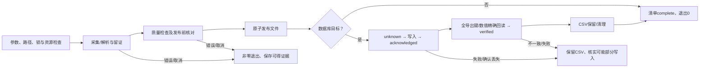

# rustdx 产品需求文档

文档版本：2.0。更新日期：2026-10-23。适用对象：当前仓库源码；整理基线为`50c996b`。本文件是需求的唯一主文档，原FR-01至FR-11编号继续有效，新增FR-12至FR-14。

核心库Cargo版本为`jelven-rustdx-complete 1.12.2`，CLI为`jelven-rustdx-cli 1.8.2`，可执行程序为`rustdx`。crates.io同版本属于10月11日发布内容，后续优化须从源码构建，部署记录同时保存Git提交及二进制摘要。功能实现、测试通过、真实源验证、目标生产验收是不同结论，不能互相代替。

## 1. 产品定位与目标

rustdx为Rust调用方和数据运营人员提供行情获取、通达信文件解析、行情计算及可追溯的数据发布能力。核心任务是把明确来源与口径的数据转为可验证的文件或数据库记录，使调用方能判断结果有效性、任务完成程度和失败后的恢复条件。

已确认的问题包括市场代码混叠、量与复权口径混用、未知交易日或证券状态被当作事实、部分数据失败后仍显示成功，以及数据库回执与实际数据不一致。产品要求相应落实为：显式行情语义、有覆盖边界的规则、不可信输入拒绝、发布前质量检查、独立数据库回读和保留恢复证据。

目标以可观察结果定义：

- 调用方取得带市场、周期、时间、单位和价格口径的行情，错误与未知结果可区分。
- 运营人员完成指定范围的历史日线或当前收盘快照发布，并依据清单审核日期、证券覆盖和质量问题。
- 运维人员识别已经发布、可能写入、已获回执和已精确验收的动作，失败后保留可核查产物。
- 维护者可以从干净源码检出复现离线回归，追溯规则、数据样本和各轮验收范围。

技术架构与源码职责见[架构评估](../architecture/PROJECT_ANALYSIS.md)，工程目录见[项目结构](../architecture/PROJECT_STRUCTURE.md)。实现方案不作为本文件的业务状态定义。

## 2. 范围与交付边界

| 范围 | 当前产品能力 | 边界 |
| --- | --- | --- |
| Rust核心库 | 通达信TCP行情、day/lc/gbbq解析、标准行情适配、价格复权、指标、日历、涨跌幅、连接池及可选缓存 | 普通TCP市场为深圳/上海；标准类型支持北交所不等于所有数据源支持 |
| CLI采集 | `day`目录/官网ZIP/URL/本地ZIP、名单筛选、`east`当前收盘快照、CSV/JSON | day输出CSV或数据库；east输出CSV/JSON或ClickHouse，未提供east直入MongoDB |
| CLI维护 | `data-check`核对/发布日历及证券历史，`data-status`覆盖巡检，`show`版本/调试 | 更新依赖原始证据，不自动补齐未来年度或全市场证券状态 |
| 数据库交付 | day写入ClickHouse/MongoDB；东财写入ClickHouse；全部导出键与数值独立回读 | 同机受管目标互斥，不提供跨主机协调、跨库事务或自动回滚 |
| 工程交付 | 源码、依赖锁定、测试夹具、验证脚本、配置示例、部署模板、维护文档 | 没有内置Web服务、账号权限系统、交易下单、行情推送或采集定时服务 |

P0表示核心正确性与完成/恢复所必需，P1表示采集、追溯和运营支持，P2表示分析及工程保障的既有分类。编号与优先级用于需求追踪，不代表低优先级规则可以在交付时跳过。

最小完整采集任务包含：有效输入与输出目标、路径和资源检查、采集/解析、质量检查、发布前核对、原子发布、可选数据库写入与精确回读、最终清单及退出状态。恢复路径属于这一任务的必要部分。

## 3. 使用者与职责

这些是工作职责，不是软件中的登录角色。实际读写权限由操作系统、部署环境及数据库账号决定。

| 使用者 | 触发任务 | 可执行动作 | 必须核实的事实 |
| --- | --- | --- | --- |
| 库使用者 | 应用或分析程序请求行情/计算 | 配置受管网络、查询数据、适配标准行情、计算规则/指标 | 市场/品种、源单位、查询范围、当日证券状态及计算口径 |
| 数据运营人员 | 历史补数、日常收盘采集、收益接续 | 选择来源/名单/日期、运行采集、查看清单与产物 | 应有证券、预期行情日、告警接受范围、前因子衔接 |
| 数据维护者 | 覆盖临近到期或规则/状态变化 | 整理公告、交叉核验、显式发布维护数据 | 来源真实性、完整区间、规则生效时间及公告语义 |
| 运维人员 | 部署、资源异常、任务失败 | 注入凭据、管理调度/备份、核查目标与留存CSV、恢复运行 | 活跃任务、可能部分写入、目标版本、外部写入者及较新数据 |
| 代码维护者/验收人员 | 修改或交付源码 | 编译、测试、审查、维护需求映射与版本记录 | 源码提交、执行环境、实际执行检查和未验收范围 |

修改输出或数据库是用户启动任务授权的结果。自动化只进行本次明确选取范围内的处理；不确定写入交由运营/运维核实，不静默重试。运行归档和数据备份保留期由部署方确定，项目没有自动清除历史归档策略。

## 4. 业务对象与共同规则

### 4.1 对象与字段

| 对象 | 关键字段/语义 | 校验和使用规则 |
| --- | --- | --- |
| 证券标识 | 市场前缀、原始代码、品种上下文 | 保留前导零；sh000001与sz000001不同，指数/股票不因数字相同而合并 |
| 标准行情 | 来源、证券、周期、UTC+8时点、OHLC、金额、量、价格口径 | 价格/金额为元、量为股；适配须核实源单位与市场，有限值及OHLC关系须有效 |
| 文件/快照导出 | CSV或JSON记录、行数、日期边界、逻辑键、字节摘要 | day/东财CSV量保持手；已有列兼容；factor为累计收益指数，不直接缩放OHLC |
| 日历数据 | version、source、start/end、完整休市日期 | 覆盖包含查询和导航搜索范围；周末休市，调休工作周末不自动变成交易日 |
| 日期规则上下文 | 行情日期、板块、当日ST、经核实上市阶段 | 不以今天的简称推断历史；规则范围、日历范围和证券事实范围分别检查 |
| 证券历史 | 版本、核实截止、证券状态区间、公告URL/日期/字节摘要 | 无重叠，状态为Trading/Suspended/Delisted；缺口未知，仅Trading生成交易规则上下文 |
| 收益与价格调整 | ReturnIndex、PriceMultiplier、上一日状态 | 两种数值不互换；收益接续保留原始OHLC，价格复权另按历史锚定 |
| 运行清单 | schema、run_id、参数/来源、阶段、产物、数据库状态、观测 | 当前schema6；最新清单及每run_id归档分别持久化，不构成跨文件事务 |
| 原始响应证据 | 请求、页序、采集时点、解析器版本、正文/证据摘要 | 描述实际收到的正文；摘要证明完整性，不证明第三方内容真实性 |
| 数据库验收 | 全部导出键、字段、行数/边界、批量、耗时、字段摘要 | 只证明本次输出范围，不能据此声称整库历史或全市场已完整 |

CSV表头、兼容列及接口类型的具体定义见[迁移说明](../release/MIGRATION.md)和[开发说明](../development/DEVELOPMENT.md)。调用方必须区分原价、价格复权和累计收益，不能仅按字段名推断口径。

### 4.2 完成条件

库任务须返回有效类型化结果或明确错误；符合协议的空集合只表示未返回记录，不证明停牌、退市或应有范围完整。

文件采集成功须同时满足退出码0、清单`complete`、非空有效产物已原子发布、输出摘要/行数/边界已记录，以及适用的质量校验通过。CSV发布前须流式回读；JSON来自已校验记录并保存字节摘要。采集前参数/路径错误可能没有清单。

数据库任务还须获得完整成功回执，独立回读本次全部导出键和全部导出数值，状态达到`verified`，并完成规定的CSV保留或清理。仅`acknowledged`不能视为验收通过；清单保存或清理失败仍是任务失败，即使数据已经写入。

生产业务可用性另由运营人员核实应有证券名单、预期行情日、使用历史区间及目标库已有数据。以上流程成功条件不替代该审核。

### 4.3 状态与转换

任务状态、阶段、产物状态和数据库状态分别记录，不将它们合并为一个成功标志。下表为业务摘要，完整字段和值以[导入说明](../operations/IMPORTS.md)为准。

| 对象/状态 | 进入条件 | 后续动作与限制 |
| --- | --- | --- |
| 任务running | 已建立运行清单并开始执行 | 正常转complete/failed；异常终止可保留最后检查点 |
| publication_pending | 待发布产物及摘要已经记录 | 原子替换后确认published；中断时须核查文件摘要 |
| published | 已确认新文件发布 | 文件任务结束，或继续写入数据库；不代表数据库已有数据 |
| database.not_started | 尚未发起数据写入 | 目标DDL/索引准备可能已执行；不能推断目标不存在 |
| database.unknown | 即将或已发起可能部分写入的动作 | 等待回执或失败；禁止当作未写入自动重试 |
| database.acknowledged | 完整成功回执/导入工具退出0 | 继续独立回读；回读失败保留CSV |
| database.verified | 全部导出键和数值精确通过 | 才允许执行保留/清理CSV |
| cleanup_pending | 数据库已verified，保留/清理待完成 | 核查文件后完成；无需再次写库 |
| 任务complete/failed | 流程成功/以错误结束 | 保留具体阶段；failed不代表数据库回滚 |

### 4.4 共同异常规则

| 情况 | 必需行为 |
| --- | --- |
| 非法参数、输出别名、覆盖输入、目标锁冲突 | 在相关采集/发布前拒绝，非零退出；不保证创建报告 |
| 截断、非法日期/数值、解压或解析失败 | 返回错误；checked接口不留下可误用的部分结果 |
| 全空文件集合/无可发布收盘日线 | 失败，保留旧成功输出；单个空源可记录告警 |
| 日历/规则/证券状态范围不足 | 返回错误或明确覆盖告警/未知，依接口严格模式处理 |
| 超时、Ctrl-C/SIGTERM、取消文件出现 | 协作取消；保留已确认动作及证据，清理受管暂存/子进程 |
| SIGKILL等强制终止 | 允许保留running/unknown与暂存；后续现场核查，不能期待最终清单 |
| 写入确认丢失或回读失败 | 保留CSV并非零退出，不承诺事务回滚，不自动重试 |
| 恢复/重复导入 | 先核实源、摘要、目标、较新数据及写入阶段，再由操作者决定重跑 |

## 5. 功能需求

### FR-01 日历、行情日期与覆盖维护

**P0；源码已实现，数据覆盖有限。** 库使用者查询交易日、前后交易日、区间或最近N日时，严格接口须验证整个搜索范围，越界返回明确错误。CLI可显式选择带版本/来源/完整区间的外部日历，清单保存实际使用数据。

内置休市表只覆盖2024–2026。旧兼容接口保留范围外工作日估算，该结果不能证明严格连续性。缺失交易日记录标记为待核实；day默认告警，`--strict`拒绝缺口及日历覆盖不足。

维护者以`data-check calendar`逐日核对候选与独立参考，覆盖区间完全一致且来源不同才能通过；显式`--output`通过后原子发布，不自动覆盖内置数据。`data-status`按核对日检查覆盖，默认UTC+8今日、提前90自然日告警；due/unverified/missing/incomplete时严格模式仍保存报告但返回非零。证券历史须核对公告实际字节摘要，未知区间返回None；格式通过不等于事实已审计。

**验收依据：** 年度365天交叉核对、导航越界、参考不一致、原子更新拒绝、临界日和缺失状态回归。当前2026两交易所参考共242交易日；2027完整数据及全市场状态未取得。见[数据维护](../operations/DATA_MAINTENANCE.md)。

### FR-02 日期化涨跌停

**P0；源码已实现，规则与证券事实覆盖有限。** 历史计算须提供行情日期、板块、当日ST状态及经公告确认的上市阶段；昨收和报价使用未复权整数分。结果区分有幅度限制、无幅度限制与非法/不支持输入，价格按规则舍入。

主板ST自2026-07-06起为10%，此前和其他板块/IPO阶段按[日期规则](LIMIT_RULES.md)选择。旧核准制IPO首日不得套用普通昨收比例；未覆盖特别制度或查询日期超出范围时返回错误。规则核实截止2026-10-22，不能因更新日历而延长。

**验收依据：** 生效日两侧、板块/ST/上市阶段、半分舍入、无幅度结果及范围外拒绝回归。当前没有项目附带的全市场上市/ST/退市事实，调用方负责提供有证据的历史上下文。

### FR-03 行情语义、标准适配与复权

**P1；源码已实现。** 调用方将TCP/day/lc/东财数据用于计算或跨源比较时，须保留市场与前导零，明确来源、周期、时间、价格口径和量单位。标准量为股；既有day/东财CSV量保留手。TCP源单位须按品种/周期显式核实，分钟文件适配须提供带市场的证券标识。

东财标准适配校验市场、源时间戳、交易日及完整字段，分别保留源快照时点与UTC+8标准日线15:00时点；factor=0表示未计算，标准适配为None。

累计收益ReturnIndex与价格缩放PriceMultiplier不可互换。收益计算承接前收/前因子与跨停牌事件，原始OHLC不改写；价格前/后复权按后端可用历史末/首日锚定，先计算完整可用历史再筛选区间，可用历史首日未必是上市日。

**验收依据：** 市场/周期/单位、非法值、连续派息、停牌事件、前因子继承及新旧CSV回归；跨源量额容差须独立声明，不应用于数据库精确验收。见[开发说明](../development/DEVELOPMENT.md)、[迁移说明](../release/MIGRATION.md)。

### FR-04 有界行情采集、时限与取消

**P1；源码已实现。** 受管TCP主连接、池、重连和HTTP任务共享进程许可；CLI同目录OS锁共享同机额度，默认8。调用方在首次初始化前配置策略，重复或晚配置返回错误。批次有界排队、批次内有界并行，结束释放批量连接。

连接、完整帧、分页、批次和整任务超过适用总体时限时返回错误，重试不得延长绝对deadline。自动选服轮换起点、冷却失败端点。CLI全局`--timeout`默认10800秒，取消文件、Ctrl-C/SIGTERM触发协作取消；同步计算/系统调用不能被硬实时抢占。

Mongo每子进程预约一个任务许可，内部socket不逐个计数。裸socket、不同许可目录、跨主机及任意外部写入不在保证范围。统计须给出计数范围与窗口样本数，不能把解析错误计为网络帧失败。

**验收依据：** 独立进程额度、重连峰值、慢正文deadline/取消、批次排队和释放、配置冲突、CLI端到端及子进程回收。见[网络预算](../architecture/NETWORK.md)。

### FR-05 日线文件采集与原子发布

**P0；源码已实现。** 用户启动day，可输入多个目录、官网包、单URL或单本地ZIP，按名单、市场、代码前缀筛选；Excel列从0计数。参数非法、空名单、来源冲突或全空有效集合失败。仅获取数量上限`-n`在每目录文件名排序后生效。

day记录以最多4096条分块，质量状态和收益因子跨块连续。输出顺序固定为目录参数顺序、文件名升序及文件内日期升序，修改线程数须得到相同CSV字节。每源质量详情有上限并保存省略数量，省略不放宽严格判定。

A股源重复/逆序日期拒绝；非A股按兼容规则告警，默认允许发布时排序并对同日保留源最后一条，strict拒绝。跨输入同证券日期区间重叠另行拒绝，即使缺口可能互补。发布前流式回读行数、键所属区间和边界，记录摘要后原子替换；发布前失败保留旧成功输出。

输出/报告/保留文件须检查输入覆盖、别名和并发输出锁。正常完成、失败及协作取消清理受管暂存并解除发送等待；强制终止残留须核查。记录相关内存有界，文件列表/报告仍随源文件数增长，暂存产生实际磁盘需求。

**验收依据：** 坏输入保留旧输出、空集、路径冲突、跨块质量/收益、1/4/8线程确定性、非A股归并、输入重叠及取消清理。见[导入说明](../operations/IMPORTS.md)和[分块回归](../../rustdx-cmd/tests/day_streaming.rs)。

### FR-06 数据库导入、精确验收与恢复

**P1；源码已实现，本机真实验收已取得，目标生产验收待完成。** 用户选择数据库目标后，先检查/准备表与索引，再处理数据。ClickHouse要求兼容字段/Float64精度、日期分区、逻辑排序键及服务端版本；Mongo要求完整非稀疏/非部分`(date,code)`唯一索引及simple排序规则。不兼容目标拒绝，CLI不自动迁移原表。

可能部分写入前持久化unknown，完整成功回执后记录acknowledged。回执后默认4096键一批，可配1–16384，独立逐键精确比较open/high/low/close/amount/vol，以及实际导出的preclose/factor。缺键、重复、字段类型错误、值变化、查询失败、迟到进程错误均拒绝verified。

同机同目标锁覆盖前因子读取至验收完成。ClickHouse通过FINAL读取即时逻辑结果，客户端run_version不替代表内服务端version；Mongo导入upsert并以一个长驻mongosh回读，最终EOF和退出码0也须通过。

只有verified后可清理CSV；day可用`-k`保留为目标名加`.csv`。写入/回读失败保留CSV、非零退出，不自动重试不确定写入。恢复须核实全部本次输出、query_id/工具记录及较新数据，不承诺回滚或跨库事务。

**验收依据：** 1,040键6/8字段和复权；65,536行首次/重复；779,200行真实历史两库各两次全键精确回读；四项TCP确认丢失/SIGKILL恢复。规模、环境和未覆盖的服务器重启/备份恢复见[数据库验收](../validation/DATABASE_ACCEPTANCE.md)、[第三轮记录](../history/OPTIMIZATION_ROUND3.md)。

### FR-07 不可信二进制与协议请求

**P0；已覆盖的新入口实现完成，旧兼容入口仍有边界。** 不可信day/lc/gbbq与协议数据须通过返回错误的checked入口。截断、非法日期、极端偏移、非法数值、超请求数量或多余字节不能冒充有效结果；失败清空旧解析结果，gbbq重复读取不能二次解密。

K线、快照、财务和当日/历史逐笔新请求参数私有，校验后编码与参数一致；股票/指数分开解码，快照核对证券身份，财务核对非有限值/日期，逐笔核对数量、时分、正价格和非负量。

Client对应入口使用checked请求。其他协议和旧公开字段对象并未全部迁移；旧parse无Result，部分低层构造可panic。保留入口不等于可以对任意输入宣称同等保证。

**验收依据：** 固定pytdx参考请求/正文/全部公开字段、逐前缀截断、错身份、非法时间/数值及ASan fuzz。见[协议接口](../architecture/PROTOCOL_REQUESTS.md)、[协议夹具](../../tests/fixtures/protocol/manifest.json)。

### FR-08 外部名单与当前收盘快照

**P1；源码已实现，源可用性没有SLA保证。** 官方名单通过HTTPS、有界响应与超时获取，核对分页总量、重复和无进展；鉴权/反爬/接口变化显式失败，不返回成功的部分名单。

east只发布当前行情日已收盘且必需字段完整的证券；无收盘数据记录证券状态未知。分页校验数量/total/重复，JSON输出数组。显式max仅限制本次采集范围，不代表全市场。

收益接续要求逐证券前因子齐全且日期为上一交易日，漏跑先补历史，不能通过同日快照跨越缺失交易日；旧ignore参数不得绕过校验。限流/连接失败保留上次成功结果，运营在收盘后安排单任务采集。

**验收依据：** 本地HTTPS/分页异常、错行情日/无收盘/不完整字段、前因子错误、JSON及旧输出保护；真实东财两股与通达信同日OHLC核对只证明小样本。见[运营说明](../operations/OPERATIONS.md)。

### FR-09 技术指标

**P2；源码已实现。** 库调用方输入有效序列及参数时获得本库明确口径的SMA/EMA/MACD/RSI/KDJ/布林带等结果，预热位置、非有限值、非法参数和缺口恢复行为明确。

布林带与KDJ常规有效输入总工作量为O(n)，扩大窗口不引入逐行全窗口扫描。RSI横盘值为50；KDJ采用本库EMA系数与首有效RSV初始化，不推定与其他软件默认一致。浮点末位差异通过独立公式误差范围判定。

**验收依据：** 独立公式、缩放不变量、预热/缺口/非法参数及窗口20/200/2000性能观测。测量不构成所有输入或生产负载的耗时承诺。见[验证方法](../validation/VALIDATION.md)。

### FR-10 工程验证与可复现验收

**P2；本机检查已执行，跨平台CI按实际执行状态记录。** 维护者修改后须保持Rust2024/MSRV1.89与同步有界架构，执行相应格式、Clippy及回归。测试夹具和独立参考结果进入版本控制，使干净检出能够执行离线验证；临时测试数据不能成为隐含依赖。

CI配置覆盖Linux/macOS/Windows、all-features、MSRV、解析fuzz和性能观测；数据库CI使用固定镜像与独立表。报告必须注明提交/二进制、日期、平台、依赖版本、输入规模、命令、退出码、跳过项与限制。已配置未运行的CI不计为通过。

**验收依据：** workspace与文档测试、Clippy拒绝警告、fmt、源码包列表及干净检出相关回归；数据库与网络外部检查单独记录。见[验证方法](../validation/VALIDATION.md)。

### FR-11 文档、目录与源码交付

**既有交付需求；本次持续维护。** 仓库应具有清晰的源码、测试、基准、配置、部署、脚本、运行数据和文档边界。文件按用途实际归类，移动后同步Cargo、测试、CI、示例及文档引用。保持现有Cargo包位置、名称和对外API，目录治理不假设不存在的服务模块。

需求、架构、开发、验证、运营、运维、迁移和发布文档互相可定位，功能与专项规则采用稳定编号和主文档定义；历史结果保留轮次归属，不覆盖为最新结论。

当前工作保存本地提交；远端推送、正式部署及crate发布按已授权范围执行。两个历史标签用于源码检出，运行归档不受“两份源码快照”限制；源码回退不会回滚数据库。

**验收依据：** 本地链接/路径存在、脚本定位根目录、夹具字节不变、打包排除运行产物、需求到实现/证据的映射。见[项目结构](../architecture/PROJECT_STRUCTURE.md)、[版本交付](../release/RELEASES.md)。

### FR-12 可选缓存与下载来源复用

**P1；源码已实现。** 库使用者可显式启用内存/文件缓存，Client不会自动缓存请求。键须由调用方包含市场、代码、周期、范围及数据版本；TTL策略由业务确定，不能据缓存命中推断实时有效。

内存缓存默认4096条/64MiB，可设置条数和字节容量并清理过期值；文件缓存checked入口传播I/O错误、校验原键并原子写入，旧格式按未命中处理。同键get_or_fetch合并并发获取；固定64锁可能碰撞串行，fetch不能递归调用同一缓存。

day下载缓存按来源隔离，来源锁持有至解析完成。续传核实版本及Content-Range，远端缓存须凭ETag或Last-Modified确认；本地替代ZIP先验证再发布，失败不破坏旧缓存。非交互环境重试耗尽后失败。

**验收依据：** 缓存容量/过期/碰撞键、原子写入、并发获取及ZIP续传/来源锁/解压失败保护回归。见[开发说明](../development/DEVELOPMENT.md)。

### FR-13 来源留证与离线重放

**P1；源码已实现。** day来源摘要必须对应实际解析的同一份字节；源摘要不能替代输入备份。east每页在解析前留存HTTP解压后UTF-8正文、请求参数、UTC采集时点、解析器版本及摘要，包括未识别字段。

单页正文16MiB、采集合计64MiB；超限失败，已获得证据保留。原始正文与规范化数据摘要分别定义。离线重放核对证据/正文摘要、版本、请求参数及页序，经同一路径校验后原子输出，不按今日日期拒绝历史证据。

默认重放未重新注入前因子，factor=0；无previous的成功采集可逐字节比较，累计收益重建须另保留并重放原前因子。归档须一并保存清单、正文、实际日历及前因子，搬迁后的绝对路径须重新定位。

**验收依据：** 真实两股在线/离线CSV字节一致；错摘要、恶意参数、缺页、页序、版本及解析失败留证回归。见[重放说明](../operations/EAST_REPLAY.md)。

### FR-14 阶段观测与数据新鲜度

**P1；源码已实现，生产阈值待部署数据确定。** 每任务清单记录来源准备、下载、解压、快照、解析、排序、写入和回读观测；并发线程归属同一任务，任务之间隔离。失败/取消及panic展开计入阶段失败。

分别输出累计调用耗时和阶段活跃墙钟时间并集；并发或嵌套不能将累计耗时当CPU或相加为总时长。临时字节只统计受跟踪私有快照/排序/归并/待发布文件的逻辑字节，正常结束应归零，不等于RSS、全盘临时空间或数据库占用。

freshness给出无质量错误且非空来源末日、自然日年龄、未来日期来源数及完整告警/错误计数；日期年龄不能推断停牌/退市、交易日缺失或全市场完整性。生产告警阈值和长期P95由真实负载确定。

**验收依据：** 并发/嵌套时间并集、跨任务隔离、失败释放、临时路径跨线程持有、实际历史新鲜度及质量汇总。见[观测定义](../operations/OBSERVABILITY.md)。

## 6. 非功能要求与运行约束

本节给出已有实现约束与必需验收，数值不作为外部服务SLA或生产容量承诺。

| 编号 | 要求 | 验收/限制 |
| --- | --- | --- |
| NFR-01 正确性 | 不以部分失败、未知状态或成功回执冒充有效/完整数据 | 失败保护、状态转换、全导出键精确回读；源真实性仍需独立证据 |
| NFR-02 资源有界 | 采集线程、通道、记录块、输入/响应大小及回读批量有明确上限 | day默认最多8线程，可选1–64；4096条块；单day32MiB、gbbq/前因子64MiB、采集外部日历1MiB；名单/回读正文16MiB |
| NFR-03 时限与可恢复性 | 分层时限受整任务剩余deadline限制，协作取消可退出并保留已确认动作 | CLI默认10800秒；数据库单操作300秒；同步调用非硬实时抢占；SIGKILL允许最后检查点残留 |
| NFR-04 可追溯性 | 参数/来源、字节摘要、产物、写入/验收、阶段/新鲜度可关联run_id | 当前schema6；归档/最新分别原子保存；Git提交与二进制摘要另记录 |
| NFR-05 并发与一致性 | 同输出冲突拒绝，同机同目标锁覆盖完整导入任务 | 跨主机、外部写入、任意DNS别名及不同许可目录需部署协调 |
| NFR-06 安全边界 | checked输入拒绝坏数据；凭据由部署注入，运行数据/凭据不进入源码包 | 没有产品RBAC；HTTP目标认证与TLS由目标配置；摘要不是签名 |
| NFR-07 兼容性 | 保持已有包/API和CSV语义，新增行为显式迁移 | Rust2024/MSRV1.89；旧parse/静态分类及规则入口边界见迁移说明 |
| NFR-08 可维护性 | 文档按职责定位、夹具版本化、脚本可复现、验证范围如实记录 | 不提交运行日志/全量数据/私有配置；跨平台仅按实际CI结果判定 |

SLA、生产吞吐、P95告警值、完整进程树内存、磁盘余量、RPO/RTO和归档期限均为`[TBD：由目标环境与业务要求确定]`。现有bench和两次导入测量只用于回归与容量评估。

## 7. 需求追踪与当前证据

| 需求 | 主要实现入口（仓库相对路径） | 持久验证依据 |
| --- | --- | --- |
| FR-01、FR-02 | `src/calendar/`、`src/limit/`、`rustdx-cmd/src/cmd/data_check.rs`、`data_status.rs` | [维护说明](../operations/DATA_MAINTENANCE.md)、[日期规则](LIMIT_RULES.md)、calendar_datasets/maintenance回归 |
| FR-03、FR-08 | `src/data/`、`src/tcp/stock/client/adjustment.rs`、`rustdx-cmd/src/eastmoney/`、`rustdx-cmd/src/fetch_code.rs` | [迁移说明](../release/MIGRATION.md)、east/CLI及跨源样本 |
| FR-04、FR-12 | `src/operation.rs`、`src/tcp/governance.rs`、`src/pool.rs`、`src/cache.rs`、`rustdx-cmd/src/download.rs` | [网络预算](../architecture/NETWORK.md)、network_budget/shared_network/reliability回归 |
| FR-05、FR-06 | `rustdx-cmd/src/io/`、`quality.rs`、`paths.rs` | [导入说明](../operations/IMPORTS.md)、[数据库验收](../validation/DATABASE_ACCEPTANCE.md)、day_streaming/CLI回归 |
| FR-07 | `src/file/`、`src/tcp/stock/*_request.rs`、`fuzz/` | [协议接口](../architecture/PROTOCOL_REQUESTS.md)、[夹具说明](../../tests/fixtures/README.md)、checked_parsers fuzz |
| FR-09、FR-10、FR-11 | `src/indicators.rs`、`tests/`、`benches/`、`.github/`、`scripts/`、`docs/` | [验证方法](../validation/VALIDATION.md)、[项目结构](../architecture/PROJECT_STRUCTURE.md)、独立公式回归 |
| FR-13、FR-14 | `rustdx-cmd/src/eastmoney/`、`observation.rs`、`quality.rs` | [重放](../operations/EAST_REPLAY.md)、[观测](../operations/OBSERVABILITY.md)、[第三轮记录](../history/OPTIMIZATION_ROUND3.md) |

截至2026-10-23，证据层级如下：

| 层级 | 当前事实 | 可得结论 |
| --- | --- | --- |
| 源码与离线回归 | Rust1.89/macOS arm64 workspace、文档、Clippy、格式及本地模拟；多轮ASan有界fuzz | 已覆盖接口及异常行为通过本机回归；fuzz不是穷尽证明 |
| 真实公共源样本 | 通达信API smoke、K线/快照/财务/逐笔固定报文、东财两股及离线重放 | 样本字段与独立参考一致；不代表全市场与长期可用性 |
| 本机真实数据库 | ClickHouse实验26.11.1.548、MongoDB8.0.16；779,200历史行两库重复全键核对与4项故障恢复 | 本机版本、配置、子集和所列故障通过；不覆盖用户生产环境 |
| 固定Linux配置 | ClickHouse25.8.33.6/MongoDB8.0.16固定digest，数据库CI及周覆盖巡检配置已保存 | 配置与语法已核对，尚未在该平台执行，不能写“CI已通过” |
| 目标生产环境 | 主机/拓扑/账号/全量负载与业务目标未提供 | 生产适用性、完整规模及备份恢复仍待验收 |

真实历史CSV摘要为`80f1b74671bcc1d8d3aa5bf7693e5dbacdcf04c60f40300255f23694fffa46e5`；原始指标见[779,200行证据](../validation/evidence/round3-real-day-databases.json)、[故障恢复证据](../validation/evidence/round3-database-faults.json)。早期约2981万行ClickHouse验收属于10月10日版本，不作为当前全量通过证明；第三轮未重跑最新全包约2971万行。

## 8. 待补事实与生产验收条件

| 项目 | 当前缺口 | 关闭条件 |
| --- | --- | --- |
| 2027日历 | 完整官方休市数据未取得 | 完整年度公告、独立逐日核对及导航边界回归，不只扩大截止日 |
| 日期规则续期 | 统一核实截止2026-10-22 | 全部适用交易所/板块制度及实施公告复核，更新来源与边界回归 |
| 全市场证券状态 | 只有输入模型，没有完整项目附带数据 | 有公告证据的逐证券区间、覆盖审计与未知区间处理 |
| 目标部署与规模 | Linux数据库CI未运行，生产主机/配置与全量负载待提供 | 目标版本/资源/工具固定，小表、真实全量、重复写入、故障和备份恢复记录 |
| 多主机协调 | 只实现同机受管互斥 | `[TBD]`明确调度拓扑、外部写入约定及协调方案并验收 |
| 生产服务指标 | 长期延迟/成功率、SLA、RPO/RTO及保留期未知 | `[TBD]`业务批准指标，按真实长周期负载和恢复演练测量 |
| 其余协议迁移 | 名单/分时/F10等仍有旧兼容对象 | 独立样本、checked请求覆盖及下游迁移；淘汰旧接口需后续版本安排 |
| crate正式版本 | 优化源码与已发布同版本内容不同 | 显式提升版本与CLI依赖，完成发布门禁及注册表核验 |

当前功能完成不意味着上述外部事实已经取得。上线前验收流程见[运维手册](../operations/RUNBOOK.md)，源码交付及历史版本见[版本说明](../release/RELEASES.md)。
